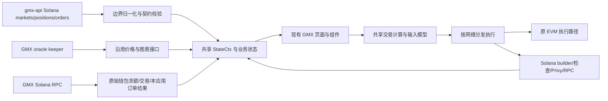

# Solana 独立集成实施：调研依据与架构边界

核验日期：2026-10-27（Asia/Shanghai）。对应根目录[实施任务表](../solana-implementation-tasks.md)。这是实施规划的证据说明，不是完整代码审查、迁移完成率或上线就绪证明。本轮只读取线上信息并编写本地文档，未修改 Linear、业务代码、Git 分支或远端。

## 用户确认的目标与授权

- 根本目标是降低维护成本：Solana 必须进入 GMX 现有统一数据流，复用共享业务模型、状态、计算、组件和交互。不能仅复用 UI、底下迁入 GMTrade 的 store、订阅体系或业务数据流。
- 尽量保护 EVM，优先边界适配；确有共同职责才做小范围抽象，保持 EVM 默认路径、SDK 兼容性和已有存储格式。不能借集成进行全局重构。
- 后续是以当前代码为起点的独立实施尝试，尽量自主开发、自审与自动验收；本地任务状态不反写 Linear，不自动认领、评论或改变任何线上需求内容。
- 当前这一轮只产出调研与任务分解。任务表不新增签名、广播、采购、部署、发布、push 或 PR 操作授权。新增前端组件或模块仍遵守根 AGENTS 的确认规则；已有规范明确要求的链适配职责不等于授权新增一套产品模块。
- 具体产品行为、外部契约或必要资源不明确时，先查证；无法解决的歧义进入明确的前置核实任务，不用假数据、替代服务或静默兜底跨过门槛。

## 本轮覆盖与版本

| 对象 | 本轮读取范围 | 结果与限制 |
| --- | --- | --- |
| Linear FESOL | 2026-10-27 22:31 北京时间同步 106 条团队需求；迁移项目 78 条全部读取正文，随后逐条实时读取评论与双向关系 | 24 条带 GMTrade 标签，均不在迁移项目；4 条其他归属单独核对。不用 Done 推断代码完成 |
| Linear 跨团队 | 查询迁移项目全部条目，返回 83 条、无下一页；另读 DES-62、DES-65/66/88/89/90 和 FEDEV-4319/4320/4321 旧编号 | 项目含上述 78 条 FESOL 与 5 条设计需求；三个 FEDEV 旧编号分别重定向 FESOL-7/6/5。DES-62 在另一个设计系统项目 |
| 主仓库 | 本地 `new-gmx` 和 `solana-integration` 均为 `e8015302585f74d632d5fea34c65533d20ab4d2b`；在线 release 为 `8ef82eb8a465b2045f73805a66941bf7f836630d` | 本轮开始工作区干净；当前分支含个人工具。读取当前页面、共享 provider/selectors、API parser、存储及 SDK 入口 |
| GitHub PR/分支 | 初始读取主仓库最近 300、API 最近 150、ADRs 最近 100 个 all-state PR；在线分页枚举主仓库、API 及两个人镜像的分支 | 深读钱包、隔离、价格、SDK、配置、bundle、API 市场、统计及 ADR 的相关 diff/审查/检查；不是每个历史 PR 的完整审查，未推送工作不在覆盖内 |
| gmx-api | 本地 `b86956df00902e44e0295827d651b206a6153942`；在线 main `cb226c6506fae8a8dd86cd167f5d1ee3edbfdc92` | 在线读取 main 文件树、Solana 路由、marketSnapshot/marketRecords、mint 映射及样例；本地快照落后，未 fetch 或更新子模块 |
| ADR-0015 | 在线 PR #27 与分支 SHA `9a4ffea920bbba6305e0d00b4f8829c688bd1660`；读取该分支全文 | 仍是 **Open / Proposed**，未当作已接受 ADR；其统一数据方向与用户明确约束一致，细节与最新需求有差异时单独标记 |
| 协议与 WASM | 本地协议 `f102501f`，读取 v0.10.0 builder 源码、事件布局；实际安装的 0.9.0-test.2 `.d.ts`、当前固定 hash；在线读协议 PR #492 | 本地协议最新源码不等于固定 WASM 或部署程序；未执行构建、WASM builder 或链上兼容验收 |
| 索引与旧项目 | 本地 gmtrade-sqd `55d26a728712eb2032a789135e1d741588c86db3` 的 schema；既有四页 72 分组审计与源码入口 | 只用于识别历史数据及行为缺口，不授权目标前端直接依赖旧 Web/keeper，也未重新验收所有旧页面线上功能 |
| 工程规范 | gmx-prompts 本地 `3f7f883fc2125bede25a32bc49ffcac40638625b` 的 dev、Solana、review、tests 入口及代码/测试规则 | 规划采用层次、lazy boundary、精度及测试门槛；本轮未运行业务测试或构建 |

本机原始材料位于 `.local/acceptance/requirements/solana-planning/2026-10-27/`，需求快照由 `.local/linear/FESOL/latest.json` 定位。这些忽略目录不随交接共享，不能作为后续 Agent 唯一依据；本页保留关键 SHA、线上链接、结论及证据边界。接手时实时重查变化，不要求复制本机报告。

## 已核实、会改变实施顺序的事实

### 当前主应用基础可复用，完整交易状态尚未接入

[MainRoutes](../src/App/MainRoutes.tsx) 在 Solana 网络下进入占位路由，[SolanaNetwork](../src/pages/SolanaNetwork/SolanaNetwork.tsx) 明确显示 coming soon。[配置](../src/config/gmsol/)、[SDK 加载](../src/domain/gmsol/loadGmsolSdk.ts)、[开关读取](../src/domain/gmsol/fetchSolanaTradingEnabled.ts)已经存在；`src/lib/solana/` 当前没有业务 RPC reader，`sdk/src/utils/gmsol/` 当前不存在。不能把网络可选、SDK 可加载当作交易完成。

[SyntheticsStateContextProvider](../src/context/SyntheticsStateContext/SyntheticsStateContextProvider.tsx) 当前读取 EVM 钱包、合约、gas、allowance、referral 等，`globals.chainId` 为 EVM 类型。Solana 不能直接照常挂载该数据采集过程，也不能将 -501 塞进 EVM chainId。应复用同一个 [StateCtx](../src/context/SyntheticsStateContext/utils.ts) 和共享交易状态逻辑，在数据来源与链执行边界适配。

[市场 selectors](../src/context/SyntheticsStateContext/selectors/shared/marketSelectors.ts) 仍按 EVM chainId 查询 token；[市场请求](../src/domain/synthetics/markets/useMarketsInfoRequest/index.ts)含 EVM RPC fallback。适配时保留 EVM 行为，Solana 缺失数据明确不可用，不调用 EVM fallback 或直接从浏览器列举持仓订单。

### 三个开放 PR 需要复用，但存在组合后的语义冲突

| PR | 在线 head、状态 | 接手重点 |
| --- | --- | --- |
| [#3110 钱包](https://github.com/gmx-io/gmx-interface/pull/3110) | `4882382a2f0fdf7ae140a79034b1634c80bc4048`，Open，已有 Approved，列出的检查全绿 | 外部钱包会话、恢复/断开、Privy kit/memo pin 已有实现；不重写连接体系。当前 release 未包含 |
| [#3120 EVM 隔离](https://github.com/gmx-io/gmx-interface/pull/3120) | `e6ed8b3bdee37a7b0e779c66b1da4e3c3df5e392`，Open，已有 Approved，列出的检查全绿 | capability 表、地址处理及 provider 隔离已有实现；与钱包合并后仍需检查 header、modal、余额 hooks、TokenPermit 的 eth_getCode、warm-switch support chat |
| [#3138 价格](https://github.com/gmx-io/gmx-interface/pull/3138) | `093d419568aa47756c13620b60796ad579be6d38`，Open，有 Changes Requested，CI 部分失败、Pages 成功 | mapping、ticker/candle/24h adapter 已有实现；BTC/WBTC 与 API 对齐及 NEAR 用例已更新。#3120 禁用 Solana ui-flags 读取后，Solana incident banner 没有消费方，必须修复并组合验收 |

FESOL-48 最新评论明确：**钱包先、隔离后**；较旧审查文字有相反顺序。独立分支也要以组合后行为为准，不因 Git 无冲突、旧 CI 通过就接受。不得修改他人的 PR 或 Linear 来落实本次尝试；接手时决定如何在独立分支整合已核实代码，并记录来源。

远端 `send-solana-order-FESOL-56` 的 `8d5e09b2df7c87e0442c261ee96cfadf9fa4a28c` 与 release 已分叉；比较返回的改动仅为四个静态配置文件，未显示交易构建器。名字和 Execution 状态不能证明该分支已有 sender。旧 nightly PR 均只能理解行为，不得合并、cherry-pick 或照搬其架构。

### 真实市场 API 今天已有代码合并，账户接口仍为样例

[gmx-api #295](https://github.com/gmx-io/gmx-api/pull/295) 于 **2026-10-27 19:40 北京时间**合并，merge commit `6663242119a60518501cb5a0837db0a93a73e16f`。在线 main 的 [solanaApp.ts](https://github.com/gmx-io/gmx-api/blob/cb226c6506fae8a8dd86cd167f5d1ee3edbfdc92/src/solanaApp.ts) 已将 markets/config 与 markets/values 接入真实 snapshot；positions、orders、fee-discount 仍导入 samples。市场样例文件已经删除，不应继续引用旧 main 的路径。

[marketSnapshot](https://github.com/gmx-io/gmx-api/blob/cb226c6506fae8a8dd86cd167f5d1ee3edbfdc92/src/domain/solana/marketSnapshot.ts)做 RPC discovery、批量刷新、token/inventory 校验及陈旧拒绝；[marketRecords](https://github.com/gmx-io/gmx-api/blob/cb226c6506fae8a8dd86cd167f5d1ee3edbfdc92/src/domain/solana/marketRecords.ts)包含 30 位归一化、八项 per-collateral OI、virtual inventory、per-market minimums 等。已有能力应先复核，不重做 FESOL-63/64。

这只证明代码合并，不证明实际 api-solana 已部署这个版本、契约全部评审完成、全部市场 parity 已由本轮复验或账户接口已真实化。实际 run.app 入口、版本与访问条件仍须负责人提供或从可靠部署记录确认；不猜地址、不沿用历史 404 推断当前部署。[既有协调稿](../solana-api-coordination.md)是旧时点草稿，不能作为当前 main 的事实。

### 已有的五个独立切片和八个非就绪切片应正确归并

[FESOL-87](https://linear.app/gmx-io/issue/FESOL-87)不在迁移项目中，但其 89、90、91、92、96 子项在项目中，已补读父项。89/90/91/92 可独立开始，96 在 89 后。此判断还需任务启动时检查新 PR 重叠。

88 的主要范围已在 #3138；93/94/95 缺 ABI、instruction/event 规则及可复现样本证明；97/98/99/100 等待隔离、已评审契约或计算。它们保留在原需求下，不删除、不重建 Linear，也不重复计量。93 的正向样本来自 95，不能让 95 再依赖 93 形成循环。

### GT rent receiver 需要协议交付证据

补读 [FESOL-85](https://linear.app/gmx-io/issue/FESOL-85) 与 [SCSOL-29](https://linear.app/gmx-io/issue/SCSOL-29)：GT Bank payout 归 owner，rent 归 recorded rent receiver；旧 completion 在不同 receiver 时会失败。[协议 PR #495](https://github.com/gmsol-labs/gmx-solana/pull/495) 仍 Open，head `400af957a64212a14951295e7f701fc0478fc89e`，SCSOL-29 为 In Review。新指令允许任何人触发不改变固定收款目标；canonical ATA 必须预先存在，可在同一交易前置创建。T47 须核实实际部署与固定 SDK 的支持，不能把需求已定义当能力已上线。

### 数值、构建与事件都有不能猜测的版本边界

- app USD 为 10^30、gmsol USD 为 10^20；价格另区分 whole-token、contract per-smallest-unit 与显示倍率。keeper 按映射的 Arbitrum token decimals 解码，再按 Solana mint decimals 转换。`k` 倍率只影响显示与输入解释。
- 固定 `@gmsol-labs/gmsol-sdk` 为 0.9.0-test.2；当前 WASM hash 在 [sdk.ts](../src/config/gmsol/sdk.ts)。实际 `.d.ts` 有 `create_orders_builder`、`merge`、`build_with_options`、`close_orders`、`update_orders`，不是“无 builder”；但 `TransactionGroup.serialize()` 是嵌套交易集合，不能因此保证增加仓位与 TP/SL 在一笔原子交易中。需执行固定产物、检查最终序列化数量/大小/顺序后才解锁 builder 实现。
- [FESOL-57](https://linear.app/gmx-io/issue/FESOL-57)要求 v0.10.0 Rust model 独立参考值，清算以程序 `min_collateral_factor_for_liquidation` 规则为准。不能把当前 WASM liquidation 输出当正确基准，也不能让前端与 API 各自推导两套公式。
- [协议 #492](https://github.com/gmsol-labs/gmx-solana/pull/492)，head `15ab63420a531a2921d7e7a95217b55ac5e8d432`，仍 Open。Rust 修复覆盖执行与关闭分笔交易、地址复用及历史延迟，但不是已交付的前端 TS decoder，其说明还明确未处理 failed transaction。前端必须过滤失败回执，按 program/store/order/action 生命周期关联；confirmed submission、账户消失都不是 fill 证据。
- 当前 [vite.config.ts](../vite.config.ts)把 `@solana-program/system` 替换为 throwing stub。需要真实 System 指令的任务须先处理该边界并证明 Privy/EVM bundle 不回归，不能直接加 import 后认为功能可用。

## 目标数据流与可接受的抽象

“同一套数据流”不要求 EVM/Solana 共用同一个 RPC 或交易编码器；要求边界之后复用相同的业务真源、模型和消费路径。FESOL-52 的 Solana provider 只负责数据来源及链适配，挂同一 StateCtx、复用 tradebox/settings/selectors；不能复制 SyntheticsStateContextProvider 的业务逻辑形成平行 store。

暂定最小抽象位置：显式 networkId 与缓存身份、network-aware token lookup、协议计算的 opt-in 分支、共享动作到链执行器的分发。精确接口由对应任务根据实际调用方确定，不预建通用链插件框架、不全仓替换地址处理。

## 需要保留为门槛的范围冲突

| 问题 | 已核实依据 | 规划处理 |
| --- | --- | --- |
| 外部钱包与 embedded | FESOL-6/8 要 embedded，FESOL-42 与当前 Solana 规范将其放在首发之后 | 外部钱包先；embedded 独立任务先确认现有 Privy 项目能力和阶段范围，不自行开第二订阅 |
| Claims | ADR/旧技术方案称 funding 无手动 claim；最新 FESOL-31 明确 Settle/Claim 同额同操作，并有五天 rebate 条件 | 后续 Claims 按新需求核实协议/API；不使用首发隐藏策略永久删除已要求能力 |
| 保证金操作 | FESOL-59 首发排除存取；FESOL-28 完整范围包含部分/全平、margin、批量撤单 | 首发与完整目标分别列任务，后续解锁 capability，不丢失范围 |
| Trade 布局 | DES-65 仍 Backlog，要求记录 VOB/market Trades 决策；FESOL-29 明确 Depth 必需，32 要 Net rate | 既有共享组件接线可按明确技术范围推进；争议 UI 必须取得已接受交接，不能静默裁剪 Depth、个人历史或 Net rate |
| Earn/GT/Referrals | FESOL-1/2 与 DES-66 已取消；新增 102/104/105/106 对应 DES-88/89/90，设计仍 Backlog | 使用新范围，不把取消项当作功能取消；GT 为新产品模块，先确认新增边界与设计 |
| 四页旧服务 | 四页 72 分组审计识别旧 WS、Core/GT SQD 与 keeper prepare/submit | 先确定进入 GMX 统一服务/历史接口的契约与负责人，不能把旧服务调用搬进新前端作为“先跑通” |
| 未列市场 | FESOL-41 评论已确定首发不展示其持仓/订单；86 延后 TradFi，包含价格 feed 版本与资源前置 | 不伪造完整仓位覆盖；不因 Arbitrum 有同名 ticker 就开放 TradFi |

## 自动验收与接手方式

复用[任务启动卡](agent-task-start.md)和[执行前环境顺序](coding-and-self-review.md#执行前的环境检查与顺序)。优先原有 suite、真实 parser、固定版本数值向量和已有浏览器入口；新增持久测试遵守 gmx-tests 的组合风险门槛，不为每个 getter 建测试或新增一套工具平台。

每个切片必须保留：目标 commit/源码身份、实际命令、数据模式与依赖版本、逐项结果、EVM 影响范围、清理结果及未覆盖项。以任务自身条件决定 passed，不要求无关离线任务等待 API 上线。真实钱包/资金验收不能由自动化钱包替身代替，替身只证明连接/状态路径。

本轮没有执行测试、构建、页面验收或远端部署探测；PR 的 CI/审查和旧本地验收仅作已有证据，不计入本次业务验收。任务表的“待实施”不是“已验证通过”。
