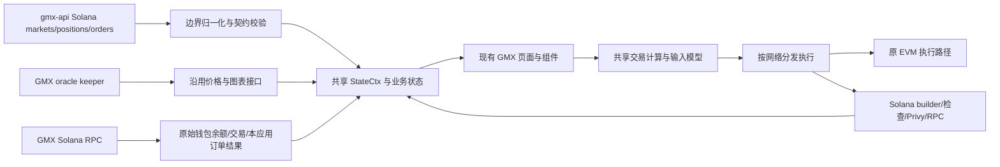

# Solana 独立集成实施：调研依据与架构边界

核验日期：2026-10-27（Asia/Shanghai）。对应根目录[实施任务表](../solana-implementation-tasks.md)。这是实施规划的证据说明及后续切片记录，不是完整代码审查、迁移完成率或上线就绪证明。初始调研阶段只读取线上信息并编写本地文档；后续实际改动与验收见末尾首轮实施记录。Linear 全程只读。

## 用户确认的目标与授权

- 根本目标是降低维护成本：Solana 必须进入 GMX 现有统一数据流，复用共享业务模型、状态、计算、组件和交互。不能仅复用 UI、底下迁入 GMTrade 的 store、订阅体系或业务数据流。
- 尽量保护 EVM，优先边界适配；确有共同职责才做小范围抽象，保持 EVM 默认路径、SDK 兼容性和已有存储格式。不能借集成进行全局重构。
- 后续是以当前代码为起点的独立实施尝试，尽量自主开发、自审与自动验收；本地任务状态不反写 Linear，不自动认领、评论或改变任何线上需求内容。
- 当前这一轮只产出调研与任务分解。任务表不新增签名、广播、采购、部署、发布、push 或 PR 操作授权。新增前端组件或模块仍遵守根 AGENTS 的确认规则；已有规范明确要求的链适配职责不等于授权新增一套产品模块。
- 具体产品行为、外部契约或必要资源不明确时，先查证；无法解决的歧义进入明确的前置核实任务，不用假数据、替代服务或静默兜底跨过门槛。

## 本轮覆盖与版本

| 对象 | 本轮读取范围 | 结果与限制 |
| --- | --- | --- |
| Linear FESOL | 2026-10-27 22:31 北京时间同步 106 条团队需求；迁移项目 78 条全部读取正文，随后逐条实时读取评论与双向关系 | 24 条带 GMTrade 标签，均不在迁移项目；4 条其他归属单独核对。不用 Done 推断代码完成 |
| Linear 跨团队 | 查询迁移项目全部条目，返回 83 条、无下一页；另读 DES-62、DES-65/66/88/89/90 和 FEDEV-4319/4320/4321 旧编号 | 项目含上述 78 条 FESOL 与 5 条设计需求；三个 FEDEV 旧编号分别重定向 FESOL-7/6/5。DES-62 在另一个设计系统项目 |
| 主仓库 | 本地 `new-gmx` 和 `solana-integration` 均为 `e8015302585f74d632d5fea34c65533d20ab4d2b`；在线 release 为 `8ef82eb8a465b2045f73805a66941bf7f836630d` | 本轮开始工作区干净；当前分支含个人工具。读取当前页面、共享 provider/selectors、API parser、存储及 SDK 入口 |
| GitHub PR/分支 | 初始读取主仓库最近 300、API 最近 150、ADRs 最近 100 个 all-state PR；在线分页枚举主仓库、API 及两个人镜像的分支 | 深读钱包、隔离、价格、SDK、配置、bundle、API 市场、统计及 ADR 的相关 diff/审查/检查；不是每个历史 PR 的完整审查，未推送工作不在覆盖内 |
| gmx-api | 本地 `b86956df00902e44e0295827d651b206a6153942`；在线 main `cb226c6506fae8a8dd86cd167f5d1ee3edbfdc92` | 在线读取 main 文件树、Solana 路由、marketSnapshot/marketRecords、mint 映射及样例；本地快照落后，未 fetch 或更新子模块 |
| ADR-0015 | 在线 PR #27 与分支 SHA `9a4ffea920bbba6305e0d00b4f8829c688bd1660`；读取该分支全文 | 仍是 **Open / Proposed**，未当作已接受 ADR；其统一数据方向与用户明确约束一致，细节与最新需求有差异时单独标记 |
| 协议与 WASM | 本地协议 `f102501f`，读取 v0.10.0 builder 源码、事件布局；实际安装的 0.9.0-test.2 `.d.ts`、当前固定 hash；在线读协议 PR #492 | 本地协议最新源码不等于固定 WASM 或部署程序；未执行构建、WASM builder 或链上兼容验收 |
| 索引与旧项目 | 本地 gmtrade-sqd `55d26a728712eb2032a789135e1d741588c86db3` 的 schema；既有四页 72 分组审计与源码入口 | 只用于识别历史数据及行为缺口，不授权目标前端直接依赖旧 Web/keeper，也未重新验收所有旧页面线上功能 |
| 工程规范 | gmx-prompts 本地 `3f7f883fc2125bede25a32bc49ffcac40638625b` 的 dev、Solana、review、tests 入口及代码/测试规则 | 规划采用层次、lazy boundary、精度及测试门槛；本轮未运行业务测试或构建 |

本机原始材料位于 `.local/acceptance/requirements/solana-planning/2026-10-27/`，需求快照由 `.local/linear/FESOL/latest.json` 定位。这些忽略目录不随交接共享，不能作为后续 Agent 唯一依据；本页保留关键 SHA、线上链接、结论及证据边界。接手时实时重查变化，不要求复制本机报告。

## 已核实、会改变实施顺序的事实

### 当前主应用基础可复用，完整交易状态尚未接入

[MainRoutes](../src/App/MainRoutes.tsx) 在 Solana 网络下进入占位路由，[SolanaNetwork](../src/pages/SolanaNetwork/SolanaNetwork.tsx) 明确显示 coming soon。[配置](../src/config/gmsol/)、[SDK 加载](../src/domain/gmsol/loadGmsolSdk.ts)、[开关读取](../src/domain/gmsol/fetchSolanaTradingEnabled.ts)已经存在；`src/lib/solana/` 当前没有业务 RPC reader，`sdk/src/utils/gmsol/` 当前不存在。不能把网络可选、SDK 可加载当作交易完成。

[SyntheticsStateContextProvider](../src/context/SyntheticsStateContext/SyntheticsStateContextProvider.tsx) 当前读取 EVM 钱包、合约、gas、allowance、referral 等，`globals.chainId` 为 EVM 类型。Solana 不能直接照常挂载该数据采集过程，也不能将 -501 塞进 EVM chainId。应复用同一个 [StateCtx](../src/context/SyntheticsStateContext/utils.ts) 和共享交易状态逻辑，在数据来源与链执行边界适配。

[市场 selectors](../src/context/SyntheticsStateContext/selectors/shared/marketSelectors.ts) 仍按 EVM chainId 查询 token；[市场请求](../src/domain/synthetics/markets/useMarketsInfoRequest/index.ts)含 EVM RPC fallback。适配时保留 EVM 行为，Solana 缺失数据明确不可用，不调用 EVM fallback 或直接从浏览器列举持仓订单。

### 三个开放 PR 需要复用，但存在组合后的语义冲突

| PR | 在线 head、状态 | 接手重点 |
| --- | --- | --- |
| [#3110 钱包](https://github.com/gmx-io/gmx-interface/pull/3110) | `4882382a2f0fdf7ae140a79034b1634c80bc4048`，Open，已有 Approved，列出的检查全绿 | 外部钱包会话、恢复/断开、Privy kit/memo pin 已有实现；不重写连接体系。当前 release 未包含 |
| [#3120 EVM 隔离](https://github.com/gmx-io/gmx-interface/pull/3120) | `e6ed8b3bdee37a7b0e779c66b1da4e3c3df5e392`，Open，已有 Approved，列出的检查全绿 | capability 表、地址处理及 provider 隔离已有实现；与钱包合并后仍需检查 header、modal、余额 hooks、TokenPermit 的 eth_getCode、warm-switch support chat |
| [#3138 价格](https://github.com/gmx-io/gmx-interface/pull/3138) | `093d419568aa47756c13620b60796ad579be6d38`，Open，有 Changes Requested，CI 部分失败、Pages 成功 | mapping、ticker/candle/24h adapter 已有实现；BTC/WBTC 与 API 对齐及 NEAR 用例已更新。#3120 禁用 Solana ui-flags 读取后，Solana incident banner 没有消费方，必须修复并组合验收 |

FESOL-48 最新评论明确：**钱包先、隔离后**；较旧审查文字有相反顺序。独立分支也要以组合后行为为准，不因 Git 无冲突、旧 CI 通过就接受。不得修改他人的 PR 或 Linear 来落实本次尝试；接手时决定如何在独立分支整合已核实代码，并记录来源。

远端 `send-solana-order-FESOL-56` 的 `8d5e09b2df7c87e0442c261ee96cfadf9fa4a28c` 与 release 已分叉；比较返回的改动仅为四个静态配置文件，未显示交易构建器。名字和 Execution 状态不能证明该分支已有 sender。旧 nightly PR 均只能理解行为，不得合并、cherry-pick 或照搬其架构。

### 真实市场 API 今天已有代码合并，账户接口仍为样例

[gmx-api #295](https://github.com/gmx-io/gmx-api/pull/295) 于 **2026-10-27 19:40 北京时间**合并，merge commit `6663242119a60518501cb5a0837db0a93a73e16f`。在线 main 的 [solanaApp.ts](https://github.com/gmx-io/gmx-api/blob/cb226c6506fae8a8dd86cd167f5d1ee3edbfdc92/src/solanaApp.ts) 已将 markets/config 与 markets/values 接入真实 snapshot；positions、orders、fee-discount 仍导入 samples。市场样例文件已经删除，不应继续引用旧 main 的路径。

[marketSnapshot](https://github.com/gmx-io/gmx-api/blob/cb226c6506fae8a8dd86cd167f5d1ee3edbfdc92/src/domain/solana/marketSnapshot.ts)做 RPC discovery、批量刷新、token/inventory 校验及陈旧拒绝；[marketRecords](https://github.com/gmx-io/gmx-api/blob/cb226c6506fae8a8dd86cd167f5d1ee3edbfdc92/src/domain/solana/marketRecords.ts)包含 30 位归一化、八项 per-collateral OI、virtual inventory、per-market minimums 等。已有能力应先复核，不重做 FESOL-63/64。

以上为初始调研时点。2026-10-28 增量核验已确认公共入口 `https://solana.gmxapi.io` 的市场路径可读，最新 main 为 `bf82ca19d5259d724cafeebc132d75528027131c`；三个账户路径被边缘路由屏蔽，仍返回404。市场字段、部署证据与未解锁项见[第二十七轮记录](#第二十七轮实施记录t04a-市场契约与公共服务只读核验2026-10-28)。不能将公共市场可读推导为账户真实化或契约评审完成。[既有协调稿](../solana-api-coordination.md)保留为历史草稿，不发送或按旧状态执行。

### 已有的五个独立切片和八个非就绪切片应正确归并

[FESOL-87](https://linear.app/gmx-io/issue/FESOL-87)不在迁移项目中，但其 89、90、91、92、96 子项在项目中，已补读父项。89/90/91/92 可独立开始，96 在 89 后。此判断还需任务启动时检查新 PR 重叠。

88 的主要范围已在 #3138；93/94/95 缺 ABI、instruction/event 规则及可复现样本证明；97/98/99/100 等待隔离、已评审契约或计算。它们保留在原需求下，不删除、不重建 Linear，也不重复计量。93 的正向样本来自 95，不能让 95 再依赖 93 形成循环。

### GT rent receiver 需要协议交付证据

补读 [FESOL-85](https://linear.app/gmx-io/issue/FESOL-85) 与 [SCSOL-29](https://linear.app/gmx-io/issue/SCSOL-29)：GT Bank payout 归 owner，rent 归 recorded rent receiver；旧 completion 在不同 receiver 时会失败。[协议 PR #495](https://github.com/gmsol-labs/gmx-solana/pull/495) 仍 Open，head `400af957a64212a14951295e7f701fc0478fc89e`，SCSOL-29 为 In Review。新指令允许任何人触发不改变固定收款目标；canonical ATA 必须预先存在，可在同一交易前置创建。T47 须核实实际部署与固定 SDK 的支持，不能把需求已定义当能力已上线。

### 数值、构建与事件都有不能猜测的版本边界

- app USD 为 10^30、gmsol USD 为 10^20；价格另区分 whole-token、contract per-smallest-unit 与显示倍率。keeper 按映射的 Arbitrum token decimals 解码，再按 Solana mint decimals 转换。`k` 倍率只影响显示与输入解释。
- 固定 `@gmsol-labs/gmsol-sdk` 为 0.9.0-test.2；当前 WASM hash 在 [sdk.ts](../src/config/gmsol/sdk.ts)。实际 `.d.ts` 有 `create_orders_builder`、`merge`、`build_with_options`、`close_orders`、`update_orders`，不是“无 builder”；但 `TransactionGroup.serialize()` 是嵌套交易集合，不能因此保证增加仓位与 TP/SL 在一笔原子交易中。需执行固定产物、检查最终序列化数量/大小/顺序后才解锁 builder 实现。
- [FESOL-57](https://linear.app/gmx-io/issue/FESOL-57)要求 v0.10.0 Rust model 独立参考值，清算以程序 `min_collateral_factor_for_liquidation` 规则为准。不能把当前 WASM liquidation 输出当正确基准，也不能让前端与 API 各自推导两套公式。
- [协议 #492](https://github.com/gmsol-labs/gmx-solana/pull/492)，head `15ab63420a531a2921d7e7a95217b55ac5e8d432`，仍 Open。Rust 修复覆盖执行与关闭分笔交易、地址复用及历史延迟，但不是已交付的前端 TS decoder，其说明还明确未处理 failed transaction。前端必须过滤失败回执，按 program/store/order/action 生命周期关联；confirmed submission、账户消失都不是 fill 证据。
- 当前 [vite.config.ts](../vite.config.ts)把 `@solana-program/system` 替换为 throwing stub。需要真实 System 指令的任务须先处理该边界并证明 Privy/EVM bundle 不回归，不能直接加 import 后认为功能可用。

## 目标数据流与可接受的抽象



“同一套数据流”不要求 EVM/Solana 共用同一个 RPC 或交易编码器；要求边界之后复用相同的业务真源、模型和消费路径。FESOL-52 的 Solana provider 只负责数据来源及链适配，挂同一 StateCtx、复用 tradebox/settings/selectors；不能复制 SyntheticsStateContextProvider 的业务逻辑形成平行 store。

暂定最小抽象位置：显式 networkId 与缓存身份、network-aware token lookup、协议计算的 opt-in 分支、共享动作到链执行器的分发。精确接口由对应任务根据实际调用方确定，不预建通用链插件框架、不全仓替换地址处理。

## 需要保留为门槛的范围冲突

| 问题 | 已核实依据 | 规划处理 |
| --- | --- | --- |
| 外部钱包与 embedded | FESOL-6/8 要 embedded，FESOL-42 与当前 Solana 规范将其放在首发之后 | 外部钱包先；embedded 独立任务先确认现有 Privy 项目能力和阶段范围，不自行开第二订阅 |
| Claims | ADR/旧技术方案称 funding 无手动 claim；最新 FESOL-31 明确 Settle/Claim 同额同操作，并有五天 rebate 条件 | 后续 Claims 按新需求核实协议/API；不使用首发隐藏策略永久删除已要求能力 |
| 保证金操作 | FESOL-59 首发排除存取；FESOL-28 完整范围包含部分/全平、margin、批量撤单 | 首发与完整目标分别列任务，后续解锁 capability，不丢失范围 |
| Trade 布局 | DES-65 仍 Backlog，要求记录 VOB/market Trades 决策；FESOL-29 明确 Depth 必需，32 要 Net rate | 既有共享组件接线可按明确技术范围推进；争议 UI 必须取得已接受交接，不能静默裁剪 Depth、个人历史或 Net rate |
| Earn/GT/Referrals | FESOL-1/2 与 DES-66 已取消；新增 102/104/105/106 对应 DES-88/89/90，设计仍 Backlog | 使用新范围，不把取消项当作功能取消；GT 为新产品模块，先确认新增边界与设计 |
| 四页旧服务 | 四页 72 分组审计识别旧 WS、Core/GT SQD 与 keeper prepare/submit | 先确定进入 GMX 统一服务/历史接口的契约与负责人，不能把旧服务调用搬进新前端作为“先跑通” |
| 未列市场 | FESOL-41 评论已确定首发不展示其持仓/订单；86 延后 TradFi，包含价格 feed 版本与资源前置 | 不伪造完整仓位覆盖；不因 Arbitrum 有同名 ticker 就开放 TradFi |

## 自动验收与接手方式

复用[任务启动卡](agent-task-start.md)和[执行前环境顺序](coding-and-self-review.md#执行前的环境检查与顺序)。优先原有 suite、真实 parser、固定版本数值向量和已有浏览器入口；新增持久测试遵守 gmx-tests 的组合风险门槛，不为每个 getter 建测试或新增一套工具平台。

每个切片必须保留：目标 commit/源码身份、实际命令、数据模式与依赖版本、逐项结果、EVM 影响范围、清理结果及未覆盖项。以任务自身条件决定 passed，不要求无关离线任务等待 API 上线。真实钱包/资金验收不能由自动化钱包替身代替，替身只证明连接/状态路径。

初始调研阶段没有执行测试、构建、页面验收或远端部署探测；PR 的 CI/审查和旧本地验收仅作已有证据，不计入后续切片验收。任务表的“待实施”不是“已验证通过”。

## 首轮实施记录：T00 / T03 / T08（2026-10-27）

以上章节保留原调研时点；本节记录其后的实际实施，不将调研结论当验收结果。

### T00：独立基线与验收范围

用户先要求 push，当前工作区干净，因此未产生新提交；随后 `git push my-gmx HEAD` 返回 Everything up-to-date。按本次明确授权，从 `new-gmx` 的 `5637a48912114f86df57bb409c1121d60a086070` 创建并切换到 **`solana-independent-implementation`**。后续轮次沿用此分支；尚未提交的代码不能仅凭该 HEAD 复原。本轮没有同步、合并上游或提出 PR。

目标前端/SDK 为本仓库；目标 API 为本地 `gmx-api/`，本轮不修改或启动 API。在线重新核实 release 仍为 `8ef82eb8a465b2045f73805a66941bf7f836630d`，ADR-0015 #27 仍 Open / Proposed。Node 为 v22.17.0，根及 SDK 使用现有锁定依赖；SDK 源码测试 Vitest 为 4.1.11，无安装或升级。

本轮范围是纯 SDK 单位转换及接缝记录，选择 V0/V1：实际执行 SDK 源码类型检查、单位边界测试、原 BigMath/numbers/fees 回归、定向 lint/格式检查及完整前端测试。没有页面、钱包或链上行为改动，不以既有两项网络冒烟代替未来钱包/交易验收。后续 T01/T02/T06/T13 等 UI/状态任务必须按 V2 增加 flag-off/on、刷新直链、账户/网络切换和迟到响应场景；真实数据与交易分别按 V3/V4 解锁。

### T03：共享字段与调用接缝清单

下表是基于当前源码确认的职责边界，完成的是接缝调查；尚未改造 StateCtx/provider 或宣称新接口已实现。后续精确类型按各切片最小增量调整，不提前建链插件框架。

| 职责 / 共享字段 | 当前来源与消费者 | Solana 边界与后续任务 |
| --- | --- | --- |
| 网络与账户：`globals.chainId/srcChainId/account/signer` | [provider](../src/context/SyntheticsStateContext/SyntheticsStateContextProvider.tsx) 读取 `useChainId`、EVM `useWallet`、URL账户；选择器及 sender 消费 | T01/T02 提供选中 Solana 会话；T13 显式 networkId/account，不能把 -501 冒充 ContractsChainId，也不能把 Solana signer 塞入 EVM WalletSigner。仍依赖 EVM chainId 的消费者必须逐个处理 |
| TokenData：mint/decimals/flags、`prices`、wallet balance | [token 类型](../sdk/src/utils/tokens/types.ts)、[tokens 请求](../src/domain/synthetics/tokens/useTokensDataRequest.ts)；tradebox、钱包面板、列表及计算消费 | T07/T11/T09 分别提供静态身份、whole-token USD30 价格、原始余额；T13 组合为共享 TokensData。`isNative` 是原生标记；余额失败不能填0 |
| Token 请求状态：`tokensData/pricesUpdatedAt/isWalletBalancesLoaded/isBalancesLoaded/error` | `globals.tokensDataResult`；共享选择器及交易校验消费 | 保留价格时间和余额加载语义。Solana 不伪造 GMX Account 已加载或假余额；T12/T13 接实际状态 |
| MarketInfo：market identity、index/long/short token、config、values | [market 类型](../sdk/src/utils/markets/types.ts)、[市场请求](../src/domain/synthetics/markets/useMarketsInfoRequest/index.ts)；市场选择器/header、TradeBox、Depth、SDK计算消费 | T04/T13 接已评审config/values并归一化；T07 替代 EVM token lookup。Solana 路径禁止挂载 claimable funding/EVM RPC fallback |
| 市场完整性与freshness | [API请求](../src/domain/synthetics/markets/useMarketsInfoRequest/useApiMarketsInfoRequest.ts) 检查完整/冻结/过期；MarketsInfoResult 暴露data/error/isLoading/dataSource | T13 复用有效判断，不改时间戳求通过；503/缺字段/stale 保持 unavailable。不得把fixture当线上来源 |
| PositionInfo：key、owner/market/collateral/side、size、PnL、费用、清算 | [position 类型](../sdk/src/utils/positions/types.ts)、[positions 请求](../src/domain/synthetics/positions/usePositionsInfo.ts)；PositionList、PositionSeller/Editor、TradeBox及选择器消费 | T16 是真实账户契约门槛；T18/T19接相同模型和math，key保留case；复用isLoading/error/dataSource，不在浏览器列举持仓 |
| OrderInfo：key/kind、size、trigger/acceptable、callback/referrer | [order 类型](../sdk/src/utils/orders/types.ts)、[orders 请求](../src/domain/synthetics/orders/useOrdersInfo.ts)；OrderList、OrderEditor、图表及TradeBox消费 | T16/T18保留可改撤所需字段；当前AggregatedOrdersDataResult只有data/count/isLoading，错误与freshness向共享消费者传播须在T13/T18做必要增量，不能永久loading或失败当空 |
| 同一业务状态：`tradebox/settings/confirmationBox/orderEditor/positionSeller/positionEditor` | provider读取[tradebox state](../src/domain/synthetics/trade/useTradeboxState.ts)、useSettings及编辑/确认hooks，并挂同一个[StateCtx](../src/context/SyntheticsStateContext/utils.ts) | T06先处理network存储；T13复用这些职责，逐个拆出EVM依赖；不能复制整份provider/hook或引入第二套store。T22/T27负责实际共享表单接线 |
| EVM专属输入：`subaccountState/tokenPermitsState/externalSwap/gasPaymentTokenAllowance/l1ExpressOrderGasReference`，以及gas/GLV/JIT/whitelists/USdg/leaderboard等 | provider当前无条件或按page读取；EVM交易及其他页面消费 | T02/T13按实际capability隔离；不执行EVM合约hook，也不伪造Solana等价值。只在当前Solana路径明确不可用，保持EVM默认行为 |
| 费用与用户：`uiFeeFactor/userReferralInfo/proDiscountFactor/claims/uiFlags` | EVM请求与settings进入共享计算/页面 | T16/T19使用协议combined discount与UI fee0；T11接Solana banner；T32/T37核实手动Claims，不能挪用EVM claim字段假装可用 |
| 交易与刷新：共享输入→执行→通知→同一query key | [sendBatchOrderTxn](../src/domain/synthetics/orders/sendBatchOrderTxn.ts)、[交易回调](../src/domain/synthetics/orders/useOrderTxnCallbacks.tsx)；原EVM执行路径 | T23/T24/T26在执行边界分流；T28/T29处理单订单生命周期。EVM sender不整体迁移；确认后的余额/API刷新只用现有统一请求体系 |
| 价格、单位与显示 | [tokens 转换](../sdk/src/utils/tokens/utils.ts)区分whole-token/contract；[market selectors](../src/context/SyntheticsStateContext/selectors/shared/marketSelectors.ts)当前仍查EVM token | T08只提供纯单位转换；T14/T15/T19/T22处理显示倍率、输入及协议计算，不能让display multiplier污染native amount/price |

### T08：实现、验收与未完成门槛

实时读取 [FESOL-92](https://linear.app/gmx-io/issue/FESOL-92) 的正文、评论和双向关系，仍为 Todo、无评论，明确无外部前置；它不完成FESOL-56。在线读取主仓库按更新时间最近100个all-state PR元数据并定向检查92/单位转换重叠，未发现新的实现PR；这不覆盖未推送的私有工作。未修改Linear。

新增 [units.ts](../sdk/src/utils/gmsol/units.ts) 与独立 `utils/gmsol` 包子路径：USD30↔USD20、whole-token USD30 price↔USD20 per-smallest-unit price。价格降精度要求显式roundUp；输入/输出验证uint256/u128，拒绝负值、非法decimals及溢出；raw amount与显示倍率不进入转换。详细单位表、来源和参考值推导见[SDK单位契约](../sdk/src/utils/gmsol/README.md)。没有新增运行依赖、app import、UI、store、RPC或EVM计算分支。

| 实际检查 | 命令 / 结果 | 证明边界 |
| --- | --- | --- |
| 改码前SDK产物与根类型检查 | `yarn sdk:artifacts verify` passed，1090产物；`yarn tscheck` 退出0 | 仅5637a48912基线；不算改码后的最终类型检查 |
| 当前SDK源码类型 | `node sdk/node_modules/typescript/bin/tsc -p sdk/tsconfig.json --noEmit --incremental --tsBuildInfoFile /tmp/solana-t08-sdk.tsbuildinfo` 退出0 | 包含新增源码/测试，不构建SDK |
| 当前SDK离线回归 | `yarn sdk:test-offline --suite src/utils/gmsol/units.spec.ts --suite src/utils/__tests__/bigmath.spec.ts --suite src/utils/__tests__/numbers.spec.ts --suite src/utils/__tests__/fees.spec.ts`：4文件、157项通过、0跳过 | 新增4个表驱动行为测试，原153项不变；source/tooling unchanged、network passed、0 blocked attempts、进程及临时目录cleanup passed |
| lint / 格式 | 对新增3个TS文件执行ESLint，退出0；对3个TS文件及sdk/package.json执行Prettier check，退出0 | 仅本次代码范围 |
| 完整前端回归 | `yarn test:ci` 退出0；299文件、3014项通过，1文件/1项既有跳过 | 保留原有EVM/共享前端suite；日志有既有happy-dom teardown AbortError，不据此声称真实钱包或交易通过 |
| 当前SDK产物来源 | 改码后 `yarn sdk:artifacts verify` 按预期 blocked / 退出2，源码/配置指纹已变化 | **不运行依赖旧产物的最终根tscheck，不构建或替换SDK产物** |

T08 当前为**已实施待验收**：源码行为已通过，包CJS/ESM/declaration与最终根类型检查仍待本地SDK构建授权。根AGENTS及[产物流程](sdk-artifacts.md)明确要求构建另获授权；取得授权后运行 `yarn sdk:artifacts build` → `verify` → `yarn tscheck`，检查新增子路径产物及导入兼容，再更新状态。本轮没有发布或调用交易builder，不声称WASM/链上兼容。该门槛不阻碍T05/T06/T07等独立任务。

本机最终原始记录：`.local/acceptance/sdk-offline/run-jCPlXk/`（原生Vitest、网络和汇总，包含补充的非bigint拒绝场景）；其余本轮日志归档到 `.local/acceptance/requirements/solana-implementation-t08/`。交接以本节摘要和可复现命令为准。首次测试命令误写不存在的fee suite，运行器在执行测试前拒绝，随后按现有默认清单纠正；未修改测试预期或网络保护。


## 第二轮实施记录：T05原始余额reader（2026-10-27）

沿用 `solana-independent-implementation` 和 `5637a48912` 基线，保留前轮改动；本轮均为未提交工作区改动，无commit/push/PR、上游同步或Linear写入。按需求查询/交付skill和gmx-prompts开发、Solana、测试、自审规范执行。

实时只读查询FESOL-89正文、评论与关系：仍为迁移项目Todo、无评论，不带GMTrade标签；它独立于钱包和价格/API，不完成FESOL-51或56。在线定向检查最近100个all-state PR，未发现新的原始余额reader重叠交付；release远端仍为 `8ef82eb8a465b2045f73805a66941bf7f836630d`，未fetch/merge。该核对不覆盖他人未推送的工作。

### 实际实现与架构边界

- 新增 [rpc.ts](../src/lib/solana/rpc.ts)：kit RPC单例只使用既有 `getSolanaRpcUrl()`，没有公共RPC fallback。
- 新增 [balances.ts](../src/lib/solana/balances.ts)：显式base58 owner，按现有非synthetic资产配置派生Token/Token-2022 ATA；owner账户加ATA每批最多100，confirmed/base64读取。以现有native SOL key及mint为key返回原始bigint，SOL与WSOL独立；余额不转Number。
- 仅明确null账户记零；RPC失败、返回数量不全、非法lamports、token owning program/可执行性/数据大小、解码mint-owner或状态不符均拒绝整个Promise，不暴露已积累的部分结果。不盘点非ATA资产，不保证冻结或Token-2022余额可花费；多批读取不保证同slot的原子快照。
- 根直接依赖精确 `@solana/kit@5.5.1` 与 `@solana-program/token-2022@0.6.1`（后者peer支持kit5）；复用已安装版本。lock仅增加精确descriptor/根依赖并发生条目排序，无既有版本或checksum升级。安装使用 `--mode=skip-build`，未触发SDK构建钩子。
- 依赖注入仅用于RPC与资产输入，默认使用中央配置，不建立registry/store/订阅；模块尚无应用caller。T09负责flag/network/owner隔离与lazy import，T12负责共享钱包面板；本轮不复制业务状态，也未改EVM、SDK计算、存储或UI。

### 自动验收与证明边界

| 实际检查 | 命令与结果 | 边界 |
| --- | --- | --- |
| 最终定向离线 | `node scripts/frontend-offline-tests.mjs --suite src/lib/solana/balances.spec.ts --suite src/domain/gmsol/fetchSolanaTradingEnabled.spec.ts`：2文件16项通过（余额13、现有flags3），0跳过 | 真实kit RPC序列化/解析、PDA和Token-2022 codec；mock fetch数据源，固定ATA参考值、两种program/扩展、冻结原始余额、0/null/超安全整数、99/100/200 mint分批、身份/尺寸错误、失败拒绝。source/tooling unchanged、network passed/0 blocked、cleanup passed |
| 补充实现阶段检查 | 精简前完整余额suite21项通过 | 额外覆盖真实非synthetic配置、非法owner/mint/program/重复配置、lamport边界；额外测试样本仅留本机证据，不作为另一套产品数据源 |
| 完整前端回归 | `yarn test:ci` 退出0：300文件3029项通过，1文件/1项既有跳过，113.48s | 包含现有EVM/共享测试；随后仅合并余额测试组织（15项合并为13项，精度/零/缺失断言保留），最终定向复验通过，生产源码未变。仍有基线已有happy-dom teardown AbortError，无新增失败 |
| 局部类型 | `node node_modules/typescript/bin/tsc -p .local/acceptance/requirements/solana-implementation-t05/tsconfig.json` 退出0 | 临时配置extends根、references为空，include本轮3TS/viem override/vite-env，SDK路径指向现有build/types/src声明；仅本轮局部类型证明，不证明T08新SDK子路径或最终根类型兼容 |
| 文档/差异 | `node scripts/agent-docs-check.mjs --file solana-implementation-tasks.md --file docs/solana-implementation-research.md --file docs/README.md` 通过；`git diff --check` 通过 | 本地链接与锚点检查，不证明外部链接可访问 |
| lint/格式 | `node node_modules/eslint/bin/eslint.js src/lib/solana/balances.ts src/lib/solana/balances.spec.ts src/lib/solana/rpc.ts` 退出0、无warning；对应Prettier check通过 | 仅本轮代码 |

低层测试显式使用Node环境：happy-dom的AbortSignal不能交给Node版kit的事件监听器；仅为既有配置初始化补self/localStorage测试环境，未mock配置或codec。早期该环境错误和BigInt测试标题序列化错误已修正，失败日志保留。格式化时误调用仓库全量脚本导致一处无关class排序，已精确恢复，最终无无关业务文件差异。

T05标为**已实施待验收**。当前未调用真实RPC、未接页面/钱包、未验真实账户余额或生产bundle；真实零值与离线构造的零值不混为真实数据验收。T08使SDK产物验证失效的问题仍存在，根AGENTS要求构建单独授权，因此未执行SDK/前端构建或最终根tscheck。后续获SDK构建授权后按既有 `sdk:artifacts build → verify → tscheck` 流程处理；bundle仍按其授权单独安排。不将该产物门槛当作T09源码实施的前置，不重复无效尝试。

原始证据：最终离线 `.local/acceptance/frontend-offline/run-IIDY6E/`，21项补充 `.local/acceptance/frontend-offline/run-SuPh1q/`；其余日志及局部tsconfig归档 `.local/acceptance/requirements/solana-implementation-t05/`。交接以本节可共享摘要和可复现命令为准。下一轮从T09开始：将这个reader动态接入现有SWR，使用显式owner与networkId key、处理刷新/不可用与迟到结果，不新增余额store或依赖钱包PR的占位余额。


## 第三轮实施记录：T09共享余额SWR（2026-10-27）

沿用 `solana-independent-implementation` / `5637a48912` 基线，保留前两轮工作区。本轮新增 [useSolanaBalances.ts](../src/domain/tokens/useSolanaBalances.ts) 及对应测试，未改EVM hook、应用SWR配置、SDK、存储格式或UI，也未新增依赖、store、provider、订阅或业务真源。所有实现仍未提交，无push/PR/同步上游/部署或Linear写入。

### 当前需求与边界

实时只读查询 [FESOL-96](https://linear.app/gmx-io/issue/FESOL-96)，抓取时间 `2026-10-27T15:33:13.600Z`：迁移项目Todo、无评论/标签，唯一未完成前置为FESOL-89。T05源码接口已实现且本轮再次通过离线回归，因此可推进本地消费者，不更改线上前置状态，也不据此完成FESOL-51/56。

在线定向核对最近100个all-state PR，未发现新增重叠hook；release现为 `25b1d906eac2f14c0a7fbfe84303e105ee2cac63`。相对上轮release仅前进4个提交，涉及CI、package/lock及market/support-chat测试；当前树未发现Solana balance reader/hook，`src/App/swrConfig.tsx` 与本地刷新策略相同。未fetch/merge或改本地依赖以追随这些提交；不覆盖他人未推送工作。

hook放在共享 `src/domain/tokens/`，接收显式owner，从现有ChainContext读取networkId，并使用中央Solana AB helper。仅flag开启、Solana选中且有owner时创建key，fetcher动态import T05 reader。统一key为 `[networkId, "solanaBalances", owner]`，由 `getSolanaBalancesKey(networkId, owner)` 导出供未来确认后mutate使用，base58大小写原样保留。

返回现有SWR响应和共享 `TokenBalancesData`；不另设余额状态模型。继承应用5s刷新、隐藏/离线页不轮询，明确 `keepPreviousData: false`，防止未来父配置开启此选项时跨账户展示上一份结果。初次错误为undefined data加error，成功零值为有效map；刷新失败时SWR保留同一key的上一份数据并暴露error，消费者必须先处理error/未知态，不能把旧零值当最新余额。没有新增兜底或自行选择钱包。

本轮只完成可复用hook及key，不挂钱包面板/Trade provider。选中钱包会话与余额/USD面板仍在T01/T12；真实交易确认调用mutate仍在T26/T28，未用占位会话绕过这些前置。

### 验收映射与证据

| FESOL-96条件 | 本轮实际结果 | 证明边界 |
| --- | --- | --- |
| EVM/flag-off/无owner均不读 | 使用真实AB配置的set/get及真实SWR，三个禁用场景数据undefined、非loading、无error；lazy reader工厂未加载且数据源未调用 | mock链上下文与reader数据源；未mock config、SWR或codec，不代替真实钱包页面 |
| owner/network切换及迟到结果隔离 | A请求延迟后切B，B成功零值不被A迟到的9覆盖；切EVM、移除owner或关flag均无旧data；父配置刻意keepPreviousData=true仍隔离 | hook真实重渲染与独立SWR缓存，不证明整个Solana页面已消除EVM请求（T02） |
| 刷新、隐藏页、错误、零值和invalidation | 真实SWR+应用配置、fake timers：5s更新、hidden保持旧值、visible恢复；错误/恢复零值/刷新错误保留同key旧值可区分；错误owner的mutate不更新当前owner，统一key能刷新 | UI后续必须消费error；真实sender调用未接入，不证明链上交易或真实零余额 |
| lazy边界 | 本轮两文件ESLint通过；`node --test scripts/test-eslint-solana-imports.cjs`：3项通过 | 静态规则与延迟加载行为通过；生产bundle/preview未构建或验收 |

最终定向命令：`node scripts/frontend-offline-tests.mjs --suite src/domain/tokens/useSolanaBalances.spec.tsx --suite src/lib/solana/balances.spec.ts --suite src/lib/chains/useChainIdImpl.spec.ts --suite src/lib/chains/chainIdSearchParam.spec.ts`，**4文件35项通过、0跳过**（hook4、reader13、既有链选择/URL18）。source/tooling unchanged；network passed、0 blocked attempts、进程/临时目录cleanup passed。报告 `.local/acceptance/frontend-offline/run-IqCTNY/`。

局部类型命令：`node node_modules/typescript/bin/tsc -p .local/acceptance/requirements/solana-implementation-t09/tsconfig.json` 退出0。复用上轮临时配置方式，仅include本轮2TS/viem override/vite-env、references为空、SDK指向现有build/types/src；不证明T08产物或最终根类型。定向ESLint无warning、Prettier check通过。

本轮完整前端回归 `yarn test:ci` 退出0：**301文件3031项通过，1文件/1项既有跳过**，112.88s；包含原EVM/共享测试与本轮4项hook测试。与上轮最终源码相比，余额测试已由15项合并为13项，因此总数不能只按上轮完整回归加4计算。日志仍有既有happy-dom teardown AbortError和旧testing-library的ReactDOM.render提示，无新增测试失败。文档链接/锚点检查与 `git diff --check` 通过。

自审按T2 hook生命周期核对：禁用、首次loading、成功、拒绝、刷新失败、key切换及卸载均交由同一SWR管理，不增加手动loading或第二套迟到结果控制。测试初版误用本项目旧testing-library没有的renderHook，已改用现有render/Probe模式；Probe需在render中读取SWR getter，才能正确模拟真实消费者订阅，fake timers在挂载前启用。测试日志存在旧testing-library的ReactDOM.render弃用提示，不修改依赖或屏蔽提示。

T09暂记**已实施待验收**：源码/离线hook行为通过，未完成真实钱包/页面/生产bundle验收。T05/T08的真实数据或包产物门槛保持原状；根AGENTS仍要求构建另获授权，本轮未构建SDK/前端，也未运行依赖过期SDK产物的最终根tscheck。后续获授权后按 `sdk:artifacts build → verify → tscheck` 完成产物门槛；完整bundle检查单独按授权执行。

原始日志、需求/PR/上游变化元数据、局部tsconfig归档 `.local/acceptance/requirements/solana-implementation-t09/`，交接以本节摘要及命令为准。下一轮优先T06：先实时核对FESOL-90，审计并接通networkId隔离的实际存储/缓存调用方，保持既有EVM格式；T07仍可独立推进。不为等待构建授权重复无效检查。

## 第四轮实施记录：T06.a杠杆偏好隔离（2026-10-28）

沿用 `solana-independent-implementation` / `5637a48912`，保留前轮工作区。实时只读查询FESOL-90，抓取时间 `2026-10-27T15:45:51.061Z`：迁移项目Todo，无评论/标签，无外部功能前置。本轮跨过上海时间午夜，记录完成日期为10月28日。未修改Linear，未提交、push、同步上游、创建PR或部署。

定向查询最近100个all-state PR，仅#3120涉及相邻tradebox/Settings代码；检查其patch后确认是feature/address隔离和trade mode，不实现本轮存储隔离，未依赖其未合并helper。在线release为 `d4b8c32147dd604d8d062d76c00a75ec4f0bbb7a`，相对上轮前进94提交；只读检查localStorage、Settings、State provider的上游patch，主要为USDG/Paxos等，未发现本轮重复实现。未同步或合并这些提交。

### 子步骤与实际范围

T06涉及交易选项初始化和EVM自动写回，拆成可独立审查的子步骤。**本轮只完成T06.a，父任务仍为实施中。**

| 子步骤 | 状态 | 范围 |
| --- | --- | --- |
| T06.a | 已实施待验收，离线通过 | 杠杆倍数、keep-leverage、slider与seller接收币key；真实页面与最终根类型待验 |
| T06.b | 待实施，下一轮优先 | trade options初始化/读写、syncedChainId比较、advancedOptions独立state/自动写回、市场排序缓存与ref隔离；保持EVM override和deep-link行为 |
| T06.c | 待实施 | 其余共享Settings偏好与相关SWR清单核对，完成整个FESOL-90验收；不将EVM专属设置简单换key就当作支持Solana |

### Key及调用方清单

| Key / 实际调用方 | 本轮修改 | EVM兼容与未验边界 |
| --- | --- | --- |
| getLeverageKey → useTradeboxState | builder参数改名networkId；实际读写使用可选p.networkId，省略时仍取chainId | 原JSON为 `[42161,"leverage-option"]`，默认2；旧调用方兼容 |
| getKeepLeverageKey → tradebox、State provider、seller | 三处按同一network作用域读取/写入，使用安全存储hook | 原JSON为 `[42161,"Exchange-keep-leverage"]`，默认true；不改EVM合约参数 |
| getLeverageEnabledKey → Settings provider | slider改用ChainContext的networkId，builder表示不变 | 原JSON为 `[42161,"leverage-enabled"]`，默认true；真实context已有flag过滤 |
| getSyntheticsReceiveMoneyTokenKey → seller | 原数组表示不变，seller数值输入随networkId；启用即时读取模式 | EVM字段顺序不变；缺失position字段时遵循安全hook已有skip-key规则；未验真实平仓表单 |
| SyntheticsStateContextProvider → 上述hook | Trade页且无override时传selectedNetworkId；其他页面/leaderboard/显式override仍用其EVM chainId | 不改globals.chainId，不挂Solana provider；实际传参经源码/局部类型核对，页面与override组合仍待验 |

复用 `useLocalStorageSerializeKeySafe` 增加可选 `readFromStorage` 模式：渲染和functional update从各自serialized key读持久值，先同步写存储再触发React更新；防止切key首帧旧值、多个同key hook旧缓存和迟到setter跨网络串写。未启用时保留原valueMap、skip-key、null和setter行为；未改原 `useLocalStorageSerializeKey`，未建新业务store、广播或序列化格式。缺值使用该偏好原有默认值，不读取另一网络；未编辑的缺省值不额外强制写盘。

### 剩余审计清单与下一轮

- **T06.b首先处理** useTradeboxState的trade options初始化、setStoredOptionsOnChain、handleChainChange/syncedChainId；advancedOptions当前独立state及effect仍可能把旧值写入新scope。本轮测试禁用了tradebox市场同步，不能证明这些路径已通过。
- useAvailableTokenOptions的getCached/saveCachedSortedMarketAddresses、sortedMarketAddressesRef/effect目前只看chainId；需要显式network输入同时保持其他EVM消费者默认行为和getSortedMarketsAddressesKey原字符串格式。不得把-501传给EVM token配置；完整Solana token lookup/provider属于T07/T13。
- T06.c核对Settings中按chainId保存的共享偏好：slippage、acceptable-price-impact buffer、PnL/fees/leverage显示、auto-cancel TPSL、net-price-impact、acceptable-price-impact开关、position lines、buy/sell icon模式、TWAP parts。语言、尺寸计价等原全局UI偏好不应无依据拆分。
- Express、execution/gas-payment、GMX Account、external swap、validation/debug等EVM专属偏好需要区分存储职责与T02 capability守卫，不因换key就宣称具备Solana功能，EVM SDK输入保持原含义。
- 本轮目标hook没有新增SWR。T09余额key已有networkId+owner隔离；既有market/position/order SWR仍为EVM数据路径，Solana请求key与迟到结果在T13/T18交叉核对。T06.c须核实实际清单，不全局改写EVM请求或新建未使用缓存框架。

### 自动验收与自审

`node scripts/frontend-offline-tests.mjs --suite src/domain/synthetics/trade/useTradeboxNetworkPreferences.spec.tsx --suite src/lib/chains/useChainIdImpl.spec.ts --suite src/lib/chains/chainIdSearchParam.spec.ts`：**3文件20项通过、0跳过**（新增2项组合行为、原链选择/URL18项）。真实tradebox、seller、Settings provider、配置和存储hook；只mock链/钱包上下文、账户与allowance数据源。覆盖同EVM chainId切换、首帧无旧杠杆值、旧setter迟到、同key多hook写入、切回恢复、slider隔离、EVM字面量旧key、false/0、缺省functional write及原opt-out/null。最终报告 `.local/acceptance/frontend-offline/run-yB670I/`。

`yarn test:ci` 退出0：**302文件3033项通过，1文件/1项既有跳过**，112.49s。EVM/共享suite无新增失败；保留既有happy-dom teardown AbortError、旧testing-library ReactDOM.render及Tailwind/Browserslist提示，不通过屏蔽日志或改依赖绕过。

局部类型 `node node_modules/typescript/bin/tsc -p .local/acceptance/requirements/solana-implementation-t06/tsconfig.json` 退出0，include本轮7文件及vite-env/viem override，references为空、SDK仍指现有build/types/src声明；不证明T08新产物或最终根类型。7文件ESLint无warning、Prettier check通过。最终离线报告确认source/tooling unchanged、网络检查通过且0次阻断，进程及临时目录清理通过；文档链接检查与 `git diff --check` 通过。

按T2生命周期自审：新模式读写只使用自己的key，false/0保真，late callback保留原key；默认模式不变。测试暴露同key hook旧缓存和React updater内写盘时序问题，已在opt-in模式修正；类型检查发现2/true被推断为literal，已显式指定number/boolean，不用断言掩盖。未改变EVM业务计算、SDK、合约访问或UI，未引入Solana包/旧服务依赖。

全部改动未提交，原始需求/PR/上游patch、验收日志和局部tsconfig归档 `.local/acceptance/requirements/solana-implementation-t06/`。SDK/前端构建与最终根类型仍受既有授权/产物门槛限制，未验真实页面、钱包或交易。下一轮优先T06.b，不将本轮子步骤当作T06/FESOL-90完成。

## 第五轮实施记录：T06.b交易选项与排序缓存隔离（2026-10-28）

沿用 `solana-independent-implementation` / `5637a48912`，保留前轮工作区。本轮实时只读 `show FESOL-90 --live --json` 抓取于 `2026-10-27T16:13:19.843Z`：仍为迁移项目Todo，无标签、评论或未完成外部前置，正文及关系未改变。最近100个all-state PR中未发现新增的FESOL-90实现；相邻#3120 head仍为 `e6ed8b3bdee37a7b0e779c66b1da4e3c3df5e392`，线上release仍为 `d4b8c32147dd604d8d062d76c00a75ec4f0bbb7a`。复用上轮相关patch核对结论，未重新全量调研、同步或合并上游，未修改Linear。

### 实际范围、存储清单与架构决定

**T06.b已实施待验收，离线通过；T06父任务仍实施中，下一轮优先T06.c。** 第四轮子步骤表保留当时状态，以本节和根任务表为最新接手依据。

| Key / 调用方 | 本轮实际修改 | 保留的EVM行为与边界 |
| --- | --- | --- |
| getSyntheticsTradeOptionsKey → useTradeboxState | 初始化、恢复、写入、handleNetworkChange均使用既有可选networkId；syncedChainId改为syncedNetworkId | 原JSON `[42161,"synthetics-trade-options"]` 与记录字段不变，省略networkId仍用chainId；已有TradeBox CT stories继续传ARBITRUM，未修改或运行组件测试 |
| tradebox stored options与setter | 原useState携带当前networkId；切scope时在渲染中重置为该key的记录，避免首帧暴露旧选项。functional setter同步读取并写入捕获的network key，再更新匹配scope的React状态；非当前network的迟到回调不能改当前状态或URL | 复用原业务状态，不增加store或通用缓存框架；缺记录仍初始化原默认值，JSON错误仍抛出，未新增静默兜底 |
| advanced options → tradebox | 直接从同一storedOptions派生，setter在同一记录中functional更新；删除独立state及自动写回effect | 默认值、字段及回调形状不变；市场默认选项重建时保留该network的advanced偏好；保留short深链方向和URL search |
| getSortedMarketsAddressesKey → useAvailableTokenOptions | tradebox传networkId，缓存读写和内存ref身份均按networkId；读取缓存进入首次memo计算，移除滞后一帧的chain-change effect | 原字符串 `sorted-markets-key:42161` 不变；未传networkId仍用chainId。SDK getTokensMap、collateral规则继续使用EVM chainId，未将-501传入EVM配置 |

生产代码中useAvailableTokenOptions仅由tradebox调用。两种key的实际调用清单已按 `rg` 核对；未新增SWR key或网络请求，不改SDK、交易发送、金额计算、base58大小写、路由挂载、Solana lazy import或开关配置。传入的markets/tokens数据必须属于当前network，采集层的数据身份与迟到响应隔离留给T13，不能把存储隔离当作Solana token lookup已完成。

### 实际验收与自审

环境沿用已准备的Node v22.17.0、锁定依赖及原测试配置，没有安装依赖、构建SDK或前端。测试复用真实tradebox、Settings、storage hooks、Router与现有市场/代币fixture；仅mock账户、钱包和allowance数据源。相同EVM chainId的两种network使用可控EVM市场fixture验证作用域，不宣称这些fixture为真实Solana市场或服务验收。

- `node scripts/frontend-offline-tests.mjs --suite src/domain/synthetics/trade/useTradeboxNetworkPreferences.spec.tsx --suite src/domain/synthetics/trade/useTradeParamsProcessor.spec.ts --suite src/lib/chains/useChainIdImpl.spec.ts --suite src/lib/chains/chainIdSearchParam.spec.ts`：**4文件36项通过，0跳过**。新增2项组合测试覆盖旧EVM记录恢复、首帧选项/排序隔离、市场延迟加载后按network初始化、short方向与search保留、选择/模式/advanced functional写入、迟到setter与URL隔离、切走切回以及userSelectedMarkets恢复。最终报告 `.local/acceptance/frontend-offline/run-Ddw7ga/report.json`，source/tooling unchanged，network passed、4次安装、0次阻断，进程及临时目录清理通过。
- `node .yarn/releases/yarn-4.12.0.cjs test:ci`：**退出0，302文件3035项通过，1文件/1项既有跳过**，117.52s。保留既有happy-dom teardown AbortError、ReactDOM.render及Browserslist提示，无新增失败，未改测试环境或屏蔽错误。
- `node node_modules/typescript/bin/tsc -p .local/acceptance/requirements/solana-implementation-t06b/tsconfig.json`：退出0。沿用上轮局部配置并加入useAvailableTokenOptions，仍使用既有SDK声明；不替代最终根tscheck或证明T08包产物已更新。
- `node node_modules/eslint/bin/eslint.js --max-warnings 0` 与 `node node_modules/prettier/bin/prettier.cjs --check`，范围为localStorage配置、useTradeboxState、useAvailableTokenOptions及useTradeboxNetworkPreferences.spec.tsx：通过；`git diff --check`通过。

按gmx-prompts完成T2生命周期与语义自审：切scope重置可收敛；迟到回调仅写原key；连续functional更新先持久化后触发React；advanced不再存在第二份可跨网络自动写回的业务状态；无新增金额除法、交易、订阅或远端失败分支。自审恢复了updateSwapTokens对原chainId的依赖，修正lint后重新运行上述最终检查；中断的早期全量运行不作为验收证据。任务表、本页与README的本地文档链接检查通过。未发现需保留的本轮已知代码问题，覆盖限于所列状态与存储路径。

原始需求/PR元数据、局部tsconfig和验收日志归档 `.local/acceptance/requirements/solana-implementation-t06b/`；全部实现仍为未提交工作区改动。真实provider/页面、flag-off/on生产bundle、最终根类型及钱包/交易未验；SDK/前端构建仍须既有独立授权，不重复已知产物阻碍。下一轮实施T06.c：先实时核对FESOL-90，再处理第四轮清单中的共享Settings偏好及相关SWR审计；EVM专属设置继续按capability职责区分，避免简单全局替换chainId。父需求不得提前完成。

## 第六轮实施记录：T06.c共享Settings与缓存清单（2026-10-28）

沿用 `solana-independent-implementation` / `5637a48912` 与既有未提交工作区。实时只读FESOL-90抓取时间 `2026-10-27T16:23:29.034Z`，仍为迁移项目Todo，无GMTrade标签、评论或未完成外部前置；正文与关系未变化。最近100个all-state PR元数据与第五轮完全相同，线上release仍为 `d4b8c32147dd604d8d062d76c00a75ec4f0bbb7a`，复用相关patch的已核实结论。未修改Linear、提交、push、创建PR或同步上游。

### 本轮实现及完整存储边界

Settings现有provider中的下列10类共享偏好均改为networkId读写，复用第四轮安全存储hook的 `readFromStorage` 模式。所有原序列化格式、原默认值和旧值语义保持；缺值返回默认值，不额外写入未编辑的缺省项。builder仅将参数命名改为networkId，仍接受原数值调用。

| Settings调用方 / Key末项 | 本轮处理 / 原EVM表示 |
| --- | --- |
| savedAllowedSlippage / getAllowedSlippageKey | `[42161,"Exchange-swap-slippage-basis-points-v4"]`，DEFAULT_SLIPPAGE_AMOUNT |
| savedAcceptablePriceImpactBuffer / getSyntheticsAcceptablePriceImpactBufferKey | `[42161,"synthetics-acceptable-price-impact-buffer"]`，DEFAULT_ACCEPTABLE_PRICE_IMPACT_BUFFER |
| showPnlAfterFees | `[42161,"Exchange-swap-show-pnl-after-fees"]`，false |
| isPnlInLeverage | `[42161,"Exchange-swap-is-pnl-in-leverage"]`，false |
| isAutoCancelTPSL | `[42161,"is-auto-cancel-tpsl"]`，true；隔离偏好不等于已实现Solana TPSL发送 |
| breakdownNetPriceImpactEnabled | `[42161,"breakdown-net-price-impact-enabled"]`，false |
| isSetAcceptablePriceImpactEnabled | `[42161,"set-acceptable-price-impact-enabled"]`，false |
| shouldShowPositionLines | `[42161,"Exchange-swap-should-show-position-lines-key"]`，true |
| buySellIconsMode | `[42161,"Exchange-swap-should-show-buy-sell-icons-key"]`，current；保留旧boolean到off/all的转换 |
| savedTwapNumberOfParts | `[42161,"twap-number-of-parts"]`，DEFAULT_TWAP_NUMBER_OF_PARTS |

调用方清单：这两个builder及其余8类Settings key的实际读写都在SettingsContextProvider，无新增第二个设置provider、store或配置注册表。消费者继续使用原useSettings。杠杆、keep-leverage、slider、seller接收币、trade options与市场排序cache见第四、五轮清单，本轮未增加新的存储格式。

核对实际消费路径时发现tradebox的allowedSlippage与numberOfParts原本只在mount初始化，单改Settings仍会保留另一network的临时输入。本轮将这两个值放入第五轮已有的当前network作用域state，切网首帧恢复该network的保存默认值，未保存的临时编辑不跨network保留；同network编辑和functional setter接口保持。旧network的临时setter在当前scope不匹配时忽略，旧Settings setter仍只写其捕获的持久key。trade-options setter合并同一scope字段，避免覆盖这两个临时值。没有复制交易模型或引入另一条业务数据流。

明确未改的存储职责：Express、EVM execution-fee及其Arbitrum默认迁移标记、gas-payment、GMX Account gas/接收目标、external swap、EVM validation/permit QA/debug配置继续使用chainId/account；这些功能及其effects须在T02/T13按capability隔离，不能把换key当作支持Solana。Tenderly配置、全局debug显示、Settings提示点、close/chart尺寸计价、tradebox全局warning/suggestion偏好保留原作用域，不无依据拆分。其余未持久化的订单输入、sidecar与交易生命周期在T13/T26按账户/网络接入时验收，不因本轮两个偏好输入重置而宣称整个表单隔离已完成。

### 相关SWR及内存缓存审计清单

| 当前路径 | 已核实的缓存身份与边界 | 本轮处理 / 后续责任 |
| --- | --- | --- |
| useSolanaBalances | `[networkId,"solanaBalances",owner]`；flag off/EVM/无owner为null，keepPreviousData false | 复用T09；本轮不改。实际钱包与TokensData消费属于T12/T13 |
| useTokenBalances → useMulticall | 内层account与token列表，useMulticall外层拼 `[chainId,name,...key]`，成功响应ref也按chainId | EVM-only RPC，不传-501、不改外层SWR；T02/T13阻止Solana挂载该路径 |
| useApiMarketsInfoRequest | config为 `["apiMarketsConfigRequest",chainId]`，values为 `["apiMarketsValuesRequest",chainId]`；useMarketsInfoRequest含EVM funding/RPC fallback | T13新增Solana数据来源时必须包含networkId、保留原EVM key与fallback，只在边界归一化到同一MarketInfo |
| useApiPositionsInfoRequest / useApiOrdersRequest | 各为 `[requestName,chainId,account]`；useApiDataRequest的retainedRef按序列化key保留，mountedAtCache仍为ContractsChainId | 仍为EVM SDK来源。T18要求Solana的networkId+owner身份、不可跨key保留旧账户响应；不能直接复用相同Arbitrum key或仅重命名helper |
| usePositions / useOrders的RPC分支 | 内层account/market或account，useMulticall外层chainId/name；positions显式keepPreviousData true | 保留EVM行为；T02/T13/T18隔离Solana采集、缓存和迟到结果，不把RPC fallback移植到Solana |
| useTokenRecentPricesRequest | `[chainId,oracleKeeperFetcher.url,"useTokenRecentPrices"]`，PRICES_CACHE与更新时间map按chainId | 当前EVM路径保留；T11价格adapter与T13接入时核对Solana网络身份及共享价格来源 |
| useMarkets / useAvailableTokenOptions | 静态市场按EVM chainId；排序localStorage/ref已在T06.b按networkId隔离 | 本轮不将-501送入SDK配置；T07/T13负责network-aware token lookup与市场适配 |

本轮没有新增或修改SWR请求，也没有全局改造useMulticall、useApiDataRequest或SDK缓存。上述表是当前实际代码审计与未来接入约束，不是Solana市场/账户请求已实施或真实返回隔离已验收的证明。

### 验收、自审与接手

复用Node v22.17.0、锁定依赖和已准备的源码离线环境；SDK产物仍为已知过期，不重复verify或自行build。按gmx-prompts的持久状态组合风险门槛，在已有suite增加1项组合测试，mock保持为网络选择/钱包/allowance数据源，使用真实Settings、tradebox、storage和配置。afterEach明确复位network上下文，避免跨用例状态污染。

- `node scripts/frontend-offline-tests.mjs --suite src/domain/synthetics/trade/useTradeboxNetworkPreferences.spec.tsx --suite src/components/SettingsModal/SettingsModal.tradingMode.spec.tsx --suite src/domain/synthetics/trade/useTradeParamsProcessor.spec.ts --suite src/lib/chains/useChainIdImpl.spec.ts --suite src/lib/chains/chainIdSearchParam.spec.ts`：**5文件42项通过、0跳过**。覆盖10类偏好真实读取/写入、原EVM字面量记录、旧boolean图标值、缺省与0/false、同EVM chainId切网首帧、迟到Settings/临时setter、返回恢复和滑点/TWAP实际消费。最终报告 `.local/acceptance/frontend-offline/run-DuMlBK/report.json`，source/tooling unchanged，network passed、5次安装、0次阻断，进程与临时目录清理通过。
- `node .yarn/releases/yarn-4.12.0.cjs test:ci`：**退出0，302文件3036项通过，1文件/1项既有跳过**，113.25s。保留既有happy-dom teardown AbortError、ReactDOM.render与Browserslist提示，未改依赖、屏蔽日志或放宽测试环境。
- 局部类型 `node node_modules/typescript/bin/tsc -p .local/acceptance/requirements/solana-implementation-t06c/tsconfig.json` 退出0，配置沿用第五轮包含本轮源码与测试的范围，使用现有SDK声明；不是最终根tscheck。
- `node node_modules/eslint/bin/eslint.js --max-warnings 0`、`node node_modules/prettier/bin/prettier.cjs --check` 对localStorage配置、SettingsContextProvider、useTradeboxState和useTradeboxNetworkPreferences.spec.tsx通过；`git diff --check`通过。

T2自审检查了scope重置收敛、首帧读取、连续functional更新、迟到写入、零值保真、旧图标格式及未编辑默认值；没有新增计时器、订阅、加载状态、交易/签名、金额运算或服务降级分支。临时输入与持久选项共用既有scope，不引入第二业务真源。EVM专属配置、SDK合约chainId、数据获取、lazy import及flag配置未变；最终bundle与真实页面仍未验。

T06.a/b/c代码与清单已实施，T06状态更新为**已实施待验收（离线通过）**，不宣称FESOL-90或FESOL-52线上完成。最终根类型、产物/bundle、真实provider/页面切网门槛仍保留；构建须既有独立授权，完整provider接入依赖T13。原始实时需求、PR元数据、局部tsconfig及日志在 `.local/acceptance/requirements/solana-implementation-t06c/`，未提交工作区不虚构commit。下一轮无构建授权时优先T07/FESOL-91，实时核对后实施共享消费者可用的network-aware token lookup，不重复已完成的T06离线工作。

## 第七轮实施记录：T07网络感知token lookup（2026-10-28）

沿用 `solana-independent-implementation` / `5637a48912`，保留全部前轮未提交改动。实时只读FESOL-91抓取于 `2026-10-27T16:30:19.754Z`：迁移项目Todo，无标签/评论、无未完成外部前置，正文明确本切片只交付lookup基础，完整selectors和页面接线仍属于52/15/25/29。最近100个all-state PR元数据与第六轮相同；线上release仍为 `d4b8c32147dd604d8d062d76c00a75ec4f0bbb7a`，相邻#3120只负责通用地址helper，未重复其实现或依赖未合并exports。未同步、合并上游或修改Linear。

### 实际接口与架构边界

新增共享入口 [loadNetworkTokenLookup](../src/domain/tokens/loadNetworkTokenLookup.ts)，显式接收networkId，返回Promise包裹的 `{ networkId, getToken }`。数据边界等待加载后，可以将这个绑定网络的同步lookup交给共享selectors；不要求selectors发异步请求或从全局当前链猜网络。EVM分支直接调用原SDK getToken，原异常、地址匹配及兼容分支均不改。没有修改现有EVM调用方、SDK TOKENS/MARKETS、StateCtx、UI或存储格式。

Solana分支先检查solanaNetwork，再动态导入 [tokens adapter](../src/domain/gmsol/tokens.ts)。adapter直接返回既有GMSOL_NATIVE_TOKEN或在GMSOL_TOKENS中精确查找，不建立第二份列表、索引registry或store，不进行地址大小写归一化，也不引入#3120的通用地址处理。未知mint为undefined，关闭开关则明确抛出 `Solana network is disabled`；已取得的Solana lookup在每次查找时重新检查开关。EVM查找不受该开关影响。

返回现有配置对象，完整保留兼容Token字段的decimals、visualMultiplier/visualPrefix、isNative/isWrapped/isSynthetic/isStable和wrappedAddress。原生SOL仍使用NATIVE_TOKEN_ADDRESS，与WSOL mint独立；index placeholder与collateral twin关系沿用wrappedAddress，复用共享getIsEquivalentTokens，不从symbol猜mint。tokenProgram仍由原Solana配置维护，本切片没有复制或改变发送器所需配置。

后续调用示例（加载发生在采集边界，selectors只使用同步方法）：

```ts
import { loadNetworkTokenLookup } from "domain/tokens/loadNetworkTokenLookup";

const lookup = await loadNetworkTokenLookup(networkId);
const token = lookup.getToken(address);
```

返回对象没有全局“当前network”缓存。T13接入异步状态时仍须按network身份丢弃迟到加载结果、处理undefined及加载失败，不可将旧lookup装进另一network的StateCtx。本轮尚未替换现有market/chart/list的SDK getter，不宣称完整页面已支持Solana。

### 实际验收与自审

沿用Node v22.17.0、已有锁定依赖和源码离线入口，没有安装依赖、构建SDK或前端。持久测试复用真实AB flag、SDK getter/等价关系和现有Solana配置，无数据源mock。所有配置token的原对象身份验证同时覆盖完整metadata保留；删除了重复的配置常量形状断言，不为单个getter增加测试框架。

- `node scripts/frontend-offline-tests.mjs --suite src/domain/tokens/loadNetworkTokenLookup.spec.ts --suite src/domain/tokens/useSolanaBalances.spec.tsx --suite src/lib/chains/useChainIdImpl.spec.ts`：**3文件17项通过、0跳过**。新增1项组合用例覆盖全部配置mint精确匹配、改小写不能命中、未知mint、SOL/WSOL、index/collateral等价关系、带倍率metadata原对象保留、显式network身份、Arbitrum/Avalanche原lookup及错误、已加载lookup在flag关闭后拒绝使用和EVM不受影响。最终报告 `.local/acceptance/frontend-offline/run-NKWNsd/report.json`：source/tooling unchanged，network passed、3次安装、0次阻断，进程和临时目录清理通过。
- `node .yarn/releases/yarn-4.12.0.cjs test:ci`：**退出0，303文件3037项通过，1文件/1项既有跳过**，112.78s。保留既有happy-dom teardown AbortError、ReactDOM.render与Browserslist提示，未改测试环境或屏蔽日志。测试精简前中断的早期运行不作最终验收证据。
- `node scripts/test-eslint-solana-imports.cjs`：**3项通过**。本轮3文件 `node node_modules/eslint/bin/eslint.js --max-warnings 0` 与 `node node_modules/prettier/bin/prettier.cjs --check` 通过；公共模块只有动态Solana入口，未添加Solana包依赖或WASM导入。
- `node node_modules/typescript/bin/tsc -p .local/acceptance/requirements/solana-implementation-t07/tsconfig.json`：退出0；include本轮3文件及既有vite-env/viem override，SDK继续使用既有声明。不是最终根tscheck，未绕过已知SDK产物门槛。

自审按gmx-prompts核对网络分支、不可用/错误语义、动态入口及配置单一来源：没有将-501传给EVM getter；没有以未知token替代mint；不做金额转换或合并native与WSOL；异步加载失败自然reject，不隐藏为“未知mint”；无应用store、RPC、旧服务、账户缓存、计时器或交易行为。本轮纯adapter没有新增React生命周期，后续StateCtx装载的迟到结果守卫仍由T13负责。

T07暂为**已实施待验收（源码与离线通过）**：真实selectors/页面调用尚未接线，生产chunk与flag-off/on页面未验；SDK产物/最终根类型及bundle仍待既有构建授权，未将lint替代构建证据。原始需求、PR/release元数据、局部tsconfig及日志归档 `.local/acceptance/requirements/solana-implementation-t07/`；全部为未提交工作区，不虚构commit或PR。无新增外部资源阻碍。

下一轮优先T01：先实时核对FESOL-42与#3110当前实现，按任务表复用外部钱包会话及lazy bootstrap，保留EVM会话；不自动合并上游、不复制钱包体系。T04契约与T10部署资源仍保持原门槛；T05/T06/T08/T09的真实/产物待验项不因本轮lookup通过而完成。


## 第八轮实施记录：T01.a 会话与启动接线（2026-10-28）

### 实时范围与切片

继续沿用 `solana-independent-implementation`，基线 `5637a48912114f86df57bb409c1121d60a086070`；前七轮和本轮全部为未提交工作区。按 `gmx-solana-task-delivery` 和需求只读入口核对 FESOL-42：抓取时间 `2026-10-27T16:38:29.945Z`，不带 GMTrade 标签的迁移需求。上游 [PR #3110](https://github.com/gmx-io/gmx-interface/pull/3110) 仍 open、head `4882382a2f0fdf7ae140a79034b1634c80bc4048`；线上 release 仍 `d4b8c32147dd604d8d062d76c00a75ec4f0bbb7a`。ADR-0015 的 PR #27 仍 open/未合并，head `9a4ffea920bbba6305e0d00b4f8829c688bd1660`，继续作为提案参考。未同步或合并上游。

FESOL-42 的钱包范围与余额分开，要求四个外部钱包、Solana-only connectWallet、保持 EVM 会话和网络、header 地址及断开；先于 FESOL-48 隔离合并。Reflectiv 在 `2026-10-27T16:15:59.109Z` 评论其 feature branch 上四钱包恢复/断开与 flag-off 等检查通过；这只是上游证据，不能当作当前独立分支验收。

为控制改动范围，T01 分为两个可接手的子步骤：

- **T01.a（本轮）：** 复用 #3110 的 lazy connector/bootstrap、选中钱包会话、恢复/断开与关联 EVM connector 保护基础，实际挂入现有 WalletProvider。
- **T01.b（下一轮）：** 接 `ConnectModalContext` 的 solana-only 分支、显式选中回调、EVM 快照/recentConnectorId 恢复、显式选择/断开的关联 connector 记录，以及既有 header/AddressDropdown 的 Solana 地址/断开。完成后再做页面和真实扩展验收。不得将 a 完成视为 T01 或 FESOL-42 完成。

### 实际改动与架构决策

`src/App/bootstrap.tsx` 仅在 `getIsSolanaNetworkEnabled()` 为 true 时动态加载 `lib/solana/solanaWalletBootstrap`，与 i18n 初始化一起 await。使用 Promise.all 及时接住两个初始化分支的 rejection；失败仍沿 `src/index.tsx` 的现有 showAppLoadError 入口暴露。未新增启动错误 UI。

`WalletProvider` 接可选 bootstrap 结果，在原 Privy config 上按需加入 externalWallets.solana.connectors，WagmiProvider 内包共享 `SolanaWalletSessionProvider`。没有参数时不加 Solana config、不挂 Solana lazy state；appearance.walletChainType 仍 ethereum-only，原 EVM walletList/loginMethods/chains/defaultChain/embedded Ethereum 均保留。flag 改动仍按既有 AB 设置刷新页面生效，不新增热切 flag 机制。

共享 session 文件只提供 plain 类型、Context 和 React.lazy 入口；Privy Solana hooks/连接器留在 `src/lib/solana/`。`SolanaWalletSessionState` 通过既有 Storage 持久化唯一 walletId，仅选择该 ID 对应的钱包，不从 Privy 列表随意取 owner。未知、未选中、embedded 钱包不成为共享余额 owner；本轮尚未接 T09/余额页面。账户变化跟随所选钱包；主动断开先清本地选择，再调用外部 disconnect；外部失败继续 reject，保留“已明确断开”的选择语义。TokenPocket 无 standard:disconnect 时只清本地选择。

相对 #3110 做了三处生命周期收敛：切换所选钱包时重置恢复超时；过期 disconnect 回调不清除已切换的新会话；enabled 子树独立持有 session，卸载/重挂重新读存储，不复用上一会话。恢复为4秒有界等待，按 source ready 变化重新计时，定时器卸载清理；silent connect 拒绝上报既有 metrics 后由超时结束恢复。只允许每个钱包一次 silent 尝试，不弹签名、不登录。初始 lazy chunk 读完持久化选择前统一 isRestoring，避免连接入口在空操作占位函数阶段可点击。存储选择只由 state 读取，bootstrap 不重复持有 rememberedWalletId。没有复制上游将加载错误吞成正常空会话的局部 ErrorBoundary；加载失败交现有 StartupErrorBoundary，保持错误可见。

`solanaLinkedEvmConnectors` 复用 #3110 的机制：发现同名扩展的 EIP-6963 rdns，只从 wagmi state 移除未被用户显式选中的关联 EVM connection，设置断开 shim；不调用扩展 disconnect，以免撤销 Solana 权限。bootstrap 注册 watcher；detach/picked/forget 的实际连接入口调用留 T01.b。本轮测试能验证保护算法，不能据此宣称用户连接后的 EVM 会话已完整受保护。

精确新增 `@solana-program/memo: 0.10.0`，因为 Privy 3.35.0 的 Solana entry 会导入此 peer；保留前轮 kit 5.5.1/token-2022 0.6.1。`yarn install --mode=skip-build` 退出0、仅增加 memo 包，保留既有 peer warnings，没有 SDK 或前端 build。所有新运行时 Solana package imports 均在 lazy Solana 目录，无 GMTrade 依赖、业务 store、价格/API/RPC 读取或交易发送。

### 验收与接手

本轮原始需求/PR/files、安装日志、局部类型配置与验收日志存于 `.local/acceptance/requirements/solana-implementation-t01/`。该目录是本机归档，下面保留可共享结果与命令；持久测试在源码仓库中。

- `yarn frontend:test-offline --suite src/lib/wallets/solanaWalletSession.spec.tsx --suite src/lib/wallets/solanaLinkedEvmConnectors.spec.ts --suite src/context/ConnectModalContext/ConnectModalContext.spec.tsx`：**3文件10项通过**。4个 session 组合用例以 Privy hooks 作为数据源 mock，执行真实 Sync/State/Provider，覆盖禁用不读取、不选任意钱包、显式选择、账户变化、旧断开回调、断开失败但清选择、刷新不恢复、恢复超时/更换选择重启、迟到列表不恢复、四个钱包名称与 TokenPocket 无 disconnect；其余为真实 wagmi config 的关联连接隔离用例和既有5项 EVM connect 回归。报告 `.local/acceptance/frontend-offline/run-p99jU4/report.json`：source/tooling unchanged，network passed、3次安装/0阻断，进程与临时目录清理通过。这些是离线行为测试，不是真实扩展验收。
- `node node_modules/typescript/bin/tsc -p .local/acceptance/requirements/solana-implementation-t01/tsconfig.json`：退出0；包含本轮9个 wallet/adapter 源码及测试入口、vite-env/viem override，使用现有 SDK 声明。bootstrap 读取调用链已自审，未将局部类型检查冒充最终根 tscheck。
- `yarn test:ci`：**退出0，305文件3042项通过，1文件/1项既有跳过**，114.60s。保留既有 happy-dom teardown AbortError、ReactDOM.render 和 Browserslist 提示，未改变测试配置。误用不带 suite 的 `frontend:test-offline` 只执行默认3文件17项，不能视为完整回归；完整结果来自本条明确的 test:ci。
- 本轮10个源码/测试文件 ESLint `--max-warnings=0` 通过；11文件（含localStorage）Prettier check通过；`yarn test:eslint-rules` 3项通过。静态导入规则通过不能代替生产 bundle 验证。文档本地链接检查、`git diff --check` 通过。

T01 父任务保持**实施中**。没有完成连接 modal、header 与 EVM session/recentConnectorId 的完整接线，没有验收四个真实扩展、MetaMask MegaETH + Phantom 的不切链组合、flag-off/on 页面及生产 bundle。SDK 产物/最终根类型、SDK 与前端构建仍受既有授权前置限制，本轮没有申请签名或广播、没有修改 Linear、没有 Git 提交/push/PR。下一轮先完成 T01.b，复用已归档 PR patch 并只补查影响该切片的实时变化；之后才进入 T02，不重复搭建钱包会话体系。


## 第九轮实施记录：T01.b 连接入口与现有钱包菜单（2026-10-28）

### 实时核对与范围

沿用 `solana-independent-implementation`，基线仍 `5637a48912114f86df57bb409c1121d60a086070`，保留前八轮工作区。只读抓取 FESOL-42，时间 `2026-10-27T16:50:46.165Z`；正文、依赖和评论的相关契约未变。#3110 仍 open，head `4882382a2f0fdf7ae140a79034b1634c80bc4048`；线上 release 仍 `d4b8c32147dd604d8d062d76c00a75ec4f0bbb7a`。复用第八轮已归档的这一精确 head patch，未合并上游、未查看或搬迁 nightly。Linear 未写入。

### 实际接线与边界

- `ConnectModalContext`：Solana选中且flag开启时，先捕获EVM会话，再调用 `connectWallet({walletChainType:"solana-only",walletList:["phantom","solflare","okx_wallet","tokenpocket"]})`。不调用login/SIWS/无参数connectOrCreateWallet；EVM保留原authenticated分支。钱包列表沿上游精确类型兼容方式添加，TokenPocket仍需Privy3.35.0的WalletListEntry cast。
- 显式 `connectWallet.onSuccess` 才保存所选Solana walletId。`connectOrCreateWallet.onSuccess` 可能在关modal时返回列表首项，因此这条非显式回调不能更新Solana owner。Solana成功在切EVM网络前return。显式EVM选择记录picked connector；EVM断开清该记录。flag关闭且从未有相关记录的用户不写新增connector存储；曾有记录则继续维护，避免以后flag开启读取过时记录。
- `privyWagmi`：复用#3110快照/等待reconnect/恢复recentConnectorId与switchAccount机制。阅读本机@privy-io/wagmi4.0.8确认其连接回调会覆盖recentConnectorId并reconnect；阅读@wagmi/core的switchAccount确认只更新storage和current，不发wallet_switchEthereumChain。恢复后detach同扩展未显式选择的EVM connector，保护已有连接。
- 生命周期补强：reconnect启动观察250ms，开始后最多4秒等待；卡住明确reject、清计时器与订阅并进入既有metrics，不永久挂起。即使恢复失败，finally仍执行关联connector隔离。每次新连接和卸载递增requestVersion，迟到恢复/隔离不覆盖之后的连接请求。取消/报错清快照、恢复可再次连接；没有签名或交易发送。
- `AppHeaderUser` 读同一共享Solana会话，恢复阶段使用现有placeholder，连接后显示所选base58地址；不把EVM account当Solana owner。复用已有AddressDropdown及GmxAccountModal，Solana使用walletOnly；现有WalletBlock提供复制、Solscan account链接、断开和Settings入口，隐藏EVM专属GMX Account、send/receive、export、PnL与Alerts。余额属于T12，不显示伪USD零值，也没有复制新UI模块。
- Avatar沿#3110将非EVM地址折叠为稳定hex图案seed，原EVM地址原样传给现有组件；不修改真实base58地址。Explorer helper只为Solana选择account/路径，EVM仍address/。Solana不向ENS name hook传base58地址；本轮没有新增通用address/capability层。
- Modal按networkId+account隔离：上下文变化时先不渲染旧scope内容，再关闭并更新scope，避免切网/切账户后沿用旧deposit/send子页。共享telemetry保留，Solana断开附network；Solana连接不触发EVM connect-click/connected统计。

本轮是接线，不是T02完成：AddressDropdownWithMultichain与WalletBlock仍会挂载若干EVM余额/账户hooks，header仍保留EVM useWallet/useIsWalletInitializing。它们的capability隔离与EVM RPC消除是已明确的FESOL-48/T02接手范围。本轮没有声称Solana页面零EVM请求，没有迁移业务store/订阅、引入旧后端、改变SDK或已有EVM存储格式。

### 验收证据

沿用Node v22.17.0及上轮依赖，无安装、SDK或前端构建。原始Linear/PR元数据、局部tsconfig、16文件清单和各检查日志归档 `.local/acceptance/requirements/solana-implementation-t01b/`；源码中保留可重复执行的测试，不仅引用本机日志。

- `yarn frontend:test-offline --suite src/lib/wallets/privyWagmi.spec.ts --suite src/context/ConnectModalContext/ConnectModalContext.spec.tsx --suite src/lib/wallets/solanaWalletSession.spec.tsx --suite src/lib/wallets/solanaLinkedEvmConnectors.spec.ts --suite src/domain/multichain/__tests__/useDisconnectAndClose.spec.tsx`：**5文件19项通过**。保留既有EVM connector ID/断开和ConnectModal用例；新增3项组合验证真实wagmi配置下MegaETH已有会话、延迟reconnect、无provider请求、空会话recent key恢复、过期请求、reconnect超时清理与flag-off存储兼容；连接入口新增显式Solana成功/非显式modal-close不选钱包验证。前轮会话/关联connector测试全部保留。报告 `.local/acceptance/frontend-offline/run-trR5n7/report.json`：source/tooling unchanged，network passed、5次安装/0阻断，进程和临时目录清理通过。其后仅测试fixture常量提升和import排序，无业务源码变动；完整回归在最终测试版本执行。
- `node node_modules/typescript/bin/tsc -p .local/acceptance/requirements/solana-implementation-t01b/tsconfig.json`：退出0，包含本轮16个实际入口及测试，使用既有SDK声明；不等于SDK新产物或最终根tscheck通过。
- `yarn test:ci`：**退出0，305文件3046项通过，1文件/1项既有跳过**，114.39s。此结果覆盖最终测试fixture版本和既有EVM行为；保留既有happy-dom teardown AbortError、ReactDOM.render和Browserslist提示，没有修改环境或屏蔽日志。
- 本轮16文件ESLint零warning通过；格式检查、导入规则3项、文档本地链接与diff检查通过。没有新增本地化文案，仅复用/移动已有Trans，未运行会写全仓文案的prepare。
- `yarn solana:browser-check --port 3015`：**真实Chrome 2项通过，0skip/flaky/unexpected**。flag-off仍保留原提示/Arbitrum且观察期间无gmsol SDK/WASM请求；flag-on可选中Solana、刷新恢复、切回Arbitrum，底层EVM网络保持42161，无未处理JS错误。报告 `.local/acceptance/solana-browser/managed-iDY8ZX/report.json`，原生结果同目录playwright-results.json；源码/目标前后核对通过、Vite停止且port-released。此后只有测试fixture常量/import格式变化，无运行时源码变化。首次managed-mhmtC3因测试文件在执行期间变化被identity检查拒绝，退出1且port-released，不作为通过证据；未关闭检查或放宽工具规则。

T01.a/b源码接线完成，父任务改为**已实施待验收**。四真实扩展连接/恢复/主动断开、TokenPocket在真实Privy modal展示、MetaMask MegaETH+Phantom组合与远端preview仍未验；离线MegaETH测试不能替代真实组合。生产flag-off/on bundle与最终根类型仍待既有SDK产物/构建授权，未重复已知blocked检查。真实钱包需要可用扩展与明确连接测试环境，不申请或执行签名、广播。本轮全部未提交，不创建PR、不push；不把上游feature branch评论当本地验收。

下一轮从T02继续：实时核对FESOL-48/#3120，复用已有capability/address方案，优先隔离本轮已明确的EVM后台hooks、RPC和modal挂载，再推进支持入口/telemetry等完整切网验收；没有重新搭建会话或余额体系的必要。


## 第十轮实施记录：T02.a 钱包余额与 TokenPermits 隔离（2026-10-28）

### 实时范围与分解

分支仍 `solana-independent-implementation`，基线 `5637a48912114f86df57bb409c1121d60a086070`，全部保留为未提交工作区。只读实时抓取 FESOL-48，时间 `2026-10-27T17:05:01.672Z`；PR #3120 仍 open、head `e6ed8b3bdee37a7b0e779c66b1da4e3c3df5e392`；线上 release 仍 `d4b8c32147dd604d8d062d76c00a75ec4f0bbb7a`。没有同步/合并上游或修改Linear。正文要求networkId capability、全局EVM providers/hooks停用及网络感知地址；最新相关评论仍要求先集成#3110钱包，再修余额hooks、TokenPermit eth_getCode、support chat warm-switch和共享telemetry。

T02按独立验收边界分解，不能以本轮结束父需求：

- **a（本轮）：** capability表，钱包按钮/WalletBlock的EVM余额挂载隔离，TokenPermits账户分类及签名迟到隔离。
- **b（下一轮）：** App/AppRoutes全局providers/effects、Settings消费者、support chat warm-switch与telemetry。复用#3120，但按最新评论将已接通的GmxAccountModal保留在EvmGlobalEffects外，保留Solana header/connect/session；不能直接应用旧AppRoutes/header patch而回退T01。
- **c：** 剩余capability消费与共享地址处理。沿上游SDK address helper做最小增量，不建立第二套helper，保留EVM默认语义。真实页面零EVM RPC与完整切网验收需这些子步骤接通后执行。

### 实际修改

`src/config/features.ts`复用#3120的NetworkFeature/getNetworkFeatures表，Solana九类能力关闭；EVM Express/One-Click仍依据原getIsExpressSupported，其余能力维持可用。原getIsV1Supported/getIsExpressSupported函数不变。本轮只有钱包入口使用gmxAccount capability；尚未将表中其余false视为所有UI入口都已关闭。

`AddressDropdownWithMultichain`在现有模块内部拆开EVM数据读取与共用按钮渲染。Solana只渲染相同WalletAddressDropdown，保留base58地址、Avatar、modal toggle与原样式，不挂载useAvailableToTradeAssetSettlementChain、useGmxAccountShowDepositButton或useENS。EVM分支执行原hooks，将原ENS、余额、loading、充值状态传给同一按钮。不是只把余额隐藏，也没有新增产品组件或业务数据源。

`GmxAccountModal/MainView.tsx`把WalletBlock原来的余额读取移到内部WalletBalance，仍由上一轮的非Solana条件决定是否挂载；原BalanceAmount的数值和打开资产列表交互保持。Solana复制、explorer、disconnect、Settings路径不变；T12真实Solana余额尚未接入，没有假USD/零值或替代RPC。

`TokenPermitsContextProvider`按networkId对EVM signer账户设门槛：Solana的账户分类SWR key为null，不能进入getTokenPermitAccountType/getAccountType/getCode；accountType明确undefined，getIsPermitAvailable为false、tokenPermits为空。保持原provider和共享上下文，不建另一业务状态。账户为undefined时不对EVM permit存储做到期维护，同时取消原timer/visibility listener；原EVM存储key/序列化和正常读取不变。现有latestStoredTokenPermits的walletKey在切到Solana后不再匹配EVM signer，因此新签名调用及EVM切出后迟到的签名都按原PERMIT_WALLET_CHANGED_ERROR拒绝，不写入permit。

自审核对null key和不可用语义、同一EVM chainId下的network切换、迟到签名、存储完整性、EVM余额/ENS/Deposit恢复以及hook调用规则。EVM数据hooks处于明确子组件边界，没有条件调用hook。本轮不改SDK、不加依赖，不引入Solana package静态导入、RPC或旧服务。TokenPermits仍挂载useWallet/useUiFlagsRequest，其他global provider亦未隔离，故只宣称修复这条eth_getCode来源，不宣称整个Solana页面零EVM请求。

### 实际验收与边界

Node v22.17.0，沿用既有依赖，无安装、构建、服务注册或钱包操作。原始实时issue/pr/files、局部tsconfig和日志归档 `.local/acceptance/requirements/solana-implementation-t02/`；下面保留可共享摘要，持久测试随源码保存。

- `yarn frontend:test-offline --suite src/context/TokenPermitsContext/TokenPermitsContextProvider.spec.tsx --suite src/components/AddressDropdown/AddressDropdownWithMultichain.spec.tsx --suite src/domain/multichain/__tests__/useDisconnectAndClose.spec.tsx`：**3文件15项通过**。原TokenPermits 11项和EVM断开2项保留；新增1项permit组合验证Solana首次挂载不做账户分类/不暴露permit/不发签名、切回EVM恢复、切出后迟到签名拒绝且原storage字节不变；新增1项UI组合验证Solana按钮可打开modal、不挂EVM余额/Deposit/ENS hooks、切EVM恢复并切回Solana无残留。仅mock数据源hooks与外部副作用，使用真实network配置/capability/Button/Lingui，不mock配置或viem codecs。报告 `.local/acceptance/frontend-offline/run-BkIoFj/report.json`：source/tooling unchanged，network passed、3次安装/0阻断，进程/临时目录清理通过。
- `node node_modules/typescript/bin/tsc -p .local/acceptance/requirements/solana-implementation-t02/tsconfig.json`：退出0；覆盖本轮6文件及vite-env/viem override/现有typings声明，SDK使用既有声明，不是最终根tscheck。首次局部配置未包含src/typings.d.ts而导致测试导入monkeyPatching时BigInt.toJSON声明缺失，补入项目已有声明后通过，未改源码声明或掩盖错误。
- 6文件ESLint `--max-warnings 0`、Prettier check通过。UI测试首次缺少I18nProvider，在EVM Deposit渲染时报错；测试改用真实Lingui provider后通过，未mock翻译或修改产品行为。
- `yarn test:ci`：退出0，**306文件3048项通过，1文件/1项既有跳过**；耗时115.67秒，覆盖既有前端与EVM回归。保留既有happy-dom teardown AbortError、ReactDOM.render及Browserslist提示，未修改测试环境。`yarn test:eslint-rules`：3项通过。
- `yarn solana:browser-check --port 3015`：退出0，真实Chrome的flag/网络选择、刷新和切回冒烟**2项通过，0跳过/失败/flaky**。报告 `.local/acceptance/solana-browser/managed-96Fl8S/report.json`，结果 `playwright-results.json`；source前后身份一致，服务清理为`port-released`。未注入钱包、未签名或广播；这两项不覆盖真实连接钱包的余额请求，也不证明零EVM RPC。
- 文档链接检查与`git diff --check`通过；原始日志保存在上述本轮忽略目录，任务表保留结果摘要。

T02.a代码与定向离线通过，父任务**实施中**；零EVM RPC、真实连接的钱包面板余额请求、全局provider隔离、支持聊天warm-switch、完整capability/address行为均保留后续验收。T01四真实钱包/MegaETH组合、SDK产物/根类型/production bundle既有门槛不变；无构建授权时不重复verify、不自行build。下一轮继续b，不重新实现capability表或钱包体系。全部为未提交工作区，无Linear写入、commit/push/PR、签名或广播。

## 第十一轮实施记录：T02.b1 共享支持聊天与 EVM 属性隔离（2026-10-28）

### 范围与架构

沿用`solana-independent-implementation`和基线`5637a48912114f86df57bb409c1121d60a086070`，保留全部未提交工作区。只读实时FESOL-48抓取时间`2026-10-27T17:16:56.552Z`，正文、关系、评论未改变相关边界；#3120仍open，head仍`e6ed8b3bdee37a7b0e779c66b1da4e3c3df5e392`，线上release仍`d4b8c32147dd604d8d062d76c00a75ec4f0bbb7a`。未同步上游或修改Linear。

T02.b涉及多项全局消费者，本轮拆为可独立验收的**b1支持聊天生命周期与属性隔离**；b2保留全局provider/effect、Settings、telemetry及支持入口的完整网络适配。复用主项目#3120的模块拆分，未引入GMTrade业务体系、新产品UI、依赖或第二套业务状态。

- `useSupportChat`保留共享messenger启动、主题、未读数、打开和通知frame清理；`AppRoutes`仅在EVM选中时挂载同文件的`SupportChatEvmAttributes`，Solana不执行这部分账户分类、volume、钱包portfolio及GMX Account余额读取。原属性格式、tier规则、EVM网络名和交易模式计算保持，GmxAccountModal仍在共享位置，T01钱包header/session不变。
- 复用上游启动订阅机制，但将“当前有效boot id”与“单调递增序号”分开：shutdown使当前id不可用，不重置序号，防止暖切换/重启复用id而漏发同一账户属性。该状态只协调现有messenger，不是业务数据真源。
- 属性发送前再次核对当前有效id，拒绝路由重挂载过程中从render读到的旧快照。定向测试首次确实发现这条抢先发送路径；修复后启动前不发送，boot后补齐。EVM属性卸载时清理tradingErrorTracker的支持上下文，避免切到Solana后沿用EVM钱包身份。
- 共享metrics/analytics未移除；本轮没有接管全局隔离。`useShowSupportChat`仍使用已有EVM连接/初始化可见性，Solana-only钱包自动显示支持入口及真实聊天仍需b2核对；不宣称已经消除所有EVM hooks/RPC，或完成T02父需求。

### 自审与实际验收

按gmx-prompts开发、Solana、测试和review规范顺序自审：核对启动/关闭/卸载、子effect先于父boot、重复boot、同账户重发、加载未完成、匿名账户、主题/未读数以及数据hooks挂载边界。Node仍v22.17.0，无安装、构建、凭据变更或钱包操作。原始issue/pr/files与日志归档`.local/acceptance/requirements/solana-implementation-t02b/`；可共享结论如下。

- `yarn frontend:test-offline --suite src/domain/supportChat/useSupportChat.spec.tsx --suite src/domain/supportChat/clipNotificationFrame.spec.ts`：最终**2文件11项通过**，报告`.local/acceptance/frontend-offline/run-SU0yHT/report.json`。新增2个组合行为用例运行真实聊天hook及属性组件，mock外部messenger与数据源；保留真实chain配置、格式化、tier与通知frame逻辑。覆盖EVM→Solana→EVM、数据loading、同账户重启、完整路由重挂载、主题/未读数和清理；断言messenger最终状态，Solana执行EVM数据源立即抛错。source/tooling unchanged，network passed、2次安装/0阻断，进程/临时目录清理通过。初次`run-dpFY2U`因捕获到旧boot抢先发送而失败，修复后通过，未放宽断言。
- `yarn test:ci`：退出0，**307文件3050项通过，1文件/1项既有跳过**，128.89秒；保留既有happy-dom teardown AbortError、ReactDOM.render与Browserslist提示，未改测试环境。`yarn test:eslint-rules`：3项通过。
- `node node_modules/typescript/bin/tsc -p .local/acceptance/requirements/solana-implementation-t02b/tsconfig.json`：最终退出0，范围为聊天模块/测试及现有vite-env、viem override、typings，SDK使用既有声明。首次将AppRoutes也纳入会展开完整页面树，在DebugMarketGraph、GmList、GmSwap、OrdersModal等出现类型错误；`types.log`保留具体诊断，没有修改无关代码或压制错误。最终局部通过不覆盖AppRoutes/根类型；最终应用类型仍受既有SDK产物前置限制，未自行构建。
- 3文件ESLint `--max-warnings 0`及Prettier check通过；文档链接和`git diff --check`通过。没有新增产品文案或静态Solana包导入，生产bundle保持待验。
- `yarn solana:browser-check --port 3015`：最终报告`.local/acceptance/solana-browser/managed-HJ9iBK/report.json`，**真实Chrome 2项通过、0skip/unexpected/flaky**，源码/目标身份前后一致，服务清理`port-released`。首次与完整回归并行执行的`managed-EvAtPH`为1通过1失败：flag-off在初始网络按钮断言超时，截图仅GMX启动标志，trace未记录应用异常；保持原超时/断言，在完整回归结束后串行复跑通过。首次失败未计为通过，具体原因未完全证实，不把并发影响写成已确认事实。两项只覆盖网络开关/选择/刷新/切回，不证明真实Intercom投递、连接钱包或零EVM RPC。

T02保持**实施中**。下一轮从**b2**继续App/AppRoutes全局provider/effect、Settings及telemetry消费者隔离，保留共享messenger与T01钱包modal；同时核对支持入口的Solana会话可见性。之后c处理其余capability/address。真实钱包、聊天服务、根类型及最终bundle门槛保持，所有实现仍为工作区改动；无Linear写入、commit/push/PR、签名或广播。


## 第十二轮实施记录：T02.b2 全局 EVM 隔离与共享设置（2026-10-28）

### 范围与实际修改

沿用`solana-independent-implementation`，基线`5637a48912114f86df57bb409c1121d60a086070`；前轮及本轮均为未提交工作区。只读实时抓取FESOL-48时间`2026-10-27T17:27:09.104Z`，issue updatedAt为`2026-10-27T16:19:10.636Z`；正文/关系/最新评论未改变相关边界。#3120仍open，head为`e6ed8b3bdee37a7b0e779c66b1da4e3c3df5e392`，线上release为`d4b8c32147dd604d8d062d76c00a75ec4f0bbb7a`。没有同步或合并上游、修改Linear。

复用#3120的全局provider、poller、Settings和统计开关方案，并保留T01钱包与T06存储接线；没有引入新产品组件、依赖、旧后端或另一业务状态体系。

- `App`按networkId选择原EVM Subaccount/SyntheticsEvents providers或同一context的显式disabled值；Solana共享消费者可安全读取不可用状态，不执行原EVM effects。`TokensBalancesContextProvider`仍为同一套纯状态context，按networkId重挂，隔离同chainId下的optimistic/websocket旧结果。PendingTxns provider位于其外，切网保留EVM pending列表。
- `AppRoutes`仅EVM挂载钱包capability metric、跨链充值toast、smart-wallet警告及已拆分的聊天EVM属性。共享metrics/analytics、messenger与`GmxAccountModal`继续挂载，不回退T01 Solana header/session。
- `PendingTxnsContext`保留共享pending列表，仅EVM挂载receipt poller及replacement tracker；Solana期间不因EVM pending阻止自动reload，切回继续轮询。原await后的mounted/latest-pending guards保留，切出后迟到成功/失败回执不清pending或吐toast。
- `SettingsContextProvider`在原network-scoped偏好上按capability限制Express；Solana对外为false，不覆盖EVM原模式，不触发fallbackMultichain自动启用或EVM执行费默认值/迁移标记写入。现有SettingsModal在Solana只挂Display/Debug，非法activeTab自动恢复；EVM Trading/Express/TWAP能力保持原语义。SettingsButton增加现有Button的QA属性，未新增产品文案。
- 共享metrics/profile/wallet-connected hooks继续工作；Solana不给EVM first-order/account stats查询传account，并关闭对应stats查询；wallet-connected延迟发送effect切出后取消。没有把整个共享telemetry移入EVM gate。
- `useShowSupportChat`使用选中Solana会话的address/isRestoring控制入口，匿名openChat继续共享；Solana不读取或覆盖EVM last-connected历史。EVM保持原JSON序列化key和连接/初始化逻辑。这里仍调用仅读取会话状态的wagmi/Privy hooks，不等于全部EVM hook已移除。

自审按gmx-prompts核对共享上下文消费者、网络切换/unmount及异步迟到、存储字节兼容、统计enabled门槛与钱包modal位置。没有修改sender、签名或广播路径；不是交易生命周期完整验收。

### 实际验收与可复核证据

Node v22.17.0，沿用现有依赖，无安装、SDK或前端构建。实时issue/pr/files、17文件清单、局部tsconfig和日志归档`.local/acceptance/requirements/solana-implementation-t02b2/`；可重复测试保留在源码，摘要如下。

- `yarn frontend:test-offline --suite src/context/PendingTxnsContext/PendingTxnsContext.spec.tsx --suite src/domain/supportChat/useShowSupportChat.spec.tsx --suite src/domain/supportChat/useSupportChat.spec.tsx --suite src/domain/synthetics/trade/useTradeboxNetworkPreferences.spec.tsx`：最终**4文件23项通过**。覆盖Solana首挂不轮询/不跟踪replacement、切回恢复、切出后迟到成功和失败回执保留pending；支持入口选中会话/恢复/断开/匿名入口与EVM历史保护；Solana Express关闭且EVM原模式及执行费migration marker不被Solana改写；保留b1聊天生命周期测试。报告`.local/acceptance/frontend-offline/run-3yP2Ze/report.json`：source/tooling unchanged，network passed、4次安装/0阻断，进程/临时目录清理通过。初次21项中1项因测试读取EVM key时漏掉既有JSON序列化而失败，修正fixture后通过；未放宽产品预期。
- `yarn test:ci`：**退出0，308文件3055项通过，1文件/1项既有跳过**，120.50秒，覆盖最终源码及测试版本的前端/EVM回归。既有happy-dom teardown AbortError等提示仍保留，没有修改环境或屏蔽日志。
- `node node_modules/typescript/bin/tsc -p .local/acceptance/requirements/solana-implementation-t02b2/tsconfig.json`：**退出2，未通过**。此次保留App/AppRoutes实际入口和本轮测试，会展开完整页面树；最终`types-final.log`与上一轮`t02b/types.log`逐字一致，共22条既有诊断，涉及DebugMarketGraph、GmList/GmSwap、MarketSelector、OrdersModal、TradeBox、Paxos及buyback。本轮修改文件没有新诊断，但不能因此宣称局部或根类型通过。SDK新产物前置仍未完成，未自行build或屏蔽错误；最终根类型/production bundle保持待验。
- 本轮16个源码文件ESLint `--max-warnings 0`通过；包含浏览器spec的17文件Prettier check通过；`yarn test:eslint-rules` 3项通过。浏览器目录默认被ESLint ignore，故不宣称其lint覆盖；未修改eslint规则绕过检查。
- 完整回归结束后串行运行`yarn solana:browser-check --port 3015`：**退出0，真实Chrome 2项通过，0skip/unexpected/flaky**。报告`.local/acceptance/solana-browser/managed-y158HM/report.json`，原生结果同目录`playwright-results.json`。flag-off保留原提示及Arbitrum，观察期间无gmsol SDK/WASM请求；flag-on选择Solana、刷新恢复后可打开Settings，Trading settings不存在，Debug settings及Show debug values可见，切回Arbitrum后Trading settings恢复；原EVM chainId/settlementChainId仍42161。source/target前后身份一致，Vite清理为`port-released`。未注入钱包，未验证真实余额、聊天投递、签名或交易。
- `yarn agent:docs-check --file docs/solana-implementation-research.md --file docs/README.md --file solana-implementation-tasks.md`退出0，所选文档本地链接通过；`git diff --check`通过。文档检查日志保存在本轮目录`docs-check.log`。

### 剩余边界与接手点

T02.b2源码、离线及上述Settings页面切网场景完成，T02父任务仍**实施中**。不能宣称Solana零EVM RPC：共享metrics仍有oracle keeper fetcher，WhatsNewToast等banner仍可能执行EVM数据工作；共享/header/Settings仍有wallet client hooks，需以实际请求区分纯状态读取和网络副作用。下一轮从**T02.c capability/address及剩余实际请求审计**继续，沿上游SDK helper做最小适配，精确处理base58，保留EVM默认语义，并结合T11既有banner边界，避免重复建设。

四真实钱包/MegaETH组合、真实支持聊天、最终SDK产物/根类型及production bundle均未验；无需为本轮新增服务或凭据。若后续依赖构建、真实钱包或外部资源，遵循既有授权门槛；无授权不绕过。无Linear写入、commit/push/PR、签名或广播。


## 第十三轮实施记录：T02.c1 共享地址 helper 与最近上架筛选（2026-10-28）

### 实时范围与切片

沿用`solana-independent-implementation`与基线`5637a48912114f86df57bb409c1121d60a086070`，保留所有前轮未提交改动。本轮只读抓取FESOL-48时间`2026-10-27T17:40:55.602Z`，issue updatedAt仍`2026-10-27T16:19:10.636Z`，正文/关系/评论对本切片无新契约。#3120仍open，head仍`e6ed8b3bdee37a7b0e779c66b1da4e3c3df5e392`；线上release仍`d4b8c32147dd604d8d062d76c00a75ec4f0bbb7a`。补查PR文件、52条行内评论和3条discussion，未使用上游CI或部署报告代替本地验收，也未同步或合并上游。

T02.c拆出本轮**c1：共享地址helper与最近上架key/筛选/计数**；其余订单/历史/图表地址消费、capability入口及真实请求审计留c2及后续子切片。PR对helper的审查已明确：空值不能相等，32字节hex key需要保持原大小写兼容，返回类型应为string；采用其最终实现，不重复建设前端helper。

### 实际修改与架构边界

- 新增`sdk/src/utils/address/`，复用#3120的`isEvmAddress`、`normalizeAddress`、`isSameAddress`和`getAddressKey`。仅完整20字节EVM地址进入viem checksum；hex地址/hash/map key不区分大小写，base58保持原样并精确比较，空/缺失输入不匹配。helper按字符串格式分流，不是Solana地址合法性校验器；不能用它替代RPC reader等现有边界验证。
- `sdk/package.json`仅新增`utils/address`的typesVersions及ESM/CJS/types子路径，不改变默认SDK入口或已有出口，保留前轮`utils/gmsol`改动。纯函数无React/browser/Solana依赖，无Solana registry或第二套业务模型；最终发布产物尚未生成/验收。
- `ChartTokenSelector/marketFilters.ts`的最近上架索引key和筛选改用同一helper；`ChartTokenSelector.tsx`计数使用相同key，避免base58小写化导致不同mint混同、计数与筛选不一致。保留原EVM小写key或原地址set两种输入兼容性，未按上游patch删掉原地址fallback。
- 没有改listing时间/30天窗口、分类、favorites、缺失日期语义或数据来源，不将样例listing日期补成真实日期。本轮未接真实Solana市场，不宣称整个market selector已支持Solana。

按gmx-prompts自审核对SDK opt-in兼容、格式分流边界、base58 case、hex/hash/空值与筛选/计数key一致性；没有新增异步effect、存储或缓存，未改钱包、sender或EVM请求路径。PR评论另明确：Solana共享metrics继续使用Arbitrum oracle keeper并发送携带networkId的batch_report，这是应保留的共享telemetry HTTP路径，**不能与EVM RPC混为一谈或一并关闭**；后续实际请求审计据此区分。

### 实际验收

Node v22.17.0，现有锁定依赖，无安装、SDK/前端build或钱包操作。原始issue/pr/files/comments、7文件清单、局部tsconfig及日志在`.local/acceptance/requirements/solana-implementation-t02c/`。持久测试使用真实helper和业务输入，无codec/config mock。

- `yarn sdk:test-offline --suite src/utils/__tests__/address.spec.ts`：**1文件2项通过**，两组表驱动覆盖EVM checksum/小写/错误checksum、base58原样与改case、32字节hex key、短hex、空/缺失、比较对称性；不是链上地址或协议数值验收。报告`.local/acceptance/sdk-offline/run-nNhQjB/report.json`。
- `yarn frontend:test-offline --suite src/components/ChartTokenSelector/__tests__/marketFilters.spec.ts`：**1文件24项通过**，新增一项跨listing-key与实际筛选的回归验证：真实EVM地址小写key/原地址set均能命中，WSOL mint与改case字符串不会混同；保留原时间边界/分类等23项。报告`.local/acceptance/frontend-offline/run-fgMcUT/report.json`。以上两报告均source/tooling unchanged、network passed，分别1次安装/0阻断，进程及临时目录清理通过。
- `node node_modules/typescript/bin/tsc -p .local/acceptance/requirements/solana-implementation-t02c/tsconfig-sdk.json`与同目录`tsconfig-frontend.json`：**均退出0**。前者包含新增SDK源码和测试，后者包含实际ChartTokenSelector入口、filter及测试。局部前端配置只把新增address模块映射到源码，其余SDK继续使用既有声明；并未生成发布产物，不等于最终根类型检查通过。前轮App入口22条诊断没有在本轮修复，既有SDK产物门槛仍保留。
- `yarn test:ci`：**退出0，308文件3056项通过，1文件/1项既有跳过**，115.59秒，覆盖本轮最终代码和既有EVM回归。保留已有happy-dom teardown AbortError等提示，未改测试环境或屏蔽错误。
- 6个本轮源码/测试文件ESLint `--max-warnings 0`通过，含package.json的7文件Prettier check通过；`yarn test:eslint-rules` **3项通过**。没有新增产品文案，不运行全仓文案写入。
- 完整回归结束后串行`yarn solana:browser-check --port 3015`：**真实Chrome 2项通过，0skip/unexpected/flaky**。报告`.local/acceptance/solana-browser/managed-c23OgJ/report.json`，source/target前后一致，服务清理`port-released`。验证现有flag-off无gmsol SDK/WASM请求、flag-on网络选择/刷新/切回及Debug/Trading settings恢复；确认新增SDK源码import不阻断页面加载。未注入钱包或市场样例，**不覆盖真实Solana市场最近上架显示、真实钱包或零EVM RPC**。

### 剩余项与下一接手点

T02保持**实施中**，c1源码与上述定向验收完成。下一轮**c2**复用现有`sdk/utils/address`，优先处理`src/domain/synthetics/orders/useOrders.ts`及SDK orders utils中的转换/过滤、`sdk/src/utils/tradeHistory/utils.ts`和图表共享消费；接线前继续核对其下游swap/token逻辑，不以机械替换约40处地址调用代表Solana业务路径已通。剩余capability、banner隔离与Solana reload/EVM→Solana→EVM实际请求审计仍待完成。

本轮没有新增需用户立即提供的资源。真实市场、钱包/MegaETH组合、支持聊天投递、最终SDK包子路径/根类型与production bundle保持待验；无构建授权不重复已知blocked检查、不自行build。更新任务表和索引，所选3份文档的`yarn agent:docs-check`及`git diff --check`通过；所有实现仍是未提交工作区。Linear只读，无commit/push/PR、签名或广播。

## 第十四轮实施记录：T02.c2 订单与历史地址消费（2026-10-28）

### 范围与实现

沿用`solana-independent-implementation`，基线仍`5637a48912114f86df57bb409c1121d60a086070`，保留所有未提交改动。实时FESOL-48抓取时间`2026-10-27T17:49:30.894Z`，updatedAt仍`2026-10-27T16:19:10.636Z`，正文/评论/关系对本切片无变化；#3120仍open，head为`e6ed8b3bdee37a7b0e779c66b1da4e3c3df5e392`，线上release仍`d4b8c32147dd604d8d062d76c00a75ec4f0bbb7a`。未同步/合并上游或修改Linear。

本轮完成c2的订单与历史地址消费，图表及其余地址调用留c3。复用#3120与c1的同一套SDK helper，没有新增状态、数据源、依赖或旧GMTrade体系：

- SDK `orders/orders.ts`与`trades/trades.ts`构建市场/抵押品筛选时使用`getAddressKey`；`orders/utils.ts`匹配市场、swap首尾市场及抵押品时使用同一key或`isSameAddress`，保留base58 case，兼容EVM hex。
- 前端`useOrders.ts`同步适配筛选key/比较，API订单转换中的market、初始抵押品及swapPath使用`normalizeAddress`。原字段、uiFeeFactor快照、TWAP解析、数值单位与RPC/API fallback规则不变。
- SDK `createRawTradeActionTransformer`使用同一normalizer解析position/swap历史地址，继续按原market/token map查找；缺失lookup沿原规则返回undefined，不补假token、价格或市场。

按gmx-prompts核对生产/消费key对称性、checksum、base58 case、swap路径和抵押品。下游`getSwapPathOutputAddresses`/`getTokenPoolType`使用精确key，可消费保持case的输入；没有修改swap业务、异步effect、存储、请求或sender。订单过滤及SDK请求层仍使用EVM chainId/getWrappedToken，**不能直接传Solana networkId就视为完整支持**。T13/T16/T18仍需明确Solana数据入口及network-aware lookup；这里的地址适配不替代账户契约。未新增API/GraphQL字段或链上ABI。

### 实际验收

Node v22.17.0，既有锁定依赖，无安装、SDK/前端build或钱包操作。原始issue/pr/files、7文件清单、局部tsconfig及日志在`.local/acceptance/requirements/solana-implementation-t02c2/`。

- `yarn sdk:test-offline --suite src/utils/__tests__/address.spec.ts --suite src/clients/v1/modules/orders/utils.spec.ts --suite src/utils/tradeHistory/__tests__/utils.spec.ts`：**3文件8项通过**。新增订单表驱动覆盖EVM/base58原样及改case、LimitIncrease/StopLossDecrease/MarketSwap、swap首尾与触发单抵押品；历史用例使用真实转换器和既有fixture工厂验证position/swap、EVM小写恢复checksum、base58精确lookup及改case不命中。原uiFeeFactor与经济字段零/缺失测试保留。报告`.local/acceptance/sdk-offline/run-uQIMwJ/report.json`：source/tooling unchanged，network passed、3次安装/0阻断，进程及临时目录清理通过。fixture仅离线测试，不接入运行时或代表真实订单。
- `node node_modules/typescript/bin/tsc -p .local/acceptance/requirements/solana-implementation-t02c2/tsconfig-sdk.json`及同目录`tsconfig-frontend.json`：**均退出0**，覆盖本轮SDK源码/测试与前端useOrders实际入口。前端仅address模块映射源码，其余SDK使用既有声明；未生成产物，不等于最终根类型通过，b2 App入口22条既有诊断仍保留。
- `yarn test:ci`：**退出0，308文件3056项通过，1文件/1项既有跳过**，115.56秒。SDK新增测试不计入此前端总数；覆盖既有EVM回归，不代表真实Solana账户验收。保留既有happy-dom teardown AbortError等提示，没有修改测试环境。
- 7个本轮源码/测试文件ESLint `--max-warnings 0`及Prettier check通过；`yarn test:eslint-rules` **3项通过**。未新增产品文案或静态Solana依赖。
- 完整回归后串行`yarn solana:browser-check --port 3015`：**退出0，真实Chrome 2项通过，0skip/unexpected/flaky**。报告`.local/acceptance/solana-browser/managed-EPNfCp/report.json`，source/target前后一致，服务清理`port-released`。覆盖既有flag-off/on网络选择、刷新/切回与Debug/Trading settings恢复；未注入钱包/订单/历史，不代表零EVM RPC、真实账户或图表验收。

### 剩余范围与接手点

T02仍实施中，c2订单/历史地址源码及定向验收完成。下一轮从c3图表与其余共享地址消费继续，优先TVChartContainer的位置key、事件账户和市场比较，先核对下游key/token契约；capability、banner及实际请求审计仍待收敛。保留共享telemetry及其Arbitrum oracle keeper HTTP路径，不将其作为EVM RPC关闭。

本轮无新增需用户立即提供的资源。真实订单/历史、四钱包/MegaETH、聊天投递、SDK最终包/根类型与production bundle保持待验；既有API部署/账户契约和构建授权前置不变。沿用未提交工作区，无Linear写入、Git写入、PR、签名或广播。

## 第十五轮实施记录：T02.c3 图表与共享地址消费（2026-10-28）

### 实际范围与架构边界

沿用`solana-independent-implementation`，基线`5637a48912114f86df57bb409c1121d60a086070`，所有前轮及本轮实现均为未提交工作区。只读实时抓取FESOL-48时间`2026-10-27T18:00:33.922Z`，updatedAt仍`2026-10-27T16:19:10.636Z`，正文/评论/关系对本切片无新契约。#3120仍open，head为`e6ed8b3bdee37a7b0e779c66b1da4e3c3df5e392`；线上release为`d4b8c32147dd604d8d062d76c00a75ec4f0bbb7a`。没有同步或合并上游、修改Linear。

本轮复用#3120与c1已有的`sdk/utils/address`，修改8个前端源码/测试文件；没有新建helper、数据源、store、组件或依赖，继续沿共享消费路径适配：

- `TVChartContainer.tsx`位置key的account/market/collateral片段、contractKey查找与map/set使用`getAddressKey`；市场/selected token、increase/decrease事件账户比较使用`isSameAddress`，保留base58大小写。核实SDK位置key只是原有冒号拼接，未改变key格式。datafeed effect增加卸载`newDatafeed.destroy()`，由现有destroy清理订阅及visibilitychange监听；切出EVM图表时也清理。未改fetcher、历史源或缓存格式。
- `tradeExport.ts`复用`normalizeAddress/isSameAddress`，`claimsExport.ts`的metadata fallback复用`isSameAddress`，删除重复viem try/catch转换，保留共享导出模型与财务字段。
- `offHoursLiquidationRisk.ts`的override查找用`getAddressKey`，原Arbitrum gate与数值不变；`useGmMarketsApy.ts`的token fallback、`useRateSnapshots.ts`的market匹配用`isSameAddress`；`useRebatesInfo.ts`的raw market/token转换用`normalizeAddress`。
- `claimsExport.spec.ts`新增真实`buildClaimsCsvRows`表驱动用例：EVM小写输入匹配checksum metadata；base58精确匹配；base58改case时保留token_address，symbol/amount为空，manual_review_reason包含`token metadata unavailable`。使用完整TokenData fixture，无codec/config mock，不将缺失metadata补成真实零。该离线测试使用原EVM chainId，不代表Solana Claims已接入。

按gmx-prompts自审核对key生产/消费对称性、EVM checksum兼容、base58身份、零/不可用区分和effect卸载。图表仍有EVM `convertTokenAddress(chainId,...)`与历史源依赖，**不代表完整Solana图表支持**。本轮没有新增异步请求、存储或交易入口；datafeed cleanup仅完成源码生命周期核对与切网冒烟，尚无实际订阅数量断言或真实marks验收。

### 实际验收与证据

Node v22.17.0，沿用锁定依赖，无安装、SDK/前端build、钱包签名或广播。实时issue/pr/files、8文件清单、局部tsconfig与日志归档`.local/acceptance/requirements/solana-implementation-t02c3/`。可共享结果如下：

- `yarn frontend:test-offline --suite src/domain/synthetics/historyExport/tradeExport.spec.ts --suite src/domain/synthetics/historyExport/claimsExport.spec.ts --suite src/domain/synthetics/markets/offHoursLiquidationRisk.spec.ts --suite src/components/TVChartContainer/__tests__/getOrderLineLabel.spec.ts --suite src/domain/tradingview/__tests__/utils.spec.ts`：最终**5文件27项通过**。覆盖原财务导出、off-hours、图表标签/工具及新增metadata身份用例。报告`.local/acceptance/frontend-offline/run-Sch4KY/report.json`，source/tooling unchanged，network passed、5次安装/0阻断，进程/临时目录清理通过；最终日志`targeted-final.log`。不覆盖实际图表marks、真实Solana数据或订阅清理数量。
- `node node_modules/typescript/bin/tsc -p .local/acceptance/requirements/solana-implementation-t02c3/tsconfig.json`：最终**退出0**，覆盖8个修改文件，日志`types-final.log`。仅address子路径映射到新增源码，其余SDK继续使用既有声明。不是最终根类型或新SDK产物验收；b2应用入口22条既有诊断未在本轮解决。
- `yarn test:ci`：最终源码（含datafeed cleanup）**退出0，308文件3057项通过，1文件/1项既有跳过**，117.28秒；日志`test-ci.log`。保留既有happy-dom teardown AbortError等提示，没有改环境或压制日志。这是前端/EVM自动回归，不代表真实链上业务验收。
- 8文件ESLint `--max-warnings 0`、Prettier check均通过，分别见`lint-final.log`、`format-final.log`；`yarn test:eslint-rules` **3项通过**，见`import-rules.log`。SDK源码本轮未改，没有重复SDK专用检查。
- 完整回归后串行`yarn solana:browser-check --port 3015`：**退出0，真实Chrome 2项通过，0skip/unexpected/flaky**；报告`.local/acceptance/solana-browser/managed-40gNY1/report.json`，原生结果同目录`playwright-results.json`，本轮`browser.log`记录摘要。source/target身份前后一致，Vite清理`port-released`。验证flag-off原网络及无gmsol SDK/WASM请求，flag-on网络选择/刷新/切回和Debug/Trading settings恢复；未注入钱包/市场数据，不能据此宣称真实图表、账户或零EVM RPC通过。

### 未验收范围与下一接手点

T02保持**实施中**，c3源码及上述离线/页面冒烟完成。下一轮从**c4剩余共享地址消费**继续：`src/components/GmList/GmList.tsx`、`src/components/GmList/useFilterSortPools.tsx`、`src/components/MarginRemediation/MarginRemediationActions.tsx`、`src/domain/synthetics/claimHistory/useClaimHistory.ts`、`src/domain/synthetics/tokens/useAirdroppedTokenTitle.tsx`、`src/domain/synthetics/tokens/useTokenRecentPricesData.ts`。这些入口来自本轮#3120地址hunks对照，不是全仓完整审计；最后一项还涉及请求隔离，必须核对范围与下游契约。之后收敛capability（TWAP/StopMarket/swap/collateral等）、banner和实际请求隔离，保留共享metrics的Arbitrum oracle keeper batch_report HTTP路径。

本轮无新增需用户立即提供的资源。真实图表/数据、四钱包/MegaETH、聊天投递、零EVM RPC、最终SDK产物/根类型与production bundle保持待验。原API部署/账户契约与构建授权前置不变，无授权不自行build、不重复已确认blocked检查。更新任务表与索引后执行所选3份文档的链接检查及差异检查，结果见本轮`docs-check.log`。无Linear写入、commit/push/PR、部署、签名或广播。

## 第十六轮实施记录：T02.c4 剩余地址消费与保证金入口（2026-10-28）

### 实时核验与修改范围

沿用`solana-independent-implementation`，基线仍`5637a48912114f86df57bb409c1121d60a086070`，保留全部前轮未提交改动。本轮FESOL-48只读抓取时间`2026-10-27T18:11:40.687Z`，updatedAt仍`2026-10-27T16:19:10.636Z`，正文/评论/关系无影响本切片的新变化。#3120仍open，head为`e6ed8b3bdee37a7b0e779c66b1da4e3c3df5e392`；线上release仍`d4b8c32147dd604d8d062d76c00a75ec4f0bbb7a`。未同步/合并上游或修改Linear。

本轮完成上一轮定位的六个文件地址消费，并接入同一MarginRemediation文件中的既有collateralDeposit能力开关，共7个源码/测试文件，无SDK源码或依赖变化：

- `GmList.tsx`最近上架计数与筛选、`useFilterSortPools.tsx`最近上架筛选使用同一`getAddressKey`，与c1生产的listing地址集合一致。保留filter原先接受EVM原地址set的兼容性，不照搬上游删除该fallback的改动；base58仍精确比较。
- `MarginRemediationActions.tsx`owner比较改用`isSameAddress`，移除viem地址强转。DepositMarginNowAction与ReplaceMarginDepositAction均检查`getNetworkFeatures(networkId).collateralDeposit`；Solana期间保留原说明children而不挂可点击编辑入口，EVM原owner/orderKey检查与回调参数不变。仍通过既有useWallet读取EVM账户状态，不代表该hook或整个交易编辑路径已完成请求隔离；没有开放Solana保证金业务。
- `useClaimHistory.ts`的token和settle market转换改用`normalizeAddress`，原索引查询、legacy getToken lookup、异常过滤和金额逻辑不变；`useAirdroppedTokenTitle.tsx`的market/token fallback比较使用`isSameAddress`，不再对base58调用viem。
- `useTokenRecentPricesData.ts`只将GLV fallback比较改为`isSameAddress`。本轮没有套用同PR的请求gate，没有改变价格请求、全局EVM缓存或价格计算；网络门槛和迟到响应隔离留后续请求切片，避免把地址适配当作请求隔离已完成。
- 在既有`useFilterSortPools.spec.tsx`增加一个表驱动行为用例，直接运行真实hook及已有pool fixture：EVM lowercase key与原地址set均匹配，WSOL mint精确匹配、改case不匹配。复用原renderToStaticMarkup入口，无新harness、config/codec mock或运行时样例。

按gmx-prompts自审，核对listing生产/计数/筛选key一致性、原set兼容、两个保证金入口gate对称、owner权限、base58与EVM语义；没有新增effect、异步请求、存储格式、API字段、旧服务或并行业务真源。对照#3120被替换的地址调用，前轮定位的六文件已处理；这不是全仓地址/请求完整审计。Claim history与奖励标题仍使用EVM token registry及原数据源，不能据此认定真实Solana历史或奖励功能可用。

### 实际验收

Node v22.17.0，沿用锁定依赖，无安装、SDK/前端build、钱包签名或广播。原始issue/pr/files、7文件清单、局部tsconfig与日志在`.local/acceptance/requirements/solana-implementation-t02c4/`。

- `yarn frontend:test-offline --suite src/components/GmList/useFilterSortPools.spec.tsx --suite src/components/GmList/sortGmTokensDefault.spec.ts --suite src/components/GmList/sortGmTokensByField.spec.ts --suite src/domain/synthetics/tokens/useTokenRecentPricesData.spec.ts --suite src/components/ChartTokenSelector/__tests__/marketFilters.spec.ts`：**5文件50项通过**。覆盖新增身份用例及既有池排序/搜索/筛选、listing窗口和GLV价格配置lookup。报告`.local/acceptance/frontend-offline/run-QspyuC/report.json`：source/tooling unchanged，network passed、5次安装/0阻断，进程/临时目录清理通过。不是实际Solana池、历史或价格数据验收。
- `node node_modules/typescript/bin/tsc -p .local/acceptance/requirements/solana-implementation-t02c4/tsconfig.json`：**退出2，未通过**。覆盖本轮7文件，仅address子路径映射源码，其余SDK使用既有声明。唯一诊断为`useFilterSortPools.tsx(171,73)`的参数`c`隐式any；b2的`types-final.log`已记录同一行原171前的170行诊断，本轮仅新增import使行号+1，没有改该分类表达式。未添加类型断言/屏蔽错误，未修改无关代码。最终SDK产物/根类型/production bundle门槛不变，不能用“无新诊断”宣称类型通过。
- `yarn test:ci`：**退出0，308文件3058项通过，1文件/1项既有跳过**，114.55秒；日志`test-ci.log`。包括新增池筛选回归与既有EVM自动回归，保留原happy-dom teardown AbortError等提示，没有改环境或压制日志。
- 7个本轮文件ESLint `--max-warnings 0`及Prettier check通过，日志`lint.log`、`format.log`；`yarn test:eslint-rules` **3项通过**，日志`import-rules.log`。没有新增产品文案或Solana包静态导入。
- 完整回归后串行`yarn solana:browser-check --port 3015`：**退出0，真实Chrome 2项通过，0skip/unexpected/flaky**。报告`.local/acceptance/solana-browser/managed-PMVhUm/report.json`，原生结果同目录`playwright-results.json`，本轮`browser.log`记录摘要。source/target身份前后一致，服务清理`port-released`。覆盖既有flag-off无gmsol SDK/WASM请求、flag-on网络选择/刷新/切回及Debug/Trading settings恢复；未注入钱包/市场或实际渲染保证金操作，不将此当保证金点击、真实业务或零EVM RPC验收。

### 未验收范围与下一接手点

T02保持**实施中**，c4源码和上述离线回归/既有页面冒烟完成；保证金入口gate已做源码对称检查，实际操作页面仍待验。下一轮从**T02.d1交易capability消费**继续，优先`availableTradeModes.ts`及其调用方、`TradeBoxHeaderTabs.tsx`、`useChartContextMenu.ts`、`PositionEditor.tsx`/`PositionItem.tsx`与`useTradeParamsProcessor.ts`：同时核对显示、状态恢复和深链参数，保留EVM默认行为及已有network-scoped偏好。再处理MainRoutes/SideNav、WhatsNewToast，以及`useIsGmxAccount`、`useTradeboxState`的empty account查询、`useUiFlagsRequest`、`useTokenRecentPricesRequest`和oracle keeper tracker的后台请求边界；不要机械重复上游已被本地改造覆盖的Settings差异。

共享metrics的Arbitrum oracle keeper batch_report HTTP仍应保留，不等于EVM RPC。Solana reload与暖切换的实际请求审计、真实池/历史/奖励/价格、图表marks与订阅清理数量、四钱包/MegaETH及聊天投递均未验。最终SDK包/根类型/bundle仍待既有产物与构建授权；不重复已知blocked检查或自行build。本轮无新增需用户立即提供的资源。所有实现仍为未提交工作区；Linear只读，无commit/push/PR、部署、签名或广播。任务表与索引同步更新，所选文档链接检查及`git diff --check`结果归档本轮`docs-check.log`。

## 第十七轮实施记录：T02.d1 交易能力与共享状态门槛（2026-10-28）

### 核验与实现范围

沿用`solana-independent-implementation`与基线`5637a48912114f86df57bb409c1121d60a086070`，保留全部前轮未提交改动。FESOL-48只读抓取时间`2026-10-27T18:19:19.482Z`，updatedAt仍`2026-10-27T16:19:10.636Z`；与c4实时结果比较，正文、评论及双向关系一致。#3120仍open，head为`e6ed8b3bdee37a7b0e779c66b1da4e3c3df5e392`；线上release仍`d4b8c32147dd604d8d062d76c00a75ec4f0bbb7a`。未同步/合并上游或修改Linear。

本轮复用#3120与现有`getNetworkFeatures`，完成7个共享源码文件与3个测试文件；没有SDK源码、依赖、组件、数据源或业务状态体系新增：

- `availableTradeModes.ts`显式接收networkId，按能力过滤TWAP/StopMarket嵌套分组及Swap；`useTradeboxState`传入其既有networkId，不改chainId或包配置。保留EVM模式分组及Arbitrum/Avalanche原生币wrap/unwrap只支持Market的规则。
- `TradeBoxHeaderTabs`关闭Solana Swap入口；`PositionItem`同时限制桌面/移动端的保证金编辑、TWAP与StopMarket菜单，保留原owner/hideActions/disabled约束；`useChartContextMenu`对多空方向及plus/context-menu两种入口都应用StopMarket能力，TP/SL与Limit原逻辑不变。
- `PositionEditor`按collateralDeposit/Withdrawal限制tabs及可见性，切到全部不支持的网络时清理editing key；仅一种操作可用时切换到可用operation，GMX Account不可用时不生成其余额选项。弹窗和Enter快捷键使用同一个受能力限制的`isVisible`，避免只隐藏Modal而快捷键仍可提交。没有新增或修改sender、报价、金额计算或交易鉴权。
- `useTradeParamsProcessor`按选中网络限制Swap深链，沿已评审方案解析为Long；TWAP/StopMarket模式参数在能力关闭时不应用，原TPSL alias、清理定时器与EVM token符号解析保留。原`getTradeLinkTradeType`增加可选networkId，现有两参数消费保持兼容，实际hook传入选中网络。
- 共享tradebox读取及更新器使用同一个本地`getSupportedTradeOptions`：不支持的Swap视为Long，TWAP/StopMarket视为Market；单纯恢复不改写原存储，用户后续更新仅写对应network的有效状态。EVM返回原对象及模式；保留T06已有key格式与迟到更新隔离。自审时发现仅派生显示值会使更新器继续按旧Swap分支处理，已在最终版本统一读取/更新输入，而不是增加另一业务真源。

按gmx-prompts进行门槛对称、状态生命周期与存储语义自审：桌面/移动、long/short、菜单/深链/恢复均核对；新增effects均为同步状态限制，没有新增await/请求/loading状态。图表原延迟价格回调及完整交易生命周期未在本轮改造。这里完成的是共享消费者能力限制，**不是Solana交易页、钱包签名或执行接线**；原EVM allowance/token配置和其他后台工作仍待后续任务。

### 实际验收

Node v22.17.0，沿用锁定依赖，无安装、SDK/前端build、签名或广播。实时issue/pr/files、10文件清单、局部tsconfig与日志在`.local/acceptance/requirements/solana-implementation-t02d1/`。

- `yarn frontend:test-offline --suite src/domain/synthetics/trade/utils/__tests__/availableTradeModes.spec.ts --suite src/domain/synthetics/trade/useTradeParamsProcessor.spec.ts --suite src/domain/synthetics/trade/useTradeboxNetworkPreferences.spec.tsx`：最终**3文件23项通过**，报告`.local/acceptance/frontend-offline/run-JRnMKn/report.json`。新增表驱动验证Solana/EVM与Long/Short/Swap模式、双向wrap/unwrap；显式/省略/未知路径的Swap深链；真实tradebox首帧恢复、切回EVM、原存储不被只读恢复覆盖，以及Solana后续更新写入有效Long/Limit且EVM存储不变。复用原hook harness，无config/codec mock；网络/钱包替身不当真实数据。source/tooling unchanged，network passed、3次安装/0阻断，进程/临时目录清理通过，日志`targeted-final.log`。
- `node node_modules/typescript/bin/tsc -p .local/acceptance/requirements/solana-implementation-t02d1/tsconfig.json`：最终**退出2，未通过**。10文件实际入口展开后仅剩`AddTPSLModal.tsx(608,9)`及`(1297,69)`的两条number/bigint诊断，与b2的`types-final.log`相同；未压制或修改无关代码。初次检查暴露新测试fixture的networkId类型、srcChainId及isFromTokenGmxAccount缺失，均修正后再运行；最终日志`types-final.log`。SDK只映射address子路径源码，其余仍用既有声明，不等于根类型或新SDK产物通过。
- `yarn test:ci`：最终**退出0，309文件3061项通过，1文件/1项既有跳过**，115.19秒，日志`test-ci-final.log`。自审发现更新器边界时中止的较早运行退出130，`test-ci.log`不计为验收；最终运行覆盖全部修正后的源码和测试。保留原happy-dom teardown AbortError等提示，没有改测试环境或压制日志。
- 10文件ESLint `--max-warnings 0`与Prettier check通过，日志`lint-final.log`/`format-final.log`；`yarn test:eslint-rules` **3项通过**，日志`import-rules.log`。未新增文案或Solana静态导入。
- 最终回归结束后串行`yarn solana:browser-check --port 3015`：**真实Chrome 2项通过，0skip/unexpected/flaky**。报告`.local/acceptance/solana-browser/managed-3lek49/report.json`，原生结果同目录`playwright-results.json`；source/target前后一致，服务清理`port-released`。验证flag-off原网络及无gmsol SDK/WASM请求，flag-on选择/刷新/切回与Debug/Trading settings恢复。Solana仍是占位路由，**不覆盖实际Solana tradebox、持仓菜单、保证金快捷键或深链页面操作**，这些入口仅有上述源码及离线验证。

### 剩余范围与接手点

T02仍**实施中**，d1共享交易capability源码及离线回归完成，真实页面/数据待验。下一轮从**T02.d2路由、导航和banner隔离**继续：`MainRoutes.tsx`、`SideNav.tsx`、`WhatsNewToastContainer.tsx`，先核对当前占位路由与未支持页面的挂载/刷新行为，复用现有组件，不新增产品模块。然后进入后台请求切片：`useIsGmxAccount`、tradebox的empty account查询、`useUiFlagsRequest`、`useTokenRecentPricesRequest`及oracle keeper tracker；保留共享metrics的Arbitrum oracle keeper batch_report HTTP，不把它与EVM RPC混同。最终以实际Solana reload/暖切换请求证据收敛T02，不能以菜单隐藏代替零RPC。

本轮没有新增需用户立即提供的资源。真实数据与交易页、四钱包/MegaETH、聊天、图表及订阅计数、零EVM RPC、最终SDK产物/根类型/production bundle仍待验，原契约、资源和构建授权前置不变。所有修改仍为未提交工作区；无Linear写入、commit/push/PR、部署、签名或广播。任务表及索引已同步，所选3份文档链接检查与差异检查结果归档本轮`docs-check.log`。

## 第十八轮实施记录：T02.d2 路由导航与公告隔离（2026-10-28）

沿用`solana-independent-implementation`，基线与HEAD仍为`5637a48912114f86df57bb409c1121d60a086070`，保留前十七轮未提交改动。FESOL-48实时只读抓取于`2026-10-27T18:32:46.800Z`，updatedAt仍为`2026-10-27T16:19:10.636Z`；除抓取时间外与d1快照一致。PR [#3120](https://github.com/gmx-io/gmx-interface/pull/3120)仍open，head为`e6ed8b3bdee37a7b0e779c66b1da4e3c3df5e392`，线上release为`d4b8c32147dd604d8d062d76c00a75ec4f0bbb7a`。复用已核对的相关hunks，没有同步或合并上游。

本轮三个源码文件与一个既有浏览器测试文件发生修改：

- `MainRoutes`与`SideNav.MenuSection`统一读取已有`evmOnlyPages`能力。Solana已知EVM页面及嵌套路径使用现有`EvmNetworksOnlyNotice`，未知路径复用`PageNotFound`，交易占位和旧路由query保留；EVM路由表原样保留。桌面与移动导航共用MenuSection，只保留Trade；未新增页面或产品模块。
- `WhatsNewToastContainer`在同文件拆出`EvmAnnouncementToasts`，EVM uiFlags、下架敞口、定向活动及What's New hooks仅在EVM子组件挂载时执行。共享应用更新和钱包扩展提示继续在外层运行，并通过节点传入保留原EVM展示顺序；滚动监听及清理逻辑不变。切到Solana卸载EVM公告子组件，没有新增store、订阅编排、旧后端依赖或SDK静态导入。
- 按gmx-prompts核对路由优先级、前缀匹配、hook顺序、卸载和共享提示生命周期；没有更改账户/缓存key、EVM存储格式、资金计算或签名逻辑。全局`useUiFlagsRequest`仍可能由其他消费者运行，例如导航的`useMegaethPointsActive`，因此这里的公告隔离不等于全部EVM请求消除。

Node v22.17.0，沿用锁定依赖，无安装、build或外部写入。本轮原始取证与日志位于`.local/acceptance/requirements/solana-implementation-t02d2/`，共享验收摘要如下：

| 检查 | 实际结果与边界 |
| --- | --- |
| `yarn test:ci` | 退出0，309文件3061项通过，1文件/1项既有跳过，115.34秒；`tests.log`。原happy-dom teardown AbortError等提示保留。包含现有公告/下架逻辑与PWA决策回归，但不证明真实活动数据或公告订阅计数。 |
| `node node_modules/typescript/bin/tsc -p .local/acceptance/requirements/solana-implementation-t02d2/tsconfig.json` | 退出2，22条诊断；与b2的`types-final.log`忽略行号后完全一致，涉及既有SDK声明消费者、AddTPSLModal等；未压制或修复无关诊断。本轮三个源码文件无诊断。仅address子路径映射SDK源码，其余仍用旧产物；不当根类型通过。 |
| 定向格式、源码lint及导入规则 | `yarn exec prettier --check`四文件通过；`yarn exec eslint --max-warnings 0`三个源码文件通过；`yarn test:eslint-rules`3项通过。初次将autotests一起传给根ESLint因既有ignore警告退出1，未取消ignore，另以原生Playwright编译执行浏览器用例。日志`format.log`、`format-final.log`、`lint.log`、`lint-source.log`、`import-rules.log`。 |
| `yarn solana:browser-check --port 3015` | 最终退出0，Chrome两项通过，0skip/unexpected/flaky；报告`.local/acceptance/solana-browser/managed-YvendZ/report.json`。source/target前后一致，服务清理`port-released`。验证flag-off原modal、Arbitrum身份和无SDK/WASM请求；flag-on选择/刷新、仅Trade导航、`/pools/details`、`/stats/`、`/actions/v2`直达提示、未知路径404、`/v2?source=network-smoke`跳转query保留、Settings隔离及切回Arbitrum导航/Trading恢复。 |

首轮Chrome报告`managed-F9cWLB`为1通过/1失败，原断言/截图/trace已保留：`/pools/details`通过后，精确`/stats`被本地已有`stats.html`构建分析文件截获，快照为visualizer而非应用。没有修改业务路由或删除产物；以`/stats/`进入真实SPA后上述断言通过，没有放宽超时或拦截外部请求。精确`/stats`在无该产物环境的直达仍待验，此经验进入[浏览器入口](solana-browser-smoke.md#本地静态文件与-spa-路由冲突)。

T02继续**实施中**，d2源码、现有离线回归与桌面路由冒烟完成；移动菜单实际操作、真实公告显示/订阅计数、T11 Solana ui-flag/banner、零EVM RPC、真实钱包及账户/交易数据均未验。下一轮从**T02.e后台请求隔离**继续：`useIsGmxAccount`、tradebox empty account、`useUiFlagsRequest`、recent prices、oracle keeper tracker；之后对reload及暖切换做实际请求审计。共享metrics的Arbitrum oracle keeper batch_report HTTP继续保留。SDK最终产物、根类型与production bundle仍待既有产物和构建授权前置，本轮没有新增需要用户立即提供的资源。全部实现为未提交工作区，无Linear写入、提交、push、PR、部署、签名或广播。任务表、索引及浏览器经验已同步；四份文档的`yarn agent:docs-check --file ...`链接检查与`git diff --check`通过，日志`docs-check.log`。

## 第十九轮实施记录：T02.e1 GMX Account 状态与查询隔离（2026-10-28）

沿用`solana-independent-implementation`及基线/HEAD `5637a48912114f86df57bb409c1121d60a086070`，全部实现仍为未提交工作区。FESOL-48于`2026-10-27T18:44:07.650Z`实时只读抓取，issue正文、评论及关系与d2完全一致，updatedAt仍为`2026-10-27T16:19:10.636Z`。#3120仍open，head `e6ed8b3bdee37a7b0e779c66b1da4e3c3df5e392`；线上release仍`d4b8c32147dd604d8d062d76c00a75ec4f0bbb7a`。未同步/合并上游或修改Linear。

T02.e拆为可独立验收的e1和后续e2。本轮完成三个源码文件及一份测试，**e1源码与离线完成，真实连接账户待验；T02及e仍实施中**：

- `useIsGmxAccount`复用#3120及既有`gmxAccount`能力，Solana返回false与noop setter，既有EVM偏好不会因能力关闭被改写。EVM结算链、来源链强制选择及setter行为保留。当前实际调用方为共享`usePositionEditorState`，没有新增状态真源。
- `useTradeboxState`按其显式networkId向`useEmptyGmxAccounts`传入链列表或undefined；reader自身也按选中网络能力关闭订阅，覆盖其他共享调用方。原ChainContextProvider创建上下文时仍用已有`isSolanaNetworkSelected`显式禁用参数，不依赖尚未提供的上下文值。EVM缓存key、multicall请求、urgent/background优先级和轮询间隔不变。
- 空账户订阅清理增加cancelled标记：停止后续timer，已发出的RPC继续完成但不再解析/发布迟到结果；取消后成功、失败均不影响重新订阅的状态。没有承诺撤回已发出的传输请求。活动查询失败通过原SWR subscription error通道返回，loading结束，不合成“空账户”；多链完成后汇总失败，防止后一条成功链清除失败状态。保留成功链的增量结果，失败链保持undefined。hook增加兼容性返回字段`error`，现有消费者不需要更改参数；本轮没有新增错误UI。

按gmx-prompts自审共享context调用层级、来源链/结算链模式、SWR key、成功/失败/卸载/迟到回调及EVM默认行为。未修改SDK、金额精度、存储格式、钱包鉴权、交易sender或旧服务依赖。中央reader能力门槛与tradebox显式参数分别保护共享调用方和tradebox已有network参数，不引入第二套数据流。

### 实际验收与范围

Node v22.17.0，锁定依赖不变；未安装、构建、签名或广播。原始issue/pr/files、局部tsconfig与日志在`.local/acceptance/requirements/solana-implementation-t02e/`。SDK产物过期及根类型/bundle构建前置沿用既有结论，没有重复已知blocked检查或自行build。

| 检查 | 实际结果 |
| --- | --- |
| `yarn frontend:test-offline --suite src/domain/multichain/__tests__/gmxAccountNetworkIsolation.spec.tsx --suite src/domain/synthetics/trade/useTradeboxNetworkPreferences.spec.tsx` | 最终2文件11项通过，报告`.local/acceptance/frontend-offline/run-M3dT5H/report.json`，`targeted-final-source.log`；source/tooling unchanged、2次网络保护安装/0阻断、进程及临时目录清理通过。真实SWR订阅、请求构建器及解析器，仅mock钱包/选中网络和multicall数据源。验证Solana禁用、EVM恢复/可写与来源链noop、轮询停止、迟到成功/失败、零/非零余额、多链部分失败不作零，以及原tradebox存储回归。 |
| `node node_modules/typescript/bin/tsc -p .local/acceptance/requirements/solana-implementation-t02e/tsconfig.json` | 最终退出0，四文件局部入口检查通过，日志`types-complete-final.log`。仅address子路径映射SDK源码，其余沿用已有声明，不能代替根类型及新SDK产物验收。初次测试表格的number类型及后续Promise结果收窄诊断均修正，未压制错误。 |
| `yarn test:ci` | 补齐多链汇总后退出0，310文件3065项通过，1文件/1项既有跳过，114.92秒，`test-ci-complete.log`；早一轮同样通过，118.38秒。之后仅将已由find筛出的rejected结果增加显式status判断以适配当前TypeScript，并以最终源码重跑上述定向测试、类型及Chrome。保留原happy-dom teardown AbortError等提示。 |
| 静态检查 | 四文件ESLint `--max-warnings 0`与Prettier check通过，`lint-complete-final.log`、`format-complete-final.log`；导入规则3项通过，`import-rules.log`。初次测试lint的临时JSX对象与空async回调已修复。 |
| `yarn solana:browser-check --port 3015` | 最终Chrome2项通过，报告`.local/acceptance/solana-browser/managed-EebyKU/report.json`，源码/目标前后一致、0skip/unexpected/flaky、服务清理port-released。复验flag-off无SDK/WASM、Solana选择/刷新、路由/404/query、Settings与切回EVM导航恢复。前一版报告`managed-as8lrn`也通过，最终版见本行。无真实钱包或账户注入，因此不当作真实空账户RPC验收。 |

初次定向运行`run-suddGr`为7通过/3失败：当前测试库没有`renderHook`，改用仓库既有render探针模式后通过；未升级依赖、改变环境或放宽断言。中间通过报告均保留，最终证据以上述最终源码报告为准。

### 剩余范围与接手点

下一轮优先**T02.e2：EVM uiFlags、recent prices及oracle keeper tracker生命周期隔离**。`useUiFlagsRequest`当前创建fetcher即启动探测，单纯SWR null key不足以消除该副作用；还需核对持久fallback/缓存结果在Solana是否可见，以及暖切换后tracker暂停/恢复。复用#3120及当前实现，但不能未经核验宣称该PR解决全部迟到数据问题。共享metrics的Arbitrum oracle keeper batch_report HTTP仍保留。随后进行实际Solana reload/暖切换请求审计，不能以本轮无mock读调用或Chrome占位页通过宣称零EVM RPC。

真实连接账户与四钱包/MegaETH、Solana实际交易页和数据、移动菜单、真实公告/订阅计数、精确/stats直达及最终产物/根类型/bundle仍待验；本轮没有新增需要用户立即提供的资源。任务表和索引同步维护，无commit/push/PR、部署、Linear写入、签名或广播。三份文档的`yarn agent:docs-check --file ...`与`git diff --check`通过，链接诊断为空，日志`docs-check.log`。

## 第二十轮实施记录：T02.e2a EVM uiFlags 查询隔离（2026-10-28）

沿用`solana-independent-implementation`及基线/HEAD `5637a48912114f86df57bb409c1121d60a086070`，保留所有已有工作区改动，未提交。FESOL-48实时抓取于`2026-10-27T19:05:30.486Z`，正文、评论和关系与e1完全一致，updatedAt仍为`2026-10-27T16:19:10.636Z`。#3120仍open，head `e6ed8b3bdee37a7b0e779c66b1da4e3c3df5e392`；线上release仍`d4b8c32147dd604d8d062d76c00a75ec4f0bbb7a`。未同步、合并上游或写入Linear。

T02.e2进一步拆为e2a查询隔离和e2b价格/tracker生命周期，避免将空SWR key误当作全部后台请求已停止。本轮修改一个共享源码文件，新增一个定向测试文件：

- `useUiFlagsRequest`只在选中EVM网络时启用原`["uiFlags", chainId]` key；Solana返回undefined，不消费EVM flags。`getOracleKeeperFetcher`移入实际请求回调，避免该hook仅挂载就构造fetcher并启动endpoint probes，复用#3120已核对方案，没有增加fetcher或缓存体系。
- 补齐#3120片段没有覆盖的输出边界：Solana不读取EVM持久化fallback，并显式隐藏SWR已有数据，包括keepPreviousData场景；切回EVM重新读取原链fallback，保留原存储格式、刷新间隔、缓存key、relay确认和持久化逻辑。
- 已发出的原EVM请求仍可完成，结果写回其捕获的EVM chainId对应缓存和存储，Solana消费者不可见。没有取消传输、清除EVM缓存或停止其他消费者的tracker。共享Settings等既有能力门槛继续限制Express等功能，未用undefined flags替代Solana能力控制。Solana自己的uiFlags/banner读取和渲染仍待T11，未新增UI或产品模块。

按gmx-prompts自审惰性副作用、hook顺序、fallback和共享SWR、迟到成功/失败、EVM恢复及flag-off导入边界；没有更改SDK、存储序列化、资金计算、钱包或sender。仍进入原共享hook及消费路径，没有GMTrade业务体系或旧后端依赖。

### 实际验收

Node v22.17.0，沿用锁定依赖，未安装、构建、签名或广播。原始issue/pr/files、局部tsconfig和日志在`.local/acceptance/requirements/solana-implementation-t02e2/`。

| 检查 | 实际结果与边界 |
| --- | --- |
| `yarn frontend:test-offline --suite src/domain/synthetics/uiFlags/useUiFlagsNetworkIsolation.spec.tsx --suite src/domain/synthetics/uiFlags/useUiFlagsRequest.spec.ts` | 最终2文件9项通过，报告`.local/acceptance/frontend-offline/run-5TbJYh/report.json`；source/tooling unchanged，网络保护2次安装/0阻断，进程及临时目录清理通过，日志`targeted-final.log`。使用真实SWR、原应用配置及持久化/relay函数，只替换选中网络与keeper fetcher数据源；覆盖Solana初始零创建、EVM fallback、keepPreviousData、迟到resolve/reject、原EVM存储保留/更新、切回恢复与轮询。原7项relay开关测试继续通过。 |
| `node node_modules/typescript/bin/tsc -p .local/acceptance/requirements/solana-implementation-t02e2/tsconfig.json` | 退出0，hook和两份测试的局部入口检查通过，`types.log`。仅address子路径映射SDK源码，其余仍用既有声明，不代表根类型或新SDK产物通过。 |
| `yarn test:ci` | 退出0，311文件3067项通过，1文件/1项既有跳过，115.79秒；`test-ci.log`。保留原happy-dom teardown AbortError等提示，未修改环境或压制日志。 |
| 静态检查 | 两个改动文件ESLint `--max-warnings 0`及Prettier check通过，`lint.log`、`format.log`；`yarn test:eslint-rules`3项通过，`import-rules.log`。 |
| `yarn solana:browser-check --port 3015` | Chrome2项通过，0skip/unexpected/flaky；报告`.local/acceptance/solana-browser/managed-sZNtj3/report.json`。source/target前后一致，服务清理port-released。复验flag-off无SDK/WASM请求、选择/刷新/切回、路由/404/query、Settings与EVM导航恢复；没有真实钱包、keeper flags内容或完整请求计数验收，不当作零EVM RPC证明。 |

初次定向报告`run-E6TSaq`为7通过/2失败：有fallback时SWR延后到动画帧重验证，测试切网前尚未开始异步读取。测试改为在fake timer中推进20ms启动该帧，再断言读取已开始后测试迟到结果；没有放宽业务断言、改SWR配置或产品逻辑。最终源码验收以本节通过报告为准。

### 剩余范围与接手点

**e2a源码、离线和现有页面冒烟完成，真实flags数据未验；T02/e/e2仍实施中。** 下一轮从**T02.e2b：recent prices与oracle keeper tracker生命周期隔离**继续，优先`useTokenRecentPricesData.ts`、`useOracleKeeperFetcher.ts`、`oracleKeeperFetcher.ts`及`OracleFallbackTracker.ts`。当前价格hook和`useConfigureMetrics`等仍可调用原oracle hook并创建tracker；需核对暂停/恢复、缓存实例、metrics订阅去重和迟到探测，不能以本轮uiFlags懒创建宣称全局探测停止。共享metrics的Arbitrum oracle keeper batch_report HTTP继续保留。之后进行实际Solana reload/暖切换请求审计。

真实账户/四钱包/MegaETH、实际Solana交易页与数据、移动菜单、真实公告/订阅计数、精确/stats直达及最终SDK产物/根类型/bundle仍待验。SDK产物及构建授权前置不变，未重复已知blocked检查或自行build；本轮没有新增需要用户立即提供的资源。任务表和索引同步，无提交、push、PR、部署、Linear写入、签名或广播。三份文档的`yarn agent:docs-check --file ...`与`git diff --check`通过，链接诊断为空，日志`docs-check.log`。

## 第二十一轮实施记录：T02.e2b 价格与 oracle tracker 生命周期隔离（2026-10-28）

沿用`solana-independent-implementation`，基线及HEAD仍为`5637a48912114f86df57bb409c1121d60a086070`；全部改动为未提交工作区，保留前轮实现。FESOL-48于`2026-10-27T19:14:42.066Z`实时只读抓取，正文、评论、关系与e2a完全一致，updatedAt仍为`2026-10-27T16:19:10.636Z`。#3120仍open，head `e6ed8b3bdee37a7b0e779c66b1da4e3c3df5e392`；线上release仍`d4b8c32147dd604d8d062d76c00a75ec4f0bbb7a`。没有同步/合并上游或修改Linear。

本轮完成五个共享源码文件和四个测试文件，**e2b源码、离线及既有页面冒烟完成，实际请求审计未验；T02/e/e2继续实施中**：

- `useTokenRecentPricesRequest`在Solana关闭原EVM价格SWR key，并隐藏旧价格、updatedAt、error和loading。EVM原key、缓存TTL、刷新间隔、原生币映射及BigInt换算不变；没有更改EVM已有错误处理或enabled参数的输出语义。已发出的价格查询仍按其EVM chainId完成缓存更新，Solana不可见，切回EVM可以恢复。没有用EVM价格代替Solana价格，没有新增业务状态或数据源。
- 复用#3120核对过的oracle三文件方案：`OracleKeeperFetcher`增加可选`track`构造参数（默认保持开启）、幂等`ensureTracking`和`pauseTracking`，metrics订阅只建立一次；`OracleFallbackTracker`转发原tracker的stop能力。缓存仍按原EVM chainId保留同一fetcher实例，公开getter仍返回原`OracleFetcher`接口；hook根据选中networkId暂停全部缓存实例，切回EVM恢复，初始Solana构造时不启动probe。共享单例不因一个hook卸载而销毁其他消费者，未新建registry或并行业务体系。
- 自审发现原共享`FallbackTracker`在abort后仍会将探测计作失败、更新网络状态，并触发endpoint选择；仅转发stop不足以隔离迟到结果。增加两处controller/abort守卫，取消或被新一轮替代的探测不发布统计、不触发选择；stop同时清理待执行的endpoint节流变更，避免暂停后写回端点及存储。这里是最小共享取消语义修正，同样作用于EVM RPC tracker；正常成功、失败、超时及重试策略不变。对应原测试由“取消等于全部端点失败”更正为“取消不构成失败证据”，没有取消真实失败断言。
- `useConfigureMetrics`及原`fetchPostBatchReport`未改动：暂停probe后仍可通过原HTTP POST上报。生命周期测试使用真实fetcher/FallbackTracker及缓存实例，替换fetch数据源和metrics订阅入口，验证两个缓存链的暂停/恢复、abort、迟到结果、订阅不重复及暂停时batch_report路径。不是关闭所有Arbitrum oracle keeper HTTP。

按gmx-prompts检查hook顺序、全缓存实例切换、start delay、重复effects、probe控制器归属、节流存储回写、metrics订阅及价格结果单位。未修改SDK、存储格式、钱包签名、交易sender或旧服务依赖；共享价格、SWR及metrics消费路径保留。直接getter仍为原EVM接口，已发出的业务HTTP及其fallback链路未被撤回，本轮不宣称所有EVM调用均已停止。

### 实际验收与证据

Node v22.17.0，锁定依赖不变，无安装、构建、签名或广播。原始issue/pr/files、九文件清单、局部tsconfig及日志在`.local/acceptance/requirements/solana-implementation-t02e2b/`。

| 检查 | 实际结果与边界 |
| --- | --- |
| `yarn frontend:test-offline --suite src/lib/oracleKeeperFetcher/useOracleKeeperFetcher.spec.tsx --suite src/lib/FallbackTracker/__tests__/FallbackTracker.tracking.spec.ts --suite src/domain/synthetics/tokens/useTokenRecentPricesNetworkIsolation.spec.tsx --suite src/lib/oracleKeeperFetcher/__tests__/oracleKeeperFetcher.test.ts` | 最终4文件53项通过，报告`.local/acceptance/frontend-offline/run-PqGm49/report.json`，日志`targeted-complete.log`；source/tooling unchanged、网络保护4次安装/0阻断、进程及临时目录清理通过。真实配置、SWR、价格codec和tracker；验证价格隐藏/恢复及原始价格100×10^18换算，暂停/恢复/取消、待处理端点变更、默认EVM构造及失败fallback行为。 |
| `node node_modules/typescript/bin/tsc -p .local/acceptance/requirements/solana-implementation-t02e2b/tsconfig.json` | 最终退出0，九文件局部入口通过，`types-final.log`。初次新测试链数组被拓宽为number，补充const tuple后修正；未压制诊断。仅address子路径映射SDK源码，其余仍用原声明，不代表根类型或新SDK产物通过。 |
| `yarn test:ci` | 退出0，313文件3070项通过，1文件/1项既有跳过，117.19秒；`test-ci.log`。包括共享FallbackTracker及EVM RPC tracker回归；原happy-dom teardown AbortError等提示保留。 |
| 静态检查 | 九文件ESLint `--max-warnings 0`和Prettier check通过，`lint.log`、`format.log`；导入规则3项通过，`import-rules.log`。没有新增Solana静态SDK加载。 |
| `yarn solana:browser-check --port 3015` | Chrome2项通过，报告`.local/acceptance/solana-browser/managed-FPrJak/report.json`，0skip/unexpected/flaky；source/target前后一致，服务清理port-released。复验flag-off无SDK/WASM请求、选择/刷新/切回、路由/404/query、Settings与EVM导航恢复。没有真实钱包、Solana实际交易页或完整请求计数验收，不当作零EVM RPC证明。 |

首轮报告`run-vwKYxY`整体失败：51项通过/1项失败，同时离线保护阻止6次网络尝试。来自原oracle测试的真实endpoint probe，网络失败使global-down状态影响禁用断言；没有关闭网络保护。为该相关测试补齐fetch数据源和每个实例的cleanup，保留原失败fallback、metrics与存储断言后，4文件52项通过（`run-Xy3zcx`）；补充暂停时端点节流回归后最终53项通过。所有中间证据保留，最终结果以本节报告为准。

### 剩余范围与接手点

下一轮进入**T02.f：实际请求审计与残余调用定位**。复用现有本地Vite/Chrome和请求诊断入口，对Solana初始reload、EVM→Solana暖切换、切回EVM分别采集请求方法、目标、JSON-RPC方法及时间窗口；区分已发出请求的完成、RPC tracker短暂探测与持续业务RPC，核对允许保留的共享metrics/chat/wallet HTTP。只读无钱包场景不能代替真实连接账户验收。发现残余调用沿现有路径修正，不以关掉共享HTTP或增加并行数据流求零请求。

真实钱包/四钱包/MegaETH、Solana实际交易页与数据、真实价格/flags、移动菜单、公告/订阅计数、精确/stats直达以及最终SDK产物/根类型/bundle仍待验；T11、T13/T16/T18接线范围不因本轮关闭EVM入口而完成。既有产物与构建授权前置不变，本轮没有新增需要用户立即提供的资源。全部改动未提交，无Linear写入、commit/push/PR、部署、签名或广播。任务表及索引已同步，三份文档的`yarn agent:docs-check --file ...`及`git diff --check`通过，链接诊断为空，日志`docs-check.log`。

## 第二十二轮实施记录：T02.f1 实际请求审计（2026-10-28）

沿用`solana-independent-implementation`，HEAD/基线仍为`5637a48912114f86df57bb409c1121d60a086070`，保留前二十一轮全部未提交改动。本轮只改既有浏览器用例及相关协作文档，没有修改生产源码或复制业务数据流。FESOL-48于`2026-10-27T19:33:45.232Z`实时只读抓取，正文、评论、关系及updatedAt与上一轮一致；#3120仍open，head `e6ed8b3bdee37a7b0e779c66b1da4e3c3df5e392`；线上release仍`d4b8c32147dd604d8d062d76c00a75ec4f0bbb7a`。未同步或合并上游。

### 实际交付与审计结论

`autotests/regression/solana-read-only/network.spec.ts`新增可选`SOLANA_REQUEST_AUDIT=1`模式。复用原fixture、两项测试、独立Vite/Chrome和原生附件；默认冒烟不增加观察等待时间。采集外部fetch/XHR的脱敏目标、HTTP/JSON-RPC方法、发起阶段和起止时间、状态/完成结果；页面CDP补充优先级与函数/本地源码调用栈。未保存query、header、RPC参数或完整body，未知路径脱敏；未拦截、修改响应或注入钱包。不同阶段继续更新同一请求记录，避免将切网前请求的迟到完成算作新请求。

最终真实采集的累计附件`request-audit-evm-return`结果如下；数量是该次本机观察，不是固定回归基线：

| 阶段 | 实际窗口与捕获结果 | 含义与限制 |
| --- | --- | --- |
| EVM初始 | 相对用例起点2.987–12.992秒观察；阶段共74项RPC，含eth_call/eth_gasPrice/eth_chainId/eth_blockNumber | 证明本次采集确有EVM流量；已有失败请求继续保留，不把发出请求当正确业务响应 |
| EVM→Solana | 13.150–78.158秒，65秒观察；118项eth_call，最后一项67.961秒（距窗口开始54.811秒）；窗口最后5秒无新增 | 主线程CDP确认9项Low，栈含RpcTracker.checkRpcForContractChain/FallbackTracker；54项High，栈为viem withTimeout；另55项没有页面主线程栈，需继续worker归因。不能把118项全部当作允许的一分钟tracker探测，也不能把本窗口末段停止扩大为所有网络条件下停止 |
| Solana刷新 | 刷新后81.177–96.187秒，15秒观察；刷新及后续既有路由导航阶段50项HTTP、0项捕获RPC | 未挂真实钱包，仅当前占位交易页/既有导航；50项包含随后多次完整导航，不是一次reload的请求数。不是已连接EVM钱包重连或真实Solana交易页验收 |
| 切回EVM | 114.023–124.034秒，10秒观察；阶段81项RPC，原方法及tickers读取恢复 | 原导航/Settings恢复断言通过，未改变EVM业务实现；无签名、下单或资金验收 |

暖切换还捕获3次Arbitrum keeper `/report/ui/batch_report` POST及Privy HTTP；这些共享路径按既有约定保留。另1次tickers GET需继续定位是否是切网前读取的fallback，不先归为tracker。18项暖切换请求在最终附件快照仍没有完成时间，**pending就是未观察到完成**；reload使页面重建并非业务取消证明。

残余调用定位分两类：

- **已证实的HTML预取：** `index.html`在React之前无条件启动Arbitrum/Avalanche `/ui-flags/v2`及其fallback。源码与本次每次导航两链GET吻合，解释了e2a关闭hook后仍有keeper HTTP；这是非RPC残余，尚未修复。下一步需沿现有AB/选中网络入口处理，避免在HTML复制一套不一致的flag判断；也不能为了零HTTP关闭未来T11需要的Solana flags/banner及共享metrics。
- **已证实的viem调用及待补的任务归因：** 主线程High eth_call不属于Low tracker栈。现有`executeMulticallWorker`在20.5秒后可转`executeMulticallMainThread`，`Multicall.call`保留多端点fallback；源码没有本轮选中网络取消令牌。该路径是下一步定位入口，但当前CDP仅有viem末端栈，尚未将每项调用绑定原业务job，不宣称所有118项均已归因或旧任务均已取消。worker需补证据，不能关闭原EVM fallback来求零请求。

### 实际检查与证据

Node v22.17.0，锁定依赖和SDK产物不变。证据目录`.local/acceptance/requirements/solana-implementation-t02f/`含实时issue/pr/files、两轮日志、最终`audit-final.json`及检查日志。共享结论与关键数量已写入本文，不只依赖本机文件。

| 检查 | 实际结果 |
| --- | --- |
| `SOLANA_REQUEST_AUDIT=1 yarn solana:browser-check --port 3015` | 首轮`managed-b7jbsB`2项通过，144.01秒；加CDP及类型修正后最终`managed-LdwlWO`2项通过，143.27秒，0skip/unexpected/flaky。两轮source/target前后一致、serviceCleanup=port-released，原始附件保留。最终冷启动0 RPC，暖切换末5秒0新增RPC的限定断言通过；不等于父需求完整通过 |
| `yarn test:regression:types` | 最终退出0，`types-final.log`；首次新增union事件名不匹配Playwright重载，拆成两个明确事件监听后修正；未压制类型错误。此检查是浏览器测试配置/源码类型，不是根前端类型 |
| 定向静态检查 | `yarn exec eslint --no-ignore autotests/regression/solana-read-only/network.spec.ts --max-warnings 0`及`yarn exec prettier --check ...`最终退出0，`lint-final.log`/`format.log`。最初普通ESLint因autotests忽略规则退出1，改显式no-ignore；随后使用node:process显式import修正client全局限制，未放宽规则 |
| EVM回归范围 | 本轮真实Chrome复验flag-off旧modal/无Solana SDK请求，flag-on网络/刷新/路由/Settings及切回EVM；实际EVM RPC与价格读取恢复。未改生产源码，不重复无关全量前端suite；上一轮313文件3070项只是上一轮证据，不冒充本轮重跑 |

按gmx-prompts自审采集不改变产品、phase与异步结果归属、脱敏边界、主线程/worker证据差异、flag-off及EVM恢复。现有统一模型/状态/计算和lazy边界未改动，没有引入EVM RPC或旧后端依赖。

### 状态与下一轮

**f1限定无钱包审计已验收；f2残余调用修复待实施；f3真实连接账户审计未验。T02/f及整个集成没有完成。** 下一轮优先f2，从multicall worker超时/main-thread fallback与选中网络取消所有权继续，补对应真实行为回归；随后处理HTML ui-flags预取与那1次ticker来源，再复跑本轮审计。无需重新选择任务或重复全量调研。

真实钱包/四钱包/MegaETH、真实Solana数据与交易页、SDK最终产物/根类型/bundle及其既有构建授权前置继续保留；本轮没有新增必须立即向用户索取的资源，f2可独立推进。未执行构建、Linear写入、commit/push/PR、部署、签名或广播。任务表、浏览器入口说明和索引同步更新；四份文档的`yarn agent:docs-check --file ...`退出0、diagnostics为空，`git diff --check`通过，日志`docs-check.log`。

## 第二十三轮实施记录：T02.f2a multicall 切网取消边界（2026-10-28）

沿用`solana-independent-implementation`，HEAD/基线仍为`5637a48912114f86df57bb409c1121d60a086070`；保留前二十二轮未提交工作区。本轮FESOL-48实时抓取时间`2026-10-27T19:46:13.385Z`，正文、评论、关系及updatedAt与上轮一致；#3120仍open，head `e6ed8b3bdee37a7b0e779c66b1da4e3c3df5e392`；线上release仍`d4b8c32147dd604d8d062d76c00a75ec4f0bbb7a`。无上游同步、合并或Linear写入。

### 修改与架构边界

f2拆为**f2a multicall取消**与**f2b HTML预取/剩余HTTP**，本轮完成f2a。八个生产源码文件、两个测试文件均为工作区改动：

- `src/lib/multicall/lifecycle.ts`维护共享EVM multicall的AbortController代际，由现有`AppRoutes`的layout effect按选中networkId启停。初始EVM及EVM链之间不重置；切到Solana中止旧代，切回EVM新建一代。它仅拥有请求取消生命周期，不持有业务数据、不新增context/store、缓存或订阅体系；单个hook卸载不能误取消同批其他消费者。
- `useMulticall`在异步生成request前捕获该代signal，传入原`executeMulticall`。已经取消的旧代即使快速切回EVM也不能重新排队；排队中的handler移除并以AbortError拒绝，已派发批次不发布旧结果。原chainId、SWR key、批处理窗口、缓存、parseResponse和成功值格式保留；取消不被当作真实RPC故障上报，不返回伪零值或成功空快照。
- 主线程与worker在同一请求生命周期中执行。worker收到cancelId后中止本job，取消不回传迟到结果；主线程收到取消时拒绝等待，不因原20.5秒超时或worker失败再转主线程执行。两处入口和`Multicall.call`保留前置守卫；每个端点请求接入取消signal，停止HTTP、超时等待、fallback和迟到结果处理，并清理监听/计时器。取消不计为端点失败；真实失败仍按原端点顺序fallback。
- `Multicall.spec.ts`增加两个行为回归：快速Solana往返时队列和迟到生成请求不发出；真实viem transport中止后不fallback，旧代拒绝，新代正常读取且primary失败仍能经fallback解码余额。使用真实配置、aggregate3/uint256编解码，仅替换fetch数据源及原metrics事件替身。原5项独立revert/transport/chunk失败回归保留。
- 原浏览器审计新增限定断言：暖切换窗口内的RPC数量必须与已归因Low tracker的CDP记录数一致，并要求初始EVM与切回EVM都有RPC，避免空采集假通过。观察时间、无钱包及静态资源/WebSocket不覆盖边界不变，没有mock业务响应。

按gmx-prompts核对队列所有权、快速往返、worker消息与取消顺序、成功/失败/超时清理、正常fallback、旧代结果和flag-off。未改SDK、金额/地址处理、存储格式、钱包会话或交易sender；继续使用原GMX共享业务与数据消费路径。RPC tracker生命周期未改，保留需求允许的一分钟内闲置探测；共享Arbitrum keeper batch_report、聊天和钱包HTTP没有关闭。

### 实际检查与请求对比

Node v22.17.0，依赖与SDK产物未变，未安装或构建。原始issue/pr/files、局部tsconfig、日志及最终`audit-final.json`在`.local/acceptance/requirements/solana-implementation-t02f2a/`；以下关键证据可独立共享，不只引用本机日志。

| 检查 | 实际结果与范围 |
| --- | --- |
| `yarn frontend:test-offline --suite src/lib/multicall/Multicall.spec.ts` | 最终1文件7项通过，报告`.local/acceptance/frontend-offline/run-gAsPwJ/report.json`、`targeted-final-source.log`；source/tooling unchanged，网络保护1次安装/0阻断，进程及临时目录清理passed。验证中止真实transport、旧代拒绝、队列不发出及新代fallback余额解码，不依靠mock codec/config |
| `node node_modules/typescript/bin/tsc -p .local/acceptance/requirements/solana-implementation-t02f2a/tsconfig.json` | 最终退出0，`types-final.log`；包含multicall源码/worker/hook/测试的局部入口，address映射源码，其余SDK仍用既有声明。AppRoutes整体/根类型仍受原SDK产物前置限制；不把局部通过扩大为根类型或最终包通过 |
| `yarn test:ci` | 313文件3072项通过，1文件/1项既有跳过，退出0，117.17秒；`test-ci.log`。最终类型修正只收窄测试中的十六进制断言、无运行时变化，之后定向源码测试再次通过。保留原Browserslist提示 |
| 静态及测试类型 | 九个源码/单测文件及浏览器用例共10文件定向ESLint、Prettier通过；`lint-final.log`/`format.log`/`format-final.log`及`browser-lint.log`/`browser-format.log`。`yarn test:regression:types`退出0，`browser-types.log`；导入规则3项通过，`import-rules.log`。未新增Solana静态加载 |
| `SOLANA_REQUEST_AUDIT=1 yarn solana:browser-check --port 3015` | 修复后两轮各2项通过；初轮`managed-5d92dw`141.07秒，强化断言后的最终`managed-D5ztAN`140.76秒，0skip/unexpected/flaky。两轮source/target一致、serviceCleanup=port-released；最终报告与原生附件均保留，日志`browser-final.log` |

最终Chrome的请求变化如下。数量只描述本次窗口，不能作为未来固定请求数：

| 阶段 | 修复后结果 | 对比与解释 |
| --- | --- | --- |
| EVM初始 | 阶段77项RPC；10秒观察窗为相对起点2.883–12.891秒 | 正常有业务RPC和tracker探测，flag-off旧modal/无SDK请求断言仍通过 |
| 暖切换Solana | 13.026–78.035秒，65秒；15项eth_call，全部有Low且栈含RpcTracker.checkRpcForContractChain，0项High、0项无归因RPC、0项pending；最后一项69.033秒，距窗口起点56.007秒 | 上轮118项中有54项High及55项无主线程栈。本轮两次均只剩15项可归因tracker，强化断言通过；不能将本次计数推广到所有网络条件。另有3项共享batch_report POST，未捕获ticker/其他keeper业务GET |
| Solana刷新及后续导航 | 0项捕获EVM RPC，50项HTTP；刷新后15秒观察窗81.274–96.282秒 | 50项包含随后的多次完整导航；仍有HTML两链flags预取、钱包及聊天HTTP，不能宣称零EVM HTTP。无真实连接账户 |
| 切回EVM | 阶段83项RPC；10秒观察窗114.560–124.565秒；tickers GET恢复 | 导航/Settings恢复断言通过，原链ID与存储格式保留。54项请求在最终快照尚未完成，不能当作正确响应；无钱包交易或真实余额验收 |

首轮定向`run-TeKkKm`5项通过/1项失败，因新增fetch替身误将viem的`(url, init)`当作Request对象，无法读取signal；按实际接口修正后通过，没有关闭网络保护。首次类型诊断还包含当前DOM类型缺AbortSignal.any、repo内Hex为string导致测试返回值不匹配；使用AbortController事件转发及明确十六进制类型修正，不改编译选项或压制诊断。首轮lint的3条导入顺序提示已修正。中间失败证据保留。

### 未完成范围与下一接手点

**f2a源码、定向/完整离线回归及本轮无钱包Chrome验收完成；T02/f及整个集成仍未完成。** 下一轮优先**f2b**：处理`index.html`的Arbitrum/Avalanche `/ui-flags/v2`预取与选中网络/flag隔离，复用已有AB语义，避免HTML另建判断真源；继续核对oracle迟到fallback。虽然本轮两次暖切换均未再出现ticker GET，本轮没有修改oracle request取消路径，不能由此宣称其所有异步链路已取消。保留共享batch_report/chat/wallet及未来T11的Solana flags/banner读取，复跑同一审计。

f3真实EVM钱包重连、四钱包/MegaETH及真实Solana交易页仍未验；T11/T13/T16/T18、真实数据与最终SDK产物/根类型/bundle前置不变。没有新增需要用户立即处理的资源，f2b可独立继续。全部为未提交工作区改动；无commit/push/PR、部署、Linear写入、签名或广播。任务表、研究、浏览器入口说明及索引四份文档的`yarn agent:docs-check --file ...`通过、diagnostics为空，`git diff --check`通过；日志`docs-check.log`与本轮文件清单`changed-files.txt`保留。


## 第二十四轮实施记录：T02.f2b1 启动 uiFlags 预取隔离（2026-10-28）

### 范围、实时来源与实现

延续第二十三轮分支`solana-independent-implementation`、HEAD/实施基线`5637a48912114f86df57bb409c1121d60a086070`；保留全部未提交改动，无commit/push/PR、同步合并、部署、签名、广播或Linear写入。本轮将f2b拆成可独立验收的f2b1启动预取及f2b2通用oracle迟到HTTP，不以冷启动修复完成父任务。

只读实时FESOL-48抓取于`2026-10-27T20:09:15.361Z`，正文/关系/评论仍以`updatedAt=2026-10-27T16:19:10.636Z`为准；#3120仍open，head`e6ed8b3bdee37a7b0e779c66b1da4e3c3df5e392`，release仍`d4b8c32147dd604d8d062d76c00a75ec4f0bbb7a`。读取PR文件、审查评论与reviews：上游已有HTML直接读取raw AB storage的guard；本轮复用其隔离意图，改用现有AB归一化语义，避免在生产预览/share=0清除手工flag后仍按残留选择关闭EVM预取。未同步或合并该PR，也未重复创建工具。原始来源保存在`.local/acceptance/requirements/solana-implementation-t02f2b/`。

- `index.html`删除无条件预取script；`src/index.tsx`在加载App动态入口前调用既有`uiFlagsPrefetch.ts`扩展的启动函数。预取从HTML parse提前请求变为入口模块求值后请求，保留早于App bootstrap的并行启动；没有构建结果，不声称启动性能或最终chunk完全相同。
- `lib/chains/selectedNetwork.ts`仅提取既有`getIsSolanaNetworkEnabled() && selectedStorage === "true"`判断，供`useChainIdImpl`与启动预取共用。不新增AB真源、storage格式、业务store、数据模型或UI。flag-off时残留Solana选择不阻断EVM请求，Solana有效选中时不创建预取。
- 原两链host、fallback顺序、10秒请求超时（保留旧浏览器无timeout支持时的既有行为）、每链alias共享promise、15秒boot消费窗及5秒等待上限保留。每次预取fallback前再检查选中网络；本轮不取消已发出的通用oracle请求。
- 浏览器审计仅将固定公开`/ui-flags/v2`加入原path白名单，其他脱敏规则不变；原两用例中加入cold-solana无flags及evm-start确有flags断言，保留RPC/tracker、路由、Settings、切回及flag-off无SDK断言。未引入Solana SDK静态依赖。

### 实际验收

Node v22.17.0，复用依赖和既有SDK产物，未安装或构建；根类型/最终bundle仍受已记录SDK产物前置限制，未重复已知失败的verify。下列局部类型不代表根类型通过。

| 检查 | 实际结果与证据 |
| --- | --- |
| `yarn frontend:test-offline --suite src/lib/oracleKeeperFetcher/uiFlagsPrefetch.spec.ts --suite src/lib/chains/useChainIdImpl.spec.ts` | 2文件18项通过，`.local/acceptance/frontend-offline/run-Rdjkft/report.json`；source/tooling unchanged、网络保护2次安装/0阻断、进程及临时目录清理passed。真实AB配置及Storage，mock仅fetch；覆盖有效选择组合、alias结果和切网后失败不再预取fallback |
| `yarn test:ci` | 313文件3073项通过，1文件/1项既有skip，退出0，120.27秒；`test-ci.log`。保留既有Browserslist提示 |
| `yarn exec tsc --project .local/acceptance/requirements/solana-implementation-t02f2b/tsconfig.json --noEmit` | 退出0，`types.log`；仅预取/选择helper/预取测试局部入口，复用既有SDK声明，不包含整个App/bootstrap |
| 定向静态与测试类型 | 5个源码/单测文件ESLint退出0，浏览器文件受原ignore规则忽略（未声称被lint覆盖）；7文件Prettier通过。`yarn test:eslint-rules`3项、`yarn test:regression:types`退出0。日志`eslint.log`/`prettier.log`/`import-rules.log`/`regression-types.log` |
| `SOLANA_REQUEST_AUDIT=1 yarn solana:browser-check --port 3015` | 2项通过，142.84秒，0skip/unexpected/flaky；`.local/acceptance/solana-browser/managed-Cd1yAy/report.json`。source/target前后一致，sourceSha256=`b0ce5397189f00ba62fb260e97007eab81357e465c507761a459c5df659d732f`，serviceCleanup=port-released。原生附件解码为本轮`audit-final.json` |

首轮定向`run-Luz678`17通过/1失败：fetch替身错误复用了已消费的Response，第二条链JSON读取失败；改为每次创建独立Response后通过，未改生产预期或网络保护。失败日志保留。审查按gmx-prompts顺序检查入口依赖、AB归一化、异步成功/失败/超时、alias消费与EVM默认行为；本轮不是资金/交易修改。

| 真实无钱包阶段 | 本轮结果及边界 |
| --- | --- |
| EVM启动 | 77项RPC、33项其他HTTP；两链`/ui-flags/v2`各1，均在App启动前开始。flags内容与产品行为未作真实数据验收 |
| 暖切换 | 65秒观察窗相对起点12.948–77.955秒；15项RPC均Low且栈含RpcTracker，最后一项68.860秒（窗口起点后55.912秒），0项High/无归因RPC，60秒后无新增RPC。phase内另有1项ticker GET于12.914秒开始、13.480秒完成，比观察窗开始早34ms，不能按phase标签认定为稳定Solana请求，仍需f2b2追踪切换前后边界 |
| Solana刷新及随后多次导航 | 0 RPC、0 flags；38项HTTP：WalletConnect GET12、Privy GET12、Intercom POST12、batch_report POST2。上轮相同导航50项，本轮少12项两链HTML flags。不是零HTTP或真实连接账户验收 |
| 切回EVM | 83项RPC，ticker与flags请求恢复、路由及Settings恢复断言通过；最终快照55项请求仍pending，不当作成功响应或业务数据准确性证明 |

warm阶段另有3项共享batch_report POST，均HTTP400；cold两项同样400。仅证实保留上报发送，不代表遥测接收/契约成功；没有关闭、替换服务或绕过鉴权。warm另有1项`app.gmx.io/<redacted>` GET发生于点击期间；不扩大记录path或body来辨识。真实浏览器仍有既有public/config导入提示，未修改无关配置。

### 状态与下轮入口

**f2b1源码、离线及无钱包真实Chrome限定验收完成；f2b、T02/f和整个集成仍未完成。** 下一轮先做f2b2：追踪`OracleKeeperFetcher.request → withFallback`、`fetchUiFlags`在预取null后的续接及点击期间ticker请求，按请求用途隔离EVM业务，保留Solana未来共享Arbitrum价格/flags与metrics。当前原request路径无取消信号；不能用本轮冷启动0 flags或窗口无ticker代替迟到失败/快速往返验收。补有意义的延迟/失败行为回归，并复跑同一请求审计。HTTP400保留为上报未验结果，后续核对既有遥测契约，不为零请求关闭上报。

f3真实钱包重连、四钱包/MegaETH、真实Solana业务页、T11/T13/T16/T18与最终SDK产物/根类型/bundle仍未验；本轮没有新增必须由用户立即提供的资源。任务表、研究、浏览器入口与README同步，全部改动仍在工作区。

本轮四份文档的`yarn agent:docs-check --file solana-implementation-tasks.md --file docs/solana-implementation-research.md --file docs/solana-browser-smoke.md --file docs/README.md`通过、diagnostics为空；`git diff --check`通过。浏览器所属3015端口已释放，未留运行服务。


## 第二十五轮实施记录：T02.f2b2 EVM oracle 请求取消与迟到 fallback（2026-10-28）

### 实时核对与实际范围

沿用`solana-independent-implementation`、HEAD/基线`5637a48912114f86df57bb409c1121d60a086070`，保留前二十四轮全部未提交工作区改动。无提交、push、PR、部署发布、同步合并、Linear写入、钱包签名或广播。本轮复用任务交付/只读需求skill及gmx-prompts开发、自审、Solana和测试规范，不重做全量调研。

FESOL-48实时抓取于`2026-10-27T20:21:16.688Z`，正文/关系/评论的`updatedAt=2026-10-27T16:19:10.636Z`未变；#3120仍open、head`e6ed8b3bdee37a7b0e779c66b1da4e3c3df5e392`，release仍`d4b8c32147dd604d8d062d76c00a75ec4f0bbb7a`。复用上一轮同head的PR files/comments/reviews核验，没有新版本或契约变更。原始issue/PR及本轮日志保存在`.local/acceptance/requirements/solana-implementation-t02f2b2/`。

代码确认原`pauseTracking()`只暂停tracker探测，不取消`OracleKeeperFetcher.request → withFallback`中的业务请求；`fetchUiFlags`等待预取返回null后也会继续请求。不能用稳定窗口偶然没有ticker或只暂停轮询作为生命周期验收。

### 实现与架构边界

- 新增`lib/oracleKeeperFetcher/lifecycle.ts`，只存EVM oracle请求代次的AbortController；`AppRoutes`与既有multicall在同一networkId layout边界禁用/恢复，避免单个hook卸载误取消共享请求。它不保存业务数据、不替代SWR，不引入另一个Solana数据流。
- `useOracleKeeperFetcher`的既有EVM缓存实例通过可选构造参数`getRequestSignal`捕获每次调用的信号。取消传入fetch；每次endpoint尝试、JSON解析完成、失败计数前与最终不完整结果回退前检查原信号，已取消请求不走下一fallback、不增加端点故障、不返回旧不完整ticker。request保持Promise拒绝契约。
- `fetchUiFlags`在等待预取前捕获信号，预取结束后检查，并将同一信号传给后续request；快速EVM→Solana→EVM不会使旧任务借用新代继续。启动预取同时组合10秒超时与生命周期取消，成功/失败/超时清理timer/listener，旧代结果不发布且不继续fallback。
- 取消只注入现有EVM缓存实例；直接创建且未传生命周期的reader保持既有默认行为，供已确认的独立读取适配使用。共享`fetchPostBatchReport/post`没有加EVM信号，真实钱包、聊天不变；不按keeper域名全部关闭。未来T11 Solana共享价格/flags需明确使用相应reader，不误用EVM缓存实例。
- 共享`withFallback`、SDK、SWR key、金额单位、地址、localStorage格式及AB语义均未修改。没有新增UI/业务模块或静态Solana SDK依赖。浏览器原两用例只加强warm稳定观察窗不得发起`/prices/tickers`或`/ui-flags/v2`断言。

### 自动验收与EVM回归

Node v22.17.0；复用已有依赖及SDK声明，无安装、构建。根类型及最终bundle仍受已记录的SDK产物前置限制，未重复已知无效检查或以局部类型替代整体检查。大型回归与Chrome串行运行，浏览器期间未编辑仓库。

| 检查 | 实际结果及追溯证据 |
| --- | --- |
| `yarn frontend:test-offline --suite src/lib/oracleKeeperFetcher/useOracleKeeperFetcher.spec.tsx --suite src/lib/oracleKeeperFetcher/uiFlagsPrefetch.spec.ts --suite src/lib/oracleKeeperFetcher/__tests__/oracleKeeperFetcher.test.ts` | 最终3文件17项通过，`.local/acceptance/frontend-offline/run-kVecG9/report.json`及本轮`targeted.log`；source/tooling unchanged、网络保护3次安装/0阻断、进程与临时目录清理passed。验证迟到成功/拒绝/已有不完整结果、快速往返、原信号续接、传输abort、正常fallback恢复、独立reader和共享POST；真实config，仅mock请求源和必要hook/订阅边界 |
| `yarn exec tsc --project .local/acceptance/requirements/solana-implementation-t02f2b2/tsconfig.json --noEmit` | 退出0，`types.log`。入口覆盖oracle request/缓存hook/生命周期/预取及测试，SDK使用原声明；不覆盖AppRoutes整体或根类型 |
| `yarn test:ci` | 313文件3074项通过，1文件/1项既有skip；118.57秒、退出0，`test-ci.log`。保留既有Browserslist提示 |
| 静态检查 | 7个源码/单测文件ESLint无诊断、8文件Prettier通过，`lint-final.log`/`format.log`；`yarn test:eslint-rules`3项、`yarn test:regression:types`退出0，`import-rules.log`/`regression-types.log`。浏览器用例由测试类型和原生执行验收，没有将原ignore文件算作lint覆盖 |
| `SOLANA_REQUEST_AUDIT=1 yarn solana:browser-check --port 3015` | 2项通过、138.91秒，0skip/unexpected/flaky；`.local/acceptance/solana-browser/managed-7McLxu/report.json`。source/target前后一致，sourceSha256=`c3d58141acfdde2bc8516c4ff6696728b6a2a8d5b382e4fe3155dbb6de607983`，serviceCleanup=port-released。本轮`audit-final.json`来自原生累计附件 |

初轮定向`run-Hm3BVA`16通过/1失败，已取消request入口同步throw使Promise拒绝断言失败；将request改为async以保持统一Promise失败契约后通过。中间`run-JwGrh1`17项通过，随后增加已有不完整ticker的场景并在最终源码重跑通过。首轮lint的两条import/order已修正；没有修改编译选项、降低断言或关闭网络保护。

| 真实无钱包阶段 | 本轮实际结果 |
| --- | --- |
| EVM启动 | 79项RPC、34项其他HTTP，ticker12、flags2；仍有真实业务与tracker请求，不是空采集 |
| 暖切换Solana | 65秒观察窗12.881–77.890秒；全phase无ticker/flags GET。15项RPC均Low且栈含RpcTracker，最后一项68.725秒（窗口后55.844秒），60秒后无新增；0High/无归因RPC。其他HTTP共3：点击期间`app.gmx.io/<redacted>` GET1（观察窗前57ms），共享batch_report POST2 |
| Solana刷新及随后多次导航 | 0 EVM RPC、0 flags/ticker；38项HTTP：WalletConnect GET12、Privy GET12、Intercom POST12、batch_report POST2。部分Intercom请求因页面导航中断，不能将HTTP200或连接请求视为聊天业务成功 |
| 切回EVM | 104项RPC，ticker12、flags4，既有导航/Settings与链存储断言通过。最终快照34项请求pending，不算数据正确性或成功响应验收；数量随endpoint/fallback时序变化，不要求与上一轮83项相同 |

共享batch_report的warm2项、cold2项均400，EVM阶段也有400。本轮只保留发送、不宣称遥测接收成功，不修改/关闭上报、不手工发报告。没有新资源或权限要求；本轮没有读取/记录账户、header、query、RPC参数或完整body。Chrome仍有原public/config导入提示，未顺带修改。

### 未完成项与下一轮

**f2b2源码、离线回归及本轮无钱包真实Chrome限定验收完成；T02/f/f2b仍实施中，整个集成未完成。** f2b1不重做。下一轮优先f2b3：只读核对浏览器现有上报400的实际错误及Metrics/BatchReportBody/服务契约，比较EVM基线，区分本地配置、服务拒绝与迁移兼容问题；不保存敏感payload、不手工补发或伪造成功。缺服务端契约/权限时记录所需资料与解锁条件，继续依赖已满足的独立任务，不把上报关闭当作解决。

f3真实已连接钱包、四钱包/MegaETH仍待前置；T11/T13/T16/T18、真实数据、最终SDK产物/根类型/bundle等未验范围不变。无mock业务响应绕过真实前置；最终Chrome没有钱包注入、签名或广播。全部实现仍为工作区改动。研究、任务表、浏览器验收说明及README索引同步。

本轮四份文档的`yarn agent:docs-check --file solana-implementation-tasks.md --file docs/solana-implementation-research.md --file docs/solana-browser-smoke.md --file docs/README.md`通过、diagnostics为空；`git diff --check`通过。最终定向离线与Chrome的源码指纹一致，3015端口已释放。

## 第二十六轮实施记录：T02.f2b3 共享上报400与本地版本前置（2026-10-28）

### 实际发现与改动

沿用`solana-independent-implementation`、HEAD/基线`5637a48912114f86df57bb409c1121d60a086070`，保留全部未提交工作区改动。实时FESOL-48抓取于`2026-10-27T20:35:41.167Z`，updatedAt仍`2026-10-27T16:19:10.636Z`；#3120仍open、head`e6ed8b3bdee37a7b0e779c66b1da4e3c3df5e392`，release仍`d4b8c32147dd604d8d062d76c00a75ec4f0bbb7a`，同head的PR资料复用前轮核验。原始来源、类型/格式日志及附件在`.local/acceptance/requirements/solana-implementation-t02f2b3/`。无提交、push、PR、同步合并、部署、Linear写入、钱包签名或广播。

本轮只扩展既有可选浏览器审计，不修改生产Metrics、oracle、SDK、业务状态、存储或环境文件，不另建工具/业务流。监听应用原有POST，不改写、手工重放或额外发送报告。新增`reportDiagnostics`只保存白名单item type/networkId、local host/dev布尔值、指标version存在状态、响应格式及固定错误关键词；未知networkId归other。原始请求/响应body、服务器错误文本、账户、header、query及凭据均不保存。

首轮真实Chrome的7次400覆盖EVM初始、warm/cold Solana及切回EVM，JSON错误摘要均含`invalid / required / version / error`，没有networkId/host/origin错误关键词。源码`lib/version.ts:getAppVersion()`直接读取`import.meta.env.VITE_APP_VERSION`，event/counter/timing统一使用它。Vite `loadEnv("development", cwd, "VITE_APP_VERSION")`仅输出配置是否存在的布尔结果，实际false；缺失值使这些payload序列化后没有必需version。因此不能据400推断Solana networkId不受支持、关闭共享上报或更改其业务格式。

复验仅为本次命令显式配置真实源码身份：

```sh
VITE_APP_VERSION=5637a48912114f86df57bb409c1121d60a086070+workspace.c3d58141acfd SOLANA_REQUEST_AUDIT=1 yarn solana:browser-check --port 3015
```

该标识由实际HEAD和工作区sourceSha256前缀组成，不是上线版本、模拟业务数据或秘密。两轮前端源码指纹均`c3d58141acfdde2bc8516c4ff6696728b6a2a8d5b382e4fe3155dbb6de607983`；第二轮仅完善只读诊断字段与断言并提供上述版本配置。12次POST全部200、指标version均present、响应错误关键词为空，warm/cold event保留-501。本地host/dev标记仍在，没有伪装生产或跳过鉴权。400根因定位和请求校验限定复验完成，不代表服务入库/下游分析已验收。

### 实际验收与EVM回归

Node v22.17.0；复用原Vite/Chrome/依赖与SDK产物，无安装或构建。仅修改浏览器诊断，不运行无关的完整前端回归、根类型或构建；历史3074项不记为本轮执行。按gmx-prompts检查实际调用、配置来源、脱敏和异步读取失败路径，不增加实现镜像单测。

| 检查 | 实际结果及追溯证据 |
| --- | --- |
| `yarn test:regression:types` | 最终退出0，`regression-types.log`；新增诊断及断言类型通过 |
| `yarn exec prettier --check autotests/regression/solana-read-only/network.spec.ts` | 退出0，`format.log`；原ESLint ignore不变，不声称lint覆盖 |
| 未配置版本的真实Chrome | `.local/acceptance/solana-browser/managed-IpyE4X/report.json`，2项通过、138.18秒、0skip/unexpected/flaky；7次上报400，累计附件`audit-final.json`。此轮只完成定位，原网络断言通过不等于上报成功 |
| 显式真实版本的真实Chrome | `.local/acceptance/solana-browser/managed-0duvss/report.json`，2项通过、143.19秒、0skip/unexpected/flaky；累计附件`audit-versioned.json`。新增断言要求四阶段各至少一次200且指标version present、无>=400报告，以及冷Solana -501批次。两轮source/target前后一致、serviceCleanup=port-released |

最终12次上报：EVM初始2、warm7、cold1、EVM return2，均200。warm有3个纯timing批次networkIds=other，表示这些项目没有networkId，不能当作实际网络归因通过；event批次记录-501。上报频率恢复不能直接与400后的丢批/错误再上报数量比较。

| 最终无钱包请求阶段 | 实际结果与边界 |
| --- | --- |
| EVM初始 | 78项RPC、32项其他HTTP，ticker11、flags2 |
| 暖切Solana | 65秒观察窗12.911–77.918秒；15项可归因Low tracker RPC，第60秒后无新增；0 ticker/flags GET。8项其他HTTP含7项共享上报、1项点击期间app.gmx.io GET |
| Solana刷新及后续导航 | 0 RPC、0 ticker/flags；37项HTTP：WalletConnect12、Privy12、Intercom12、report1。没有真实钱包注入，不等于已连接账户场景 |
| 切回EVM | 82项RPC、ticker14、flags4，导航/Settings及链存储断言通过；最终50项请求pending，不当作数据正确性或成功响应验收 |

### 状态与下一接手点

f2b3完成的是本地400定位及请求校验限定复验，f2b无钱包请求隔离范围已有证据；T02/f及整个集成仍未完成。f3真实EVM钱包重连、四钱包/MegaETH仍待前置。下一轮优先T04：核对最新API字段契约、账户sample状态及已评审证据，明确T13/T18能否解锁，不重复全量调研或本次400排障。

环境经验已提升至通用编码检查入口及浏览器说明：仅在遥测验收前核对VITE_APP_VERSION，缺失则显式配置目标真实源码版本；普通UI冒烟不增加此项。每次checkout/dirty源码应使用其实际身份，不复制本段历史字符串。本轮没有写.env.local，因此未来默认命令仍可能因缺配置返回400。遥测入库/分析、真实钱包/业务数据与最终SDK产物/根类型/bundle仍未验。

本轮五份文档的`yarn agent:docs-check --file solana-implementation-tasks.md --file docs/solana-implementation-research.md --file docs/solana-browser-smoke.md --file docs/coding-and-self-review.md --file docs/README.md`通过，diagnostics为空；`git diff --check`通过。已确认浏览器所属3015端口释放，没有遗留本轮服务。

## 第二十七轮实施记录：T04.a 市场契约与公共服务只读核验（2026-10-28）

沿用实施分支及基线 `5637a48912114f86df57bb409c1121d60a086070`，保留全部未提交工作区改动。本轮完成 T04.a 的源码字段审计和真实市场限定验收，同时推进 T10 的公共入口核实；没有修改生产源码、API_URLS、共享模型、网络配置或嵌套仓库，没有签名、广播、提交、部署或 Linear 写入。按 gmx-linear-requirements、gmx-solana-task-delivery 及 gmx-prompts 的 Solana/API 消费者审查规则，区分类型、数值语义、真实数据与评审证据；不声称执行了不可用的通用 review/security-review 技能或完整 API 安全审计。

### 增量来源与评审边界

- 实时 FESOL-61 抓取于 `2026-10-27T20:52:53.006Z`，仍 Todo、无评论，明确要求已评审并分享的 spec/sample；FESOL-71 是其前置。实时补读 FESOL-65/66 的正文、关系和评论，二者无评论。API owner 为 Divhead；本轮不代替其接受契约。
- API main 固定为 `bf82ca19d5259d724cafeebc132d75528027131c`；本地嵌套 API 仍 `b86956df00902e44e0295827d651b206a6153942`，不更新。源码依据为该 main 的 [marketRecords.ts](https://github.com/gmx-io/gmx-api/blob/bf82ca19d5259d724cafeebc132d75528027131c/src/domain/solana/marketRecords.ts)、[marketSnapshot.ts](https://github.com/gmx-io/gmx-api/blob/bf82ca19d5259d724cafeebc132d75528027131c/src/domain/solana/marketSnapshot.ts) 和 [solanaApp.ts](https://github.com/gmx-io/gmx-api/blob/bf82ca19d5259d724cafeebc132d75528027131c/src/solanaApp.ts)。
- [#295](https://github.com/gmx-io/gmx-api/pull/295) 已合并；本次 reviews 返回4条 COMMENTED，没有 APPROVED。线程讨论确认服务端保留协议20位 Reader 数学，前端共享 SDK 计算通过归一化字段接入；这不是 FESOL-61 全部契约通过的证明。
- [#305](https://github.com/gmx-io/gmx-api/pull/305) 已合并，公开 host 除 `/v1/pairs` 外指向 api-solana，但 `local.solana_sample_paths` 把 positions/orders/fee-discount 改写为404。[#308](https://github.com/gmx-io/gmx-api/pull/308) 仍 Open，head `17318052dca57180f9b0f343ec1b1e23b3ba7b3c`，准备解除屏蔽；解除后仍可能是样例，不能自动解锁账户验收。
- [#307](https://github.com/gmx-io/gmx-api/pull/307) 仍 Open，head `1ed93a72295429115678fa821177cdda28f27eed`，无 reviews/comments；仅订单和折扣真实化，正文明确持仓在下一 PR。其全 store 扫描及 minContextSlot 设计与 FESOL-65 旧正文的 per-owner 缓存不同，合并后按最终契约再核对，不在前端猜测。
- 固定 main 的 `api-solana-deploy (gmx-api-production)` check 为 success，[Cloud Build 记录](https://console.cloud.google.com/cloud-build/builds;region=northamerica-south1/c81d533c-edac-4133-9a32-07c6bcd07cab?project=438971529003)。GitHub production deployment `7363381673` 为 success，但指向 OpenTofu job 且没有 environment_url。响应未提供 commit/revision，因此已有该 SHA 的部署流水线成功证据，**尚不能将每次实际响应严格绑定到该 revision**；T10 不标完整通过。

### 市场字段与共享消费者对照

以下为已核实源码事实，非 owner 已接受的 spec。金额、因子在线 JSON 为十进制字符串，parser 转 bigint；地址原样保留 base58 大小写。API 在服务端把协议20位美元/因子乘 `10^10`，消费端不得再次转换。现有 [市场 parser](../sdk/src/utils/markets/api.ts) 只严格检查部分 v2.2c 字段，不能凭 parser 成功认定所有业务字段有效；本轮另核对28项 values key及关键扩展字段。

| 字段 / 路径 | 来源、单位与缺省语义 | 当前共享接缝与限制 |
| --- | --- | --- |
| config：`marketTokenAddress/indexTokenAddress/longTokenAddress/shortTokenAddress`、`name/data` | 市场账户mint及映射名称；字符串，`data`为空串 | `RawMarketConfig` / `MarketInfo`；按market mint合并，禁止小写或EVM地址校验 |
| `isDisabled/isSameCollaterals/isSpotOnly` | 市场与token禁用状态；相同抵押mint；spotOnly固定false | 已有共享字段；API可返回UI未列市场，T13仍须静态列表过滤 |
| `reserveFactor{Long,Short}`、`openInterestReserveFactor{Long,Short}`、`maxOpenInterest{Long,Short}` | 前两类30位因子，最后为USD30；来自config | 共享字段；不以单一杠杆常量代替 |
| `maxCollateralSum{LongTokenLong,LongTokenShort,ShortTokenLong,ShortTokenShort}` | 固定MaxUint256，表示此接口未设该上限 | 不能解释为实际余额或真实零 |
| `minCollateralFactor`、`minCollateralFactorForLiquidation`、`minCollateralFactorForOpenInterest{Long,Short}` | 30位因子；清算使用market-closed参数或普通参数，协议值0时取minCollateralFactor | 清算因子已有共享字段；回退发生在服务端，是明确协议规则 |
| `minCollateralUsd/minPositionSizeUsd` | 每市场最低抵押/仓位，USD30 | API额外字段；parser运行时保留，但 `MarketInfo/RawMarketConfig` 尚未声明，消费者未接通；T19/T22后续最小opt-in接线 |
| `maxPnlFactorFor{Traders,Deposits,Withdrawals}{Long,Short}` | 30位因子；各自config来源 | deposits/withdrawals在共享类型可选，此服务实现实际返回；不得用缺失当0 |
| `positionFeeFactorForBalanceWas{Improved,NotImproved}`、`positionImpactFactor{Positive,Negative}`、`maxPositionImpactFactor{Positive,Negative,ForLiquidations}`、`positionImpactExponentFactor{Positive,Negative}` | 30位因子/指数；正impact因子上限取正负配置较小值 | 共享字段，但Solana计算分支及独立协议向量仍待T17/T19 |
| `borrowingFactor{Long,Short}`、`borrowingExponentFactor{Long,Short}`、`fundingFactor/fundingExponentFactor/fundingIncreaseFactorPerSecond/fundingDecreaseFactorPerSecond`、`thresholdFor{StableFunding,DecreaseFunding}`、`{min,max}FundingFactorPerSecond{Long,Short}` | config中的因子/指数归一化30位 | 已有共享字段；`minFundingIncreaseRatePerSecond`固定0是服务映射，不能据此证明协议动态值为零 |
| `swapFeeFactorForBalanceWas{Improved,NotImproved}`、`swapImpactFactor{Positive,Negative}`、`swapImpactExponentFactor`、`withdrawalFeeFactorBalanceWas{Improved,NotImproved}` | 30位因子/指数；withdrawal两方向均取negative swap费率 | withdrawal类型可选，此实现返回；`atomicSwapFeeFactor`固定0 |
| `max{Long,Short}PoolAmount/minPositionImpactPoolAmount` | 对应token原子量，保持mint decimals | 不能按USD30解释 |
| `max{Long,Short}PoolUsdForDeposit`、`positionImpactPoolDistributionRate` | USD30、归一化分配因子 | 已有共享字段，分配语义仍由协议计算验证 |
| `maxLendableImpactFactor/maxLendableImpactFactorForWithdrawals/maxLendableImpactUsd/lentPositionImpactPoolAmount` | 此映射固定0，Solana无对应借出机制 | 显式映射常量，不能当作未实现时静默兜底的先例 |
| `virtualMarketId/virtualIndexTokenId`、`virtualLongTokenId/virtualShortTokenId` | 前二者为启用inventory的base58账户解码为32字节hex，无/禁用为ZeroHash；后二者固定ZeroHash | ID本身不是mint；不能统一当base58地址改写 |
| values：`longPoolAmount/shortPoolAmount/positionImpactPoolAmount/swapImpactPoolAmount{Long,Short}` | 原子量；position impact pool按当前时间计算 | `RawMarketValues`，不得二次乘精度 |
| `poolValue{Max,Min}/totalBorrowingFees`、`longInterestUsd/shortInterestUsd` | USD30；协议Reader数学、pending borrowing和当前OI | 非本轮链上parity验证，不能用内部一致性代替数值正确性 |
| `longInterestInTokens/shortInterestInTokens` | index token原子量 | 共享字段 |
| `longInterestUsdUsing{LongToken,ShortToken}/shortInterestUsdUsing{LongToken,ShortToken}` | USD30，`openInterestByCollateral`四格 | 共享类型可选，API实际返回；本轮67市场均检查四格汇总 |
| `longInterestInTokensUsing{LongToken,ShortToken}/shortInterestInTokensUsing{LongToken,ShortToken}` | index token原子量，`openInterestInTokensByCollateral`四格 | 共享类型可选，API实际返回；同抵押市场不能误删一格或重复翻倍 |
| `longsPayShorts/fundingFactorPerSecond/borrowingFactorPerSecondFor{Longs,Shorts}` | boolean及30位每秒因子，协议next-state计算 | 共享字段；不是前端自行计算的另一真源 |
| `virtualPoolAmountFor{LongToken,ShortToken}/virtualInventoryForPositions/virtualInventoryForPositionsInTokens` | swaps原子量；positions为short减long的有符号USD30；inTokens固定0 | 必须保留负值；无/禁用inventory明确0，并结合config ID理解 |
| `updatedAt/updatedAtSlot` | RPC接收时间毫秒number与slot number，values中实际返回；slot为扩展字段 | shared类型允许updatedAt null，但此实现非null；不能用Date.now覆盖，不能把slot转成时间 |

两个GET分别返回快照配置和数值数组，没有跨请求原子版本token。67项键本轮完全匹配，但后续T13必须保留缺config/value、冻结和迟到响应处理；不能假定数量匹配永久成立。源码 freshness：ticker和snapshot最大年龄10秒，chain Clock允许落后5秒；无RPC返回503/BACKEND_UNAVAILABLE，无快照或过期返回500及明确message。**不能仅处理503，也不能把500/404归为空数组。** 共享冻结判定应复用服务时间推进和本地接收间隔，避免客户端时钟偏差。

### 账户契约与真实数据仍受阻

固定main的三个账户路由仍导入samples，但公共host对路径直接404；本轮未带钱包query，也未探测或记录任何真实账户。以下只审计源码样例，不当真实数据或交易授权：

| 路径 | 已有字段与消费风险 | 解锁条件 |
| --- | --- | --- |
| `/v1/positions?address=...` | [parser](../sdk/src/utils/positions/api.ts)强制 `positionValueInUsd` 为bigint，样例有此字段但只是占位；size/pnl/USD为30位、价格为每最小单位的契约方向仍需独立向量确认；`updatedAtSlot/accountLamports`为扩展 | Divhead提供真实持仓实现、已评审字段和FESOL-57费用/PnL/清算向量，FESOL-71提供测试钱包数据；T16/T18不解锁 |
| `/v1/orders?address=...` | [parser](../sdk/src/utils/orders/api.ts)仅反序列化，无严格字段校验；样例包含 `orderAccount/callback/referrer/actionState/positionAccount/rentReceiver/escrowTokens`，与EVM的`callbackContract`不能混淆 | #307合并/部署及最终契约；订单type映射、隐藏liquidation/ADL、已执行未关闭仍可取消、callback/referrer optional与sentinel值需owner确认 |
| `/v1/fee-discount?address=...` | 样例有 `orderFeeDiscountFactor/rankDiscountFactor/referredUserDiscountFactor/gtRank/hasUserAccount/updatedAt`，并混有EVM referral字段；需求规定合成因子为referred + rank × (1 − referred) | 确认Solana-only最终响应及30位合成因子消费，不照搬样例EVM referral字段或重复叠加折扣；#307与真实User/Store对照 |

### 本轮实际验收与下一步

原始JSON、headers、PR评审和scratch解析位于忽略目录 `.local/acceptance/requirements/solana-implementation-t04/`；可共享依据是上述固定SHA/线上链接、字段表和实际结果，不依赖本机日志才能接手。初次GitHub样例读取遇到一次EOF，随后单次重试成功；不是业务失败，也未更换服务。

1. `curl --silent --show-error --max-time 25 -D HEADERS -H 'Origin: http://localhost:3015' https://solana.gmxapi.io/PATH`：`/ping`200，两个市场路径200，三个账户路径404。所有响应含 `Access-Control-Allow-Origin: *`，市场JSON content type正确。这是带Origin的HTTP层检查，未做本轮真实浏览器CORS验收。
2. `yarn exec tsx --tsconfig sdk/tsconfig.json .local/acceptance/requirements/solana-implementation-t04/parse-live.ts`：退出0，直接运行已有SDK parser读取真实响应，config/values各67项、无重复键且完全配对；28项values类型正确，八项OI分组四个汇总关系逐市场成立；最低抵押/仓位和清算因子为bigint。没有改写响应、时戳或mock业务数据。scratch仅为取证，不加入产品测试体系。
3. 两次values GET均67项，`updatedAt`从 `1793134524913` 推进至 `1793134619920`，slot从 `462213416` 至 `462213856`；说明采样间有刷新，不证明所有时刻SLA或与链上数值完全相等。
4. `yarn sdk:test-offline --suite src/utils/markets/__tests__/api.spec.ts --suite src/utils/positions/__tests__/api.spec.ts`：2文件61项通过、0skip、退出0、0联网尝试，源码/工具身份不变且清理通过；证据 `.local/acceptance/sdk-offline/run-Ro8CSe/report.json`。覆盖原EVM parser正负/零值、缺失/畸形字段等，不能代替完整EVM UI或真实持仓验收。

5. `yarn frontend:test-offline --suite src/domain/synthetics/markets/useMarketsInfoRequest/useApiMarketsInfoRequest.spec.ts`：1文件18项通过、0skip、退出0、0联网尝试、清理通过，证据 `.local/acceptance/frontend-offline/run-sw3YlG/report.json`；覆盖既有市场缺失/陈旧、冻结及恢复行为，未修改测试或生产实现。本轮没有运行完整前端、真实Chrome、根类型或build；不复用旧3074项作为本轮结果。

T04.a完成字段审计与限定取证，T04.b的owner评审和账户真实样本仍待外部交付；T10市场入口部分推进，revision响应绑定及浏览器/链上验证待验。整个集成未完成。下一轮转入依赖已满足的 **T11价格adapter**：先实时核对FESOL-88/现有#3138及映射变化，复用现有实现推进共享价格入口与Solana incident flag，不重复重做API或本轮审计。T13仍待T04评审和T11，T18仍待T16；无需用户重新选择任务。

本轮四份文档的 `yarn agent:docs-check --file solana-implementation-tasks.md --file docs/solana-implementation-research.md --file docs/README.md --file solana-api-coordination.md` 通过，diagnostics为空；`git diff --check`通过。没有启动本轮服务，嵌套API工作区保持干净。此次不改变EVM默认行为、SDK兼容、存储或lazy/flag-off边界；这不替代最终bundle验收。

## 第二十八轮实施记录：T11.a keeper适配与共享实时价格入口（2026-10-28）

沿用 `solana-independent-implementation`、基线/HEAD `5637a48912114f86df57bb409c1121d60a086070`，保留此前所有未提交改动，本轮新增内容同样是工作区改动。未同步/合并上游、提交、push、修改PR/Linear、构建或部署，没有钱包签名和交易广播。

### 增量需求与实施范围

实时读取FESOL-88和FESOL-50正文、评论及关系，确认价格adapter继续复用[#3138](https://github.com/gmx-io/gmx-interface/pull/3138)，不另建映射/fetcher。PR仍Open、head `093d419568aa47756c13620b60796ad579be6d38`；release仍 `d4b8c32147dd604d8d062d76c00a75ec4f0bbb7a`。读取当前reviews/inline comments：BTC与NEAR等代码修复已有，隔离后banner无读取/渲染的组合问题仍待接线；旧CI或他人预览不记作本轮验收。

按前端开发、Solana、测试与自审规范实施；新测试保留价格/地址/精度、错误、开关/切网及存储隔离行为，未新增产品组件或另建业务状态。本轮把T11拆成下列可审查子步骤，不以a完成替代整个需求：

| 子步骤 | 本轮准确范围与状态 | 后续验收边界 |
| --- | --- | --- |
| T11.a 适配器与共享实时价格入口 | 已接入#3138的mint映射、GmsolOracleFetcher、priceDelta及原24h helper复用；共享useTokenRecentPricesRequest增加显式Solana输入 | 源码/离线及真实HTTP捕获回放；最终页面价格展示仍由T12/T13/T14接入，不宣称Trade已可用 |
| T11.b candles/24h消费者 | adapter方法已复用，真实捕获47项24h解析通过，但图表及network-aware 24h hook未接 | 复用同一DataFeed/共享状态，接网络、symbol及错误；不要重复写adapter |
| T11.c Solana flags/banner | 本轮未实施；原EVM flags仍在Solana暂停，Solana占位页不新增banner副本 | 从独立Solana只读flags入口与solanaTrading共用请求，复用WhatsNewToastContainer/useUiFlagEvents；真实banner开关需owner准备，不擅自改远端flag |

### 实际改动与架构决策

- 从固定PR head逐文件复用 `src/config/gmsol/tokens.ts`、`src/domain/gmsol/gmsolOracleFetcher.ts`、`src/domain/synthetics/tokens/priceDelta.ts` 及相应既有测试/24h消费者helper变更；没有整PR合并、导入无关公告格式或locale改动。mapping仍只在原GMSOL_TOKENS/GMSOL_NATIVE_TOKEN上，未新增registry。
- 每mint新增明确 `arbitrumTokenAddress`；BTC/WBTC均指向synthetic BTC，ETH/WETH均指向WETH，SOL/WSOL/native SOL共用SOL。金额解析只用映射后的Arbitrum decimals，保留mint大小写及30位USD；不使用mint decimals或旧decimals_gmx。API固定main `bf82ca19d5259d724cafeebc132d75528027131c` 的 `src/config/solanaMints.ts` 与46项mint逐一一致。
- 共享 `useTokenRecentPricesRequest` 参数在原EVM类型上加 `SolanaNetworkId`，只有**显式传入Solana ID、当前选中Solana、AB flag开启且enabled**才请求；原EVM调用在Solana仍暂停。继续使用原 `useSequentialTimedSWR`、刷新间隔和 `TokenPricesDataResult`，Solana响应进入同一SWR消费路径，不迁移旧store/hook或新增价格业务真源。返回带网络身份，遮蔽keepPreviousData及迟到结果；Solana错误直接暴露，未知mint/缺ticker不伪造0，真实0仍为bigint零。
- Solana fetcher仅从该共享hook的fetcher动态导入；复用OracleKeeperFetcher，惰性创建独立untracked实例，带10秒请求deadline，不借已abort的EVM请求代次。无后台tracker探测、RPC或旧GMTrade服务。网络切走后SWR key关闭，已发请求可在deadline内结束并保留在原网络缓存，返回值不泄漏至EVM；这不声称即时取消该请求。
- 自审发现独立实例若沿用Arbitrum fallback存储key，端点ban会影响EVM。为现有OracleKeeperFetcher/OracleKeeperFallbackTracker增加可选trackerKey，Solana用 `OracleFallbackTracker:SolanaPrices`；默认仍为原Arbitrum key，旧存储格式完全不变。回归验证Solana ban不改EVM持久状态且不产生后台fetch。
- 原24h hook改用#3138的共享pure helper，正常涨跌/归一化symbol计算保持；open非正数或NaN时返回undefined，避免Infinity/NaN百分比。未新增用户文案或改翻译目录。

### 实际验证、限制与接手点

Node v22.17.0，复用现有依赖及SDK声明，无安装/构建；既有SDK产物不完整前置不重试、不用局部类型通过替代根类型或bundle验收。原始需求/PR/HTTP捕获及日志在忽略目录 `.local/acceptance/requirements/solana-implementation-t11/`。

- 定向 `yarn frontend:test-offline` 选择adapter、priceDelta、新Solana价格hook、原EVM价格隔离、oracle fallback、oracle hook、token lookup共7文件，20项通过、0skip，0联网尝试、清理通过；最终报告 `.local/acceptance/frontend-offline/run-qvGhKa/report.json`。首轮新hook测试误以为重新启用key会绕过原SWR dedup立即请求，实际仍命中缓存；测试改用真实SWR mutate主动刷新后验证错误，未修改产品去重策略或放宽错误断言。旧6通过/1失败不算最终通过。
- 本轮实际 `yarn keeper:preflight` 于 `2026-10-27T21:05:35.788Z` 读取主GMX Arbitrum keeper：SOL/BTC/ETH/USDC/USDT ticker、24h、SOL/BTC/ETH candles和ui-flags可读；整体退出2/blocked，因为 `solanaTrading` 缺失。此项阻碍真实交易，不阻碍本轮只读价格适配；没有新增override、补远端flag或用mock解锁交易。
- 随后通过只读curl取得真实116条tickers、116条24h及SOL三根1m candles。使用已有adapter对原始HTTP捕获做scratch回放，47个资产均获得正价格、min<=max及有限24h变化，46项mint映射与固定API源码一致。1项scratch通过，报告 `.local/acceptance/frontend-offline/run-f6cxYu/report.json`；scratch已移至忽略取证目录，不进入产品测试。这是**真实HTTP捕获的离线消费验证**，不是浏览器实时价格消费、行情正确性独立定价或完整图表接线验收。
- 相关11份源码/测试ESLint通过，局部 `yarn exec tsc -p .local/acceptance/requirements/solana-implementation-t11/tsconfig.json --noEmit` 退出0；局部入口覆盖本轮文件并复用既有SDK声明，不覆盖完整App/根类型或最终产物。
- `yarn test:ci` 退出0：316文件、3081项通过，1文件/1项既有skip，117.56秒；本轮实际执行，日志 `full-regression.log`。没有将旧CI或上一轮完整回归当作本轮结果。
- `yarn solana:browser-check --port 3015` 退出0：真实Chrome两项通过，47.88秒、0skip/unexpected/flaky；报告 `.local/acceptance/solana-browser/managed-ZZtaYL/report.json`。开关关闭仍为旧网络modal且不加载SDK，开启时Solana选择/刷新/切回EVM及Settings/存储断言通过。未启用可选请求审计，不声称重做65秒零RPC/flags检查、价格页面或遥测验收。源码指纹 `5f2ab33b1dda1fe50edc01ed21065ad70122abe64c226023a2a722159d6e003d` 与定向离线一致，source/target前后一致；serviceCleanup=port-released。运行期间未编辑仓库文件。

下一轮优先 **T11.c flags/banner共享接线**：原review已明确问题和复用入口，先核对FESOL-50/71及flag契约变化，共享Solana flags请求与交易门槛，复用原toast组件并按网络过滤。T11.b图表/24h显示与T12/T13消费者仍待接，不把本轮hook可调用当作页面已显示价格。T04.b评审/账户向量、T10响应revision、真实钱包及签名验收仍保留原阻碍；整个集成未完成。

最终11份相关源码/测试的 `yarn exec prettier --check ...` 通过；任务表、本研究及README的 `yarn agent:docs-check --file solana-implementation-tasks.md --file docs/solana-implementation-research.md --file docs/README.md` 通过，diagnostics为空，`git diff --check`通过。自审分别检查单位/除法、网络与flag门槛、错误/timeout/迟到结果、持久化隔离及lazy导入；本轮无交易/approval路径。未执行不可用的通用review技能，不将源码审查或dev浏览器懒加载当最终构建边界证明。

## 第二十九轮实施记录：T11.c 共享flags与公告接线（2026-10-28）

沿用 `solana-independent-implementation` 和基线/HEAD `5637a48912114f86df57bb409c1121d60a086070`，保留前轮全部工作区改动，本轮同样未提交。未同步/合并上游、push、创建PR、修改Linear、构建或部署，没有钱包签名和广播。

### 增量核对与实现

实时只读核对[FESOL-50](https://linear.app/gmx-io/issue/FESOL-50)和[FESOL-71](https://linear.app/gmx-io/issue/FESOL-71)的正文、评论和关系，updatedAt分别为 `2026-10-25T23:43:51.346Z`、`2026-10-23T06:18:03.366Z`，没有新评论。沿用[#3138](https://github.com/gmx-io/gmx-interface/pull/3138)仍Open的固定head `093d419568aa47756c13620b60796ad579be6d38`，相关评审明确#3120隔离后Solana flags不再读取且toast不渲染；只修复此组合接缝，不整PR合并或重复建立公告系统。release沿用前轮固定 `d4b8c32147dd604d8d062d76c00a75ec4f0bbb7a`，本轮不宣称重新核验release。

- `fetchSolanaUiFlags`从原交易开关reader抽出原GMX Arbitrum主keeper读取，保留no-store、10秒deadline，拒绝null/array根响应。共享domain的 `useSolanaUiFlagsRequest` 使用同一SWR key，按enabled、AB及选中Solana启用，60秒刷新、关闭keepPreviousData，inactive遮蔽结果，fetcher动态导入。没有EVM provider/RPC或旧GMTrade服务依赖，不读写EVM持久flags。
- `useSolanaTradingEnabled`与公告共用上述raw flags请求；loading/error/缺key/非显式true均关闭交易。保留DEV true/false覆盖、非法值报错、生产忽略override；独立 `fetchSolanaTradingEnabled`仍每次fresh读取，未来sender不得用SWR缓存取代发送前检查。当前仍没有真实sender调用者，未据此完成交易门槛验收。
- 复用#3138的event网络标记，缺省事件归EVM；新增 `solana-service-disruption`独立ID及 `showSolanaServiceDisruptionBanner`，原EVM `showServiceDisruptionBanner`仅EVM消费。`useUiFlagEvents`选择当前网络的原有/新flags源并过滤，dismiss key前缀、格式和cooldown不变。
- 现有 `WhatsNewToastContainer`统一消费flags，原 `AnnouncementBanner`及motion渲染提取同文件函数复用；EVM专属hooks仍仅挂EVM分支。保留EVM原顺序：delisting、warning、app update、campaigns、generic、wallet、what's new；Solana复用warning/app update/generic/wallet。没有新增产品组件、store或业务数据流。
- `yarn lingui:prepare`成功提取/编译两条banner消息；十份locale各新增8行，英文已填，其余遵循现有英文fallback。清理此次extract附带的两条重复Disconnect源引用，不扩大翻译范围。原交易hook测试改为tsx，真实SWR和AB配置验证组合行为，仅mock网络/链上下文及EVM数据源。
- 可选Chrome审计从历史零flags调整为原生Solana flags调用归因，记录脱敏 `flagInitiators`，要求目标为主Arbitrum keeper且函数栈包含 `fetchSolanaUiFlags`；保留warm无EVM ticker、cold零RPC、warm tracker归因及60秒后零RPC限制。未关闭或拦截真实业务请求以获得通过。

### 实际验收及边界

Node v22.17.0，复用现有依赖；已知SDK产物不完整/过期前置未重复尝试或自行build。原始需求、远端flags、预检、日志和脱敏审计附件位于忽略目录 `.local/acceptance/requirements/solana-implementation-t11c/`。

1. `yarn keeper:preflight`实际于 `2026-10-27T21:20:26.806Z`读取primary，价格/24h/candles/ui-flags可读，整体退出2/blocked：`solanaTrading`缺失。随后只读GET `/ui-flags/v2`确认 `solanaTrading`和 `showSolanaServiceDisruptionBanner`均不存在，EVM `showServiceDisruptionBanner.enabled=false`。不写远端开关、不用mock解锁真实验收。FESOL-71 owner（Divhead）需添加两个key并安排banner on/off窗口；默认off，验收后恢复off。无需在对话提供凭据。
2. `yarn frontend:test-offline --suite src/domain/gmsol/fetchSolanaTradingEnabled.spec.ts --suite src/domain/gmsol/useSolanaTradingEnabled.spec.tsx --suite src/domain/synthetics/uiFlags/useUiFlagsNetworkIsolation.spec.tsx`：最终3文件7项通过、0skip、0联网尝试、清理通过，报告 `.local/acceptance/frontend-offline/run-O6dmJb/report.json`。覆盖共享请求、banner过滤/dismiss、严格权限值、timeout/cached true拒绝、DEV override、flag-off/EVM不请求及迟到响应隔离。首轮测试factory默认参数把undefined变true，导致6通过/1失败；移除该默认值后复验，未放宽生产断言。
3. `yarn test:ci`退出0：316文件3076项通过，1文件/1项既有skip，119.48秒，日志 `full-tests.log`。本轮把旧7个简单交易hook用例合并为2个真实共享消费组合用例，所以总项数比前轮减少5；不是跳过或减少真实需求。8份相关源码/测试ESLint、包含完整toast容器的局部 `yarn exec tsc -p .local/acceptance/requirements/solana-implementation-t11c/tsconfig.json --noEmit`、`yarn test:regression:types`均退出0。局部类型复用既有SDK声明，不等于根类型/最终产物通过。9份本轮源码/测试（含audit）Prettier检查通过。
4. `VITE_APP_VERSION=5637a48912114f86df57bb409c1121d60a086070+workspace.2d282939f8f2 SOLANA_REQUEST_AUDIT=1 yarn solana:browser-check --port 3015`退出0：真实Chrome2项通过，141.16秒，0skip/flaky/unexpected；报告 `.local/acceptance/solana-browser/managed-itB1Af/report.json`。离线与浏览器源码SHA均 `2d282939f8f298dabf99ff85ed6c106ae32a3b5073bed162bea460a091aa1c7b`，target/source前后一致，所属服务清理 `port-released`。运行期间没有编辑仓库文件。

| 实际浏览器阶段 | 捕获结果与限定结论 |
| --- | --- |
| flag off | 保留旧Solana modal，无SDK加载 |
| warm Solana（65秒） | 全phase两次flags GET均200、均归因原生reader；观察窗内无ticker，15项EVM RPC均匹配Low RpcTracker，60秒后无新增RPC。不是任意环境零RPC证明 |
| cold Solana及后续导航 | 43项HTTP、0项EVM RPC、0项ticker；6次flags均200且原生reader（含多次整页导航），EVM旧预取没有混入 |
| EVM初始/切回 | 分别79/82项RPC，ticker/flags恢复，Settings/网络与存储断言通过；切回期间一项旧flags失败后进入原fallback，原预取两链200，不把全部EVM HTTP都记为成功 |
| 共享上报 | 12次batch report均200，冷Solana -501保留；仅证明本轮请求校验，不证明后端入库/分析 |

真实正向banner展示和交易开关切换因key缺失仍待owner；离线events正确、HTTP200和浏览器无钱包通过均不能替代该验收。四钱包/MegaETH、真实连接账户审计、SDK最终包/根类型/bundle前置保持。按gmx-prompts完成网络/AB/lazy、success/error/timeout/unmount/迟到结果、关闭存储及EVM默认路径自审；无数值单位或交易指令改动，未执行不可用的通用review技能。

T11.c为**已实施、离线及真实读取限定验收通过，正向公告待资源**；T11父任务仍实施中。下一轮优先 **T11.b 原图表DataFeed和network-aware 24h消费者**，复用现有adapter/helper，先增量核对FESOL-88/PR契约，不从头调研或重复写reader；之后T12/T13。T04.b owner评审/账户向量、T10响应revision、真实钱包等阻碍不变，整个集成未完成。

收尾 `yarn test:eslint-rules` 3项通过；五份本轮文档的 `yarn agent:docs-check --file solana-implementation-tasks.md --file docs/solana-implementation-research.md --file docs/README.md --file docs/keeper-preflight.md --file docs/solana-browser-smoke.md` 通过，diagnostics为空；`git diff --check`通过。端口3015无所属监听，gmx-prompts工作区保持干净。keeper测试入口已更新tsx后缀，浏览器说明已区分当前原生Solana flags归因与历史零flags证据。

## 第三十轮实施记录：T11.b1 共享24h入口与消费者接线（2026-10-28）

沿用 `solana-independent-implementation`、基线/HEAD `5637a48912114f86df57bb409c1121d60a086070`，全部实现仍为未提交工作区改动。未同步/合并上游、提交、push、创建PR、修改Linear、构建或部署，没有钱包签名或广播。

### 切片与实际修改

实时只读核对FESOL-88正文/关系/评论（updatedAt `2026-10-25T16:12:30.326Z`，无评论、无GMTrade标签），确认复用#3138，Trade页面显示仍归FESOL-15/29。PR仍Open，head `093d419568aa47756c13620b60796ad579be6d38`；release仍 `d4b8c32147dd604d8d062d76c00a75ec4f0bbb7a`。相关评审要求的地址映射、priceDelta复用及NEAR向量已在前轮实现，没有重复建立adapter。

DataFeed同时负责symbol解析、K线预取/订阅和销毁，涉及面较大。本轮将b拆为可独立验证的 **b1：共享24h入口与两个现有消费者接线**、**b2：原DataFeed的网络/symbol/candles订阅生命周期**，本轮仅完成b1。

- `fetchGmsol24hPriceDeltas`复用已有单例GmsolOracleFetcher、原mint配置、Arbitrum映射及priceDelta helper，一次读取全部配置mint/native SOL，避免不同消费者子集共用key却只缓存首个子集。独立untracked keeper、10秒deadline及Solana fallback存储key保持；无RPC或旧服务。
- 原文件新增 `use24hPriceDeltaRequest`提供map/error/loading，原 `use24hPriceDeltaMap`保持返回map接口。只有显式Solana输入、选中Solana且AB开启才从fetcher动态导入adapter；EVM输入在Solana暂停。inactive/网络不匹配遮蔽结果，keepPreviousData关闭；Solana错误暴露且旧map不可用，未知mint不补零，真实零变化保留。
- `PriceDeltaMap`地址键扩为string以保留base58。EVM仍用原chainId、URL及use24PriceDelta key、原fetch24hPrices、symbol/normalized symbol计算和metrics；SWR响应增加内存网络身份，不改持久存储或SDK契约。
- ChartTokenSelector和图表header的24h调用显式选择Solana networkId，EVM仍传原context chainId。header在Solana使用共享chartToken元数据，避免以保留的EVM chainId查base58；EVM原SDK getter保持。没有新增组件、页面或并行业务状态。真实共享市场/token状态待T13，因此其他图表筛选/volume/marks及最终展示不在本轮完成范围。

### 实际验收与限制

Node v22.17.0，复用现有依赖；SDK产物不完整/过期前置保持，没有重复无效verify或自行build。原始需求/PR/真实响应/日志位于忽略目录 `.local/acceptance/requirements/solana-implementation-t11b/`。

1. `yarn keeper:preflight`于 `2026-10-27T21:32:25.683Z`读取primary，ticker/24h/candles可读；整体退出2/blocked，仍缺少solanaTrading。未配置替代服务或远端flag。
2. 最终 `yarn frontend:test-offline`选择24h新hook、gmsolOracleFetcher、priceDelta及useTokenRecentPricesNetworkIsolation共4文件，7项通过、0skip、4份网络保护安装、0联网尝试、清理通过；报告 `.local/acceptance/frontend-offline/run-DOypyN/report.json`。源码SHA `ebf4d805fd1c63883720440dfc819d727924da2c8f8133658e450e5227e97c62`，前后一致。一项组合测试使用真实SWR/adapter/配置，mock链上下文及keeper数据源，覆盖AB/网络门槛、正常EVM变化、native/WSOL真实零变化、base58大小写/未知mint、迟到响应、timeout拒绝旧数据及恢复。
3. 只读curl取得真实116条24h响应，scratch经同一共享hook消费，47个配置资产都有结果，native SOL变化率与原始open/close计算一致；1项通过、0联网尝试、清理通过，报告 `.local/acceptance/frontend-offline/run-DmX2CK/report.json`。scratch已移至忽略目录，不进入产品测试。这是**真实HTTP捕获的离线共享消费验证**，不是浏览器实时展示或独立定价。scratch首次因隔离CWD相对路径失败，显式绑定本次捕获路径后通过，未改业务数据。
4. 首轮组合测试只mock首次keeper读取，重新启用key的SWR再验证触发3次意外联网尝试，被保护拒绝；6通过/1失败不计通过。补齐数据源mock默认响应后通过。lint指出共享测试不能静态导入Solana配置，也禁止顶层await，最终使用beforeAll动态导入真实配置，未关闭规则；中止的完整回归退出130，不计成功证据。
5. 五份本轮源码/测试ESLint及Prettier、导入规则3项通过。`yarn exec tsc -p .local/acceptance/requirements/solana-implementation-t11b/tsconfig-consumers.json --noEmit`退出0，覆盖hook/adapter/测试和两个实际消费者；复用既有SDK声明与地址源码，不等于根类型/最终产物或bundle通过。

6. 最终 `yarn test:ci`退出0：317文件3077项通过，1文件/1项既有skip，119.69秒，日志 `full-regression-final.log`；没有把中止运行或旧CI计为通过。
7. `yarn solana:browser-check --port 3015`退出0：真实Chrome两项通过，46.96秒，0skip/flaky/unexpected；报告 `.local/acceptance/solana-browser/managed-XwSQjA/report.json`。AB关闭保持旧modal、无SDK加载；开启后的Solana选择/刷新、路由和Settings隔离、切回EVM恢复通过。源码SHA与最终定向离线一致，target/source前后一致，serviceCleanup为port-released；运行期间未编辑仓库文件。本轮未启用可选65秒请求审计，不声称重做零EVM RPC/flags归因；更不以当前占位页冒烟替代24h或K线实际展示。

按gmx-prompts完成状态生命周期自审：success/error/timeout及切网/卸载/迟到结果均由原网络key缓存和输出身份隔离；Solana失败不输出旧map，EVM默认源与错误下原map消费保持。单位仍为原keeper的人类价格number/百分比，不引入20位金额或新的美元转换；未知值与真实零变化分开。无交易指令、approval、账户或签名路径变更。未执行不可用的通用review技能，不将局部类型、静态lazy规则及开发浏览器当作最终bundle证明。

T11.b1为**已实施、离线和真实HTTP捕获消费限定通过，页面真实展示待T13**。下一轮优先T11.b2：先实时核对FESOL-29/88及PR相关变化，从原DataFeed.resolveSymbol、fetchCandles和TVChartContainer创建/销毁入口接网络感知metadata和已有adapter，验证symbol切换、晚到响应及订阅清理；不另建DataFeed或价格真源。T11.c正向公告仍待owner配置两个Solana keys；T04.b评审/真实账户向量、T10响应revision、四钱包/MegaETH及最终SDK产物/根类型/bundle阻碍不变。T11父任务及整个集成尚未完成。

收尾任务表、本研究与README三份文档的 `yarn agent:docs-check --file solana-implementation-tasks.md --file docs/solana-implementation-research.md --file docs/README.md` 通过，diagnostics为空；`git diff --check`通过，gmx-prompts工作区保持干净。已更新任务接手点与索引，没有更改既有历史验收记录。

## 第三十一轮实施记录：T11.b2 原DataFeed的Solana数据源与生命周期（2026-10-28）

沿用 `solana-independent-implementation`、基线/HEAD `5637a48912114f86df57bb409c1121d60a086070`，全部实现仍为未提交工作区改动。未同步/合并上游、提交、push、创建PR、修改Linear、构建或部署，没有钱包签名或广播。

### 增量来源与实际实现

实时只读核对FESOL-29/88正文、关系和评论，updatedAt分别为 `2026-10-25T23:43:50.015Z`、`2026-10-25T16:12:30.326Z`，均无新评论；FESOL-29要求复用原Price/Depth、共享状态及所有适用交互，不能以本轮candles完成其父需求。PR #3138仍Open、head `093d419568aa47756c13620b60796ad579be6d38`，release仍 `d4b8c32147dd604d8d062d76c00a75ec4f0bbb7a`，沿用前轮已复用的adapter，不重复建立mapping/fetcher。

- 原DataFeed增加可选ChartDataSource，提供token-by-symbol和candles；EVM默认构造/SDK getter、未知symbol回退native、原稳定币固定1的共享业务规则及原错误处理保持。Solana使用原GMSOL_TOKENS与同一GmsolOracleFetcher单例，按mint映射keeper symbol，未知symbol明确报错；非稳定币K线继续经过原预取、历史查询、实时订阅、排序、时间转换和视觉倍率逻辑。未新增Solana DataFeed或图表副本，稳定币沿用原共享规则，不声称其固定1序列是实际keeper历史。
- TVChartContainer仅在选中Solana且AB开启时动态加载source；等待source时不创建EVM替代feed，导入失败交给现有错误边界，取消后不接受旧加载结果。EVM仍同步使用原source路径。创建feed时使用选中networkId，切网/effect清理销毁原实例；symbol可用性与stable显示读取该网络metadata。
- DataFeed的resolve、history、ready、marks及订阅回调增加销毁/代次或listener身份守卫；切symbol后的旧history不回写，unsubscribe/destroy后旧tick不触发。销毁清除pending resolve、预取表、订阅和visibility listener；重复退订安全。已发HTTP不声称即时abort，仍受既有5秒图表等待及独立keeper10秒deadline限制。Solana请求失败经onError暴露，预取保留失败promise供消费并附拒绝处理，避免无人消费的unhandled rejection；EVM原空历史错误路径保持。
- 阻止Solana进入原EVM markers及openedAt indexer查询，切网取消原openedAt结果。个人markers完整需求仍属T34，当前缺网络感知历史契约，**未完成且未从FESOL-29范围移除**；Depth、overlays和交易动作仍按T15/T18/T22/T34推进，不把隔离边界当成支持这些功能。
- 自审发现原SaveLoadAdapter构造即写全局EVM布局key；新增可选networkId，Solana使用 `tv-save-load-charts:-501`，实例key固定，旧实例迟到保存不会写另一网络。EVM默认key、布局内容格式及跨EVM原行为保持；全局主题override版本标记仍按原应用级偏好，不迁移为市场状态。容器传入networkId，未改SDK或依赖。

### 实际验收与边界

Node v22.17.0，复用现有依赖和SDK声明；既有SDK产物不完整/过期前置保持，没有重复无效verify或自行build。原始需求/PR/HTTP捕获、测试及日志位于忽略目录 `.local/acceptance/requirements/solana-implementation-t11b2/`。

1. `yarn keeper:preflight`实际于 `2026-10-27T21:45:29.925Z`读取primary，ticker/24h/candles可读；整体退出2/blocked，仍缺少solanaTrading。不写远端flag，不用替代服务或mock解除真实交易前置。
2. 最终 `yarn frontend:test-offline`选择 `src/domain/gmsol/chartDataFeed.spec.ts`、`src/domain/gmsol/gmsolOracleFetcher.spec.ts`、`src/domain/synthetics/tokens/use24hPriceDeltaMap.spec.tsx`、`src/components/TVChartContainer/SaveLoadAdapter.spec.ts`：4文件12项通过、0skip，4份网络保护安装、0联网尝试、清理通过；报告 `.local/acceptance/frontend-offline/run-kODiMz/report.json`。源码SHA `6e83ddbcfa27002d9465e6526974207ee939b442919912ef9af85fbbd0e1879a`，前后一致。新测试以真实DataFeed/adapter/token配置运行，仅替换keeper数据源，验证SOL/ETH/NEAR、BONK历史及实时倍率、prefetch、未知symbol、错误回调、EVM普通/稳定币/native fallback、迟到history/tick/resolve/ready和存储迟到写隔离。
3. 实际只读GET `https://arbitrum-api.gmxinfra.io/prices/candles?tokenSymbol=SOL&period=1m&limit=3`取得三根真实K线，scratch把该原始HTTP捕获交给原OracleKeeperFetcher parser→原gmsol adapter→原DataFeed。1项通过、0联网尝试、清理通过，报告 `.local/acceptance/frontend-offline/run-RtGBB5/report.json`；校验OHLC不改值、顺序反转及秒转毫秒。scratch已移至忽略目录，不进入产品测试。这是**真实HTTP捕获的离线消费验证**，不是浏览器实时K线、程序独立定价或完整交易页验收。
4. 首轮新增测试时间与历史to窗口不一致，原offset计算触发10000根上限，6通过/1失败；测试固定时钟后通过，未改生产窗口/上限或放宽业务断言。最终六份源码/测试零warning ESLint、Prettier及导入规则检查通过；含原DataFeed、完整TVChartContainer、source及新测试的局部 `yarn exec tsc -p .local/acceptance/requirements/solana-implementation-t11b2/tsconfig.json --noEmit`退出0，不等于根类型/SDK最终产物或bundle验收。
5. 最终 `yarn test:ci`退出0：318文件3080项通过，1文件/1项既有skip，119.04秒；本轮证据目录 `full-regression.log`保留实际输出。覆盖现有前端/EVM回归，不用旧CI代替。
6. `yarn solana:browser-check --port 3015`退出0：真实Chrome两项通过，49.26秒，0skip/flaky/unexpected；报告 `.local/acceptance/solana-browser/managed-znXZcY/report.json`。验证AB关闭旧入口/无SDK加载、Solana选择与刷新、路由/Settings隔离及切回EVM恢复。target/source前后一致，源码SHA与最终定向相同，serviceCleanup为port-released；运行期间未编辑仓库文件。本轮未重做65秒请求审计，也不把占位页冒烟当成真实K线展示验收。

按gmx-prompts完成共享路径、状态生命周期、分支和数值语义自审：source仅提供采集/metadata，原DataFeed继续处理排序、时间单位和一次视觉倍率；没有新store、旧服务或新EVM RPC路径。错误/未知值不补零，稳定币原规则明确保留；source加载失败、请求拒绝/timeout、切symbol、退订、卸载及重复listener均核对取消/身份守卫。布局实例key隔离，EVM默认构造、native fallback与旧存储格式兼容。本轮不涉及新交易指令、approval、钱包签名或广播；未声称执行不可用的通用review技能。

T11.a/b/c源码已接入，T11保持**已实施待验收**；真实共享交易页/图表仍依赖T13，个人markers依赖T34网络感知历史契约，Depth/overlays/交易动作保留T15/T18/T22范围。真实两个Solana flags缺失，FESOL-71 owner Divhead配置 `solanaTrading`、`showSolanaServiceDisruptionBanner`并安排on/off后才能补正向验收；不能用本地flag解除该阻碍。T04.b owner评审/真实账户与数值向量、T10响应revision、四钱包/MegaETH、最终SDK产物/根类型/bundle及真实交易仍待前置，整个集成未完成。

下一轮优先T12共享钱包面板余额与价格接线：增量核对FESOL-51/6及PR #3110，使用已有显式owner余额SWR、统一TokenBalancesData和keeper价格，复用现有面板，不新建Solana UI/store；T13依赖reviewed契约时继续保留受阻，不以样例替代。

收尾任务表、本研究和README三份文档的 `yarn agent:docs-check --file solana-implementation-tasks.md --file docs/solana-implementation-research.md --file docs/README.md`退出0、diagnostics为空；`git diff --check`通过，gmx-prompts工作区干净，本轮3015端口无监听。记录均为工作区实现，没有虚构commit或真实业务验收。

## 第三十二轮实施记录：T12 共享钱包资产与USD接线（2026-10-28）

沿用 `solana-independent-implementation`，基线/HEAD仍为 `5637a48912114f86df57bb409c1121d60a086070`；前三十一轮与本轮实现均为未提交工作区改动。未同步/合并上游、提交、push、创建PR、修改Linear、构建或部署；没有钱包签名或广播。

### 增量核查与实际实现

实时只读核对FESOL-51及父需求FESOL-6的正文、关系、评论和项目/标签，二者无新评论、无GMTrade标签，updatedAt分别为 `2026-10-25T16:12:28.176Z`、`2026-10-09T11:40:50.884Z`。FESOL-51明确reader/hook已拆给89/96，钱包面板和USD仍属其本体，必须复用，不因已完成子切片关闭父需求。FESOL-6包含嵌入式钱包的完整目标，本轮不扩大已确认的首发外部钱包范围，也不宣称父需求完成。PR #3110仍Open、head `4882382a2f0fdf7ae140a79034b1634c80bc4048`，正文仍明确余额为占位0；上游release仍 `d4b8c32147dd604d8d062d76c00a75ec4f0bbb7a`，没有重复建设已接入的钱包会话。

- 在既有tokens domain增加薄组合hook `useSolanaWalletAssets`，复用T09余额SWR、T11共享价格request、T07网络lookup和原SDK `getMidPrice/convertToUsd`，输出原token metadata、bigint余额及可选30位USD；没有新余额轮询、钱包store或价格真源。metadata lookup只按network缓存，实际余额仍按network+显式owner，Solana配置动态导入。未知metadata在加载后仍不能匹配时明确抛错，不静默丢资产。
- 原MainView的WalletBlock启用可点余额摘要，进入原Available Assets页面；桌面/移动共用现有入口。原AssetsList增加可选walletOnly/status，Solana复用原TokenIcon、Amount、UsdValue、SearchInput和滚动列表，隐藏GMX Account筛选与存入/接收空态动作，不另建Solana UI或面板副本。地址/copy/explorer/断开沿用T01；标题按network判断，不被残留srcChainId误标为GMX Account。
- 展示reader实际支持的原生SOL和非synthetic配置ATA：当前为8项（原生SOL+7个mint），不把47项完整价格配置误算成47项钱包资产，也不盘点任意非ATA资产。原生SOL和WSOL独立计入。保留真实零余额；非零资产缺价时显示Unavailable，原始余额仍可见，钱包总USD保持undefined，禁止汇总部分估值冒充总资产。余额失败不展示缓存旧资产，价格失败不使用旧价格伪造USD；loading/error/缺价与零值分开。raw余额不保证可转移/可花费，未扩展Token-2022权限或转账限制判断。
- EVM继续原WalletBalance、useTokensDataRequest、settlement/multichain列表和默认空态；本轮共享组件新增参数均opt-in，未改SDK、依赖或EVM业务计算。新增展示只使用既有Loading.../Unavailable文案，运行 `yarn lingui:prepare`成功，locale仅补对应源码引用，未改既有翻译。

### 实际验收与边界

Node v22.17.0，沿用既有依赖与SDK声明，SDK产物不完整/过期前置不变，不重复无效verify或自行build。详细报告与捕获位于忽略目录 `.local/acceptance/requirements/solana-implementation-t12/`，本节保留可共享摘要。

1. 最终 `yarn frontend:test-offline --suite src/domain/tokens/useSolanaWalletAssets.spec.tsx --suite src/domain/tokens/useSolanaBalances.spec.tsx --suite src/domain/synthetics/tokens/useSolanaTokenPrices.spec.tsx --suite src/components/GmxAccountModal/__tests__/TransferDetailsView.loading.spec.tsx`退出0：4文件17项通过、0skip，4份网络保护、0联网尝试、清理通过；报告 `.local/acceptance/frontend-offline/run-0q0yAa/report.json`。新2项组合测试使用真实SWR/lookup/数值helper，mock reader和keeper数据源：超安全整数余额、精确USD、零值、正余额缺价/不完整总额、price/RPC错误后的旧数据、显式owner、迟到响应、切网/flag-off/无账户及无EVM价格请求。
2. 原AvailableToTradeAssetsView的scratch消费真实hook与共享渲染，数据源mock，检查SOL/USDC、原金额格式、缺价显示、symbol搜索/无匹配、无GMX Account与存入按钮、RPC失败后不留资产及零EVM资产hook调用。1项通过，0联网尝试、清理通过，报告 `.local/acceptance/frontend-offline/run-wF8lyr/report.json`；scratch已移到忽略目录，不扩充产品测试。首轮断言写1.5而原共享格式为1.5000，失败保留；仅修正scratch预期，未改产品格式。
3. 先用Solana CLI核对默认Mainnet与公开账户，随后从现有GMX Alchemy配置、原Origin只读请求完整Mainnet genesis及 `getMultipleAccounts`，未启动新RPC服务或换源。捕获slot `462232126`，8账户中7个存在：SOL `98404876` lamports、USDC `11007505`、WGMX `3392`原始单位，其余为0；WSOL账户缺失正确返回0。scratch将原始响应供给真实 `fetchSolanaBalances`（仅注入RPC响应），再经原SWR、lookup、真实keeper tickers捕获/原adapter及USD helper消费；全部8项余额与原始二进制amount逐项一致，钱包USD30为 `20956202314290496983437480000000`，无部分汇总。1项通过，0联网尝试、清理通过；报告 `.local/acceptance/frontend-offline/run-meulUx/report.json`。这是**真实HTTP捕获的离线消费验证**，不是实时钱包连接、浏览器资产页面或独立定价验收。临时捕获脚本首轮错用截短genesis而停止，改为既有verify中的完整Mainnet hash后通过，未修改产品网络校验。
4. 本轮五份源码/测试ESLint零warning、Prettier和导入规则3项通过；局部 `yarn exec tsc -p .local/acceptance/requirements/solana-implementation-t12/tsconfig.json --noEmit`退出0，覆盖完整MainView/AvailableToTradeAssetsView/标题及hook/测试。首轮类型发现filter未收窄和必需的isStable字段，已修正类型/构造，不压制诊断。局部类型不等于根类型、SDK最终包或bundle通过。
5. 最终 `yarn test:ci`退出0：319文件3082项通过，1文件/1项既有skip，121.96秒，日志 `full-regression.log`；未把scratch或旧CI计入产品完整回归。
6. `yarn solana:browser-check --port 3015`退出0：真实Chrome两项通过、48.04秒、0skip/flaky/unexpected；报告 `.local/acceptance/solana-browser/managed-vB8l9I/report.json`。AB关闭旧入口/无SDK加载、Solana网络选择/刷新、路由/Settings隔离及EVM恢复通过。target/source与工具前后一致，源码SHA `b02b9143dca56db2d4405395374e412dc690c6c5bcf295ffc774c86b4ba5a862`与最终定向相同，serviceCleanup为port-released；浏览器运行期间未编辑仓库文件。该用例没有连接真实扩展钱包，不覆盖本轮资产面板；未重跑65秒请求归因审计，也不宣称零EVM RPC已重新验收。

按gmx-prompts执行共享路径、分支、数值语义与状态生命周期自审：余额/价格/lookup分别复用既有缓存和采集入口，实际USD使用原bigint helper及mint decimals，价格按既有Arbitrum映射处理，不用视觉倍率放大钱包金额；原生SOL/WSOL不重计。成功、缺价、余额/价格拒绝、原keeper deadline、切网/账户、flag-off及卸载均核对，不补0或回退旧服务；本轮无新HTTP timeout规则，继承原RPC/keeper边界。EVM默认组件参数、数据源和存储保持；未引入交易/approval/签名分支。未声称执行不可用的通用review工具，静态导入检查不代表最终bundle通过。

T12为**已实施、离线/真实HTTP捕获消费限定通过，真实钱包面板待验收**。真实外部钱包连接、桌面/移动面板操作及分支preview仍待具备环境后验收；根类型/最终SDK产物/bundle前置保持。T13仍受T04.b reviewed字段/真实账户与数值向量约束，T10响应revision、FESOL-71两个真实Solana flags及完整钱包/交易验收阻碍不变，未宣称FESOL-51/6或整个集成完成。

下一轮优先T17.a：增量核对FESOL-57及相关协议/SDK版本，从现有Rust model/program与EVM math建立差异清单，固定独立向量的来源和生成入口；需要编译时明确构建前置，不从待验证的前端或WASM反向生成期望。T13在owner交付reviewed契约后再接共享StateCtx，不用样例绕过。

收尾三份任务/研究/README文档的 `yarn agent:docs-check --file solana-implementation-tasks.md --file docs/solana-implementation-research.md --file docs/README.md`退出0、diagnostics为空；`git diff --check`通过，gmx-prompts工作区保持干净，3015端口无监听。已记录工作区实现、限定验收与下一轮接手点，没有提交或线上写入。


## 第三十三轮实施记录：T17.a 交易数学差异与Rust向量入口（2026-10-28）

### 实际范围与只读增量

沿用 `solana-independent-implementation`，基线/HEAD `5637a48912114f86df57bb409c1121d60a086070`；保留前三十二轮全部未提交改动，本轮仅更新协作文档。按项目交付/Linear只读skill和gmx-prompts开发、Solana、测试、自审规则完成源码调查，不扩大Git或外部写入授权。

实时FESOL-57抓取于 `2026-10-27T22:08:38.596Z`，updatedAt `2026-10-25T23:43:47.128Z`；正文、1条评论、关系齐全，无GMTrade标签。需求仍明确SDK-only opt-in、EVM不变、v0.10.0 Rust model独立JSON和程序清算规则。线上release `d4b8c32147dd604d8d062d76c00a75ec4f0bbb7a` 的tree无 `sdk/src/utils/gmsol/`；限定PR搜索没有直接数学实现命中（FESOL-57返回静态配置#3111，open Solana math返回价格#3138），不将搜索无命中当作全仓无人实施。未同步/合并上游，Linear未写入。

### 已完成与架构边界

新增[交易数学参考](solana-trade-math-reference.md)，固定本地和在线一致的协议tag提交 `7ce035b41a266cb5ddb0192e5d29deb0c7e67a72`。本地协议HEAD `f102501f30635062fac156ca05831c0fb63a8590` 的model比tag多4文件、223行新增/8行删除，含fee credit/decrease变化；npm WASM `0.9.0-test.2` 也不是该tag。九项差异均映射到共享SDK入口和覆盖矩阵，不新增生产模块、并行状态/订阅或WASM计算依赖。

明确核实：Rust盈利PnL cap含零，EVM当前helper条件为 `cappedPnl > 0`；Rust正impact直接用正配置，EVM当前取正负配置较小值。这两项后续必须opt-in；其他即时impact、pool cap、combined discount、market minima、清算、funding、lamports/rent分别记录源函数、单位、舍入和错误。清算以 `check_liquidatable(prices,true,true)` 判定，并需相邻价格单位验证；不采用已知错误的WASM status价。rank组合、keeper付款和退款是程序层，不能用model纯数学证明实际转账。

核实现有 `TestMarket<u128,20>`、`TestMarketConfig`、`TestPosition`、`MarketAction::execute` 和 `tests/max_pnl_factor.rs` 零cap用例可复用；在tag的model及examples未找到本需求可直接用的JSON生成器。T17.a完成的是来源/差异/生成入口核实，T17.b生成器、真实输入/参考输出尚未实施，T17父任务未完成。

### 验收边界与接手

本轮环境 Node `v22.17.0` / Yarn `4.12.0`；纯文档切片按工程入口只验证源码依据、链接及差异，不执行无关前端全量测试/Chrome。实际验收：

- `git -C gmx-solana rev-parse 'v0.10.0^{commit}'` 与 `gh api repos/gmsol-labs/gmx-solana/git/ref/tags/v0.10.0`：本地/在线commit一致。
- 用只读Python逐条提取数学参考中的固定提交GitHub blob路径，并以 `git -C gmx-solana show <commit>:<path>` 校验文件和关键symbol：12个源码链接、11个symbol全部通过；报告 `.local/acceptance/requirements/solana-implementation-t17a/source-audit.json`。只是来源核验，没有执行数学。
- `yarn agent:docs-check --file docs/solana-trade-math-reference.md --file docs/README.md --file docs/solana-implementation-research.md --file solana-implementation-tasks.md`：四份文档140个本地链接通过，外部链接不作在线可达性验收。
- `git diff --check`：通过。自审核对版本、全路径价格单位、正负舍入、真实零值、model与程序层覆盖边界，并修正说明中可能混淆共享whole-token价格与Rust unit price的表述。

原始需求/PR/release tree和source-audit存于 `.local/acceptance/requirements/solana-implementation-t17a/`；可共享结论及固定源码链接均已写入本页与数学参考，不依赖本机日志。在线/本地tag一致、固定tag源码函数存在不等于数值或部署兼容；本轮未改EVM/产品源码，未跑EVM回归，不借用前轮通过结果。未运行cargo、SDK构建、根类型或bundle；无签名/广播。

下一轮从T17.b开始：在主仓库工具范围实现专用Rust generator，固定tag依赖并复用builders，先明确输入/单位、完整输出与错误，再获得构建前置后执行生成、两次一致性和API/SDK共用校验；不改参考仓库、不复刻公式冒充model。构建范围和授权边界见数学参考。T19仍待独立向量与T04.b reviewed字段；T13/T16、T10 revision、FESOL-71真实flags、四钱包/交易、最终SDK产物/根类型/bundle等阻碍不变，整个集成未完成。


## 第三十四轮实施记录：T17.b1 Rust生成器首个子集（2026-10-28）

### 范围与只读增量

沿用 `solana-independent-implementation`，基线/HEAD仍为 `5637a48912114f86df57bb409c1121d60a086070`；保留前三十三轮工作区改动。继续使用项目交付及Linear只读skill，遵循gmx-prompts开发/Solana/测试/自审规范。实时FESOL-57抓取 `2026-10-27T22:14:55.300Z`，完整issue内容与上一轮一致（含正文、关系和1条评论）；PR查询仍仅命中静态配置#3111，线上release仍为 `d4b8c32147dd604d8d062d76c00a75ec4f0bbb7a`，复用上一轮该提交tree检查。在线v0.10.0 tag仍指向 `7ce035b41a266cb5ddb0192e5d29deb0c7e67a72`。未同步/合并上游或修改Linear。

### 工作区实现与未完成范围

新增 `tools/solana-trade-math-vectors/` 专用Rust工程：Cargo.toml将model固定到协议commit，序列化/摘要库精确版本，publish=false；main.rs直接调用model函数，inputs.json有43组明确输入，README记录范围和后续命令。没有编写另一份费用/impact/PnL业务公式，没有生产caller、store、hook、订阅、UI或新的网络服务，也没有修改参考仓库。

首个子集为15组 `FeeParams::fee`、8组 `cap_positive_position_price_impact`、20组 `PositionExt::pnl_value`；覆盖折扣0/半/全、fee direction、pool/factor cap与正负/零impact、long/short、两种抵押标志、side OI两抵押合计、盈利cap为真实零/有限/未命中、亏损及减仓舍入。金额/价格/factor为十进制字符串；model错误/None/真实零分开；原始输入随输出保留，设计记录编译时source/manifest/lock及输入摘要。USD20→30只作精确整数十进制扩展，不转Number。测试builder仅显式种入这些只读入口需要的状态，不声称仓位有效或真实市场配置。fee输入为已合并factor，不能证明rank/referral组合；未覆盖raw impact、执行价/保证金、清算/minima/funding或程序keeper/rent，未缩减父需求。

**T17.b1状态为源码已实施、待编译及数值验收**。没有Cargo.lock、已接受的输出JSON、编译结果、两次生成一致性或API/SDK消费证据；未用WASM、Python公式或空expected填充参考值。T17父任务仍实施中，T19仍待向量与T04.b reviewed字段。

### 实际验收与自审

证据目录 `.local/acceptance/requirements/solana-implementation-t17b/`；可共享范围与命令亦记录于[数学参考](solana-trade-math-reference.md#t17b1-生成器首个子集2026-10-28)，不只引用本机日志。

- 环境为Node22.17.0/Yarn4.12.0。`rustc --version`、`cargo --version`、`rustfmt --version`返回command not found；常见Cargo/Homebrew路径未找到工具链。未安装或编译。已通过异步问题请求限定授权：安装Rust1.90.0及Cargo/rustfmt、下载固定依赖并仅构建运行本generator；答复未到达不作为授权。
- 静态审计使用已有 `python3.11` 的 `tomllib` 读取manifest，核对固定commit/在线tag、publish=false、43个唯一id、整数范围、factor/decimals/价格边界、无expected占位，以及14个固定tag源码symbol：通过，报告 `static-audit.json`。首轮临时审计误用系统Python3.9.6，因缺tomllib退出；改用已有Python3.11通过，无依赖安装。此项不包含Rust语法/类型或运行验证。
- `yarn exec prettier --check tools/solana-trade-math-vectors/inputs.json`：通过。Rustfmt待工具链，不声称已运行。
- `yarn sdk:test-offline --suite src/utils/__tests__/fees.spec.ts --suite src/utils/__tests__/positions.spec.ts`：退出0，两文件55项通过/0skip/0failed，sourceUnchanged/toolingUnchanged=true，0联网尝试，进程组和临时目录清理通过。SDK源码摘要 `c0d26868af57fb6888176d9bab3da07d030ccc553f2f1d6aa4d82b9965ace213`；报告 `.local/acceptance/sdk-offline/run-YcFTCA/report.json`，日志 `evm-regression.log`。这是原EVM源码的限定基线，不是Solana数学验收；本轮未改SDK产品代码，无需用前端全量/Chrome替代Rust验收。
- 按gmx-prompts分别自审数值/分支/来源：无自行实现的金融除法，model调用及其价格选择保留固定tag；输入校验在计算前、非法输入整次失败、缓冲输出完成后写stdout，发布仍要求成功退出及原子替换；原生token amount、unit price、USD20/30与fee同输入单位分开；compiled-source及lock摘要设计不将本地HEAD/WASM混作v0.10.0。共享EVM默认参数、存储、lazy/flag及bundle依赖未改。未使用通用review工具冒充审查通过。

### 阻碍及接手

优先补齐工具链/限定构建授权后完成b1：rustfmt、生成并评审Cargo.lock、处理编译诊断、两次运行逐字一致、输入拒绝/真实零/错误分支及完整输出复核，再保存独立JSON并安排SDK/API消费者验证。源码里的compile-time lock摘要要求先生成真实lock，不能手填。工具链尚缺时可独立推进b2动作/清算predicate输入与源码，但不得把未经编译的多个子集标为向量验收通过。Rust前置已提升到通用工程入口。

T04.b reviewed字段/真实账户、T10 revision绑定、FESOL-71真实flags、四钱包/MegaETH、最终SDK产物/根类型/bundle与真实交易等阻碍不变。没有提交、push、PR、部署、钱包签名或广播，整个集成未完成。

收尾 `yarn agent:docs-check --file docs/solana-trade-math-reference.md --file docs/coding-and-self-review.md --file docs/README.md --file docs/solana-implementation-research.md --file solana-implementation-tasks.md --file tools/solana-trade-math-vectors/README.md`：退出0，六份文档215个本地链接通过、diagnostics为空；报告 `docs-check.json`。`git diff --check`通过。工具目录不存在Cargo.lock/target，gmx-solana/gmx-prompts保持原状态；没有把等待中的授权问题当作同意。

## 第三十五轮实施记录：T20.a 固定WASM builder与分包核实（2026-10-28）

### 选择与只读增量

沿用 `solana-independent-implementation`，HEAD/基线仍为 `5637a48912114f86df57bb409c1121d60a086070`，保留前轮所有工作区改动。T17.b1仍缺Rust工具链及限定构建授权，未获新答复、不安装/编译；转推依赖B03/T08已满足的P0 T20.a，不累积更多未经编译Rust。按项目交付/Linear只读skill、gmx-prompts开发/Solana/测试/前端SDK自审规范执行。

实时读取FESOL-56（抓取 `2026-10-27T22:24:25.187Z`、updated `2026-10-25T23:43:57.963Z`）及FESOL-95（抓取 `2026-10-27T22:24:26.762Z`、updated `2026-10-25T16:10:42.809Z`），含关系且均无评论；要求仍为实际unsigned ABI、nonce/hints、LUT/setup及组合原子性。相关PR增量只命中#3138 OPEN价格接线（head `093d419568aa47756c13620b60796ad579be6d38`）和#3082 MERGED SDK加载（head `bbb2b23c803d2570191e76b317094063a45a0596`），没有直接builder重复实现命中。release仍为 `d4b8c32147dd604d8d062d76c00a75ec4f0bbb7a`，复用此前该提交tree检查，没有全量重研或同步/合并。原始issue/PR/release响应保存在本轮证据目录。

### 实际工作区结果

新增 `scripts/solana-builder-probe.mjs` 和真实WASM测试，复用原 `solana-sdk-vectors.mjs` 提取的单实例 `loadPinnedSdk()`，保存六组完整真实unsigned bytes到 `tools/solana-builder-probe/unsigned-fixtures.json`。输入固定公开payer、离线blockhash、现有SOL/USD[USDC-USDC]配置和明确单位值，未接生产订单、store、hooks、sender或新服务。完整输入/矩阵/固定IDL来源/限制见[ABI专题](solana-builder-abi.md)，不把本机日志作为唯一交接。

分别无LUT和历史LUT各16种case：五种单动作各force=false/true、两种增仓+TP/SL组合、两次额外nonce字段及update/close。真实输出为create/update/close v2，独立programs仓库旧IDL缺v2，改用固定gmx-solana v0.9.0 commit的IDL只读匹配；不声称tag为npm产物构建来源或当前部署兼容。所有签名为null、payer/blockhash一致、LUT索引可解析、gmsol discriminator及账户数量/owner/receiver已核对；金额/枚举/全部可选参数尚未完整解码。

无LUT时组合3笔，三个create跨两笔；历史LUT+force=false仍3笔/create跨两笔；历史LUT+force=true为536/1167字节两笔，setup在前、三个create同在后笔。**整个group不原子**，仅该fixture的订单创建同笔。历史LUT捕获slot460940960、有authority，未复验当前链上内容或frozen，不解锁T25。高层create额外nonce字段被忽略，两次输出随机且不同；低层类型有nonce不等于公开可控builder已就绪。

### 实际验收、自审与限制

本轮原始证据 `.local/acceptance/requirements/solana-implementation-t20/`；共享结论及可追溯bytes见ABI专题和fixture。

- `yarn solana:runtime-preflight --local-only`：退出0；固定npm0.9.0-test.2及本机独立产物摘要符合既有前置，WASM `775a7ddb532d6d49a1800a3d8eccca523960d685db8e1800fbd5eb519ed8dd68`。只是产物前置，不代表部署兼容。
- `node --import tsx scripts/solana-builder-probe.mjs`、同命令加 `--lut-report .local/acceptance/solana-alt/report.json`：最终均退出0，原始报告 `no-lut.json`、`historical-lut.json`，状态observed；没有simulate/签名/广播，非业务passed。
- `GMX_AGENT_NETWORK_EVENTS_FILE=... node --import tsx --test scripts/solana-builder-probe.test.mjs scripts/solana-sdk-vectors.test.mjs`：最终4项通过、0失败/0skip；连续无/历史LUT真实输出验证，网络日志installed一次、blocked零次。基础12条独立apply_factor向量仍通过，不冒充T17金融数学验收。
- `yarn exec eslint scripts/solana-sdk-vectors.mjs scripts/solana-builder-probe.mjs scripts/solana-builder-probe.test.mjs --max-warnings 0`：最终退出0。首轮lint暴露Node globals、import顺序、top-level await及客户端Solana导入规则；改显式Node导入、普通async main/同步fixture读取，probe文件仅豁免客户端导入限制且注明离线用途，不修改生产规则。
- `yarn exec prettier --check scripts/solana-sdk-vectors.mjs scripts/solana-builder-probe.mjs scripts/solana-builder-probe.test.mjs tools/solana-builder-probe/unsigned-fixtures.json`及 `git diff --check`：收尾复核见下方结果。未运行构建或服务。

首次运行定位getrandom的Node ESM缺module.require，使用真实createRequire/crypto并恢复global descriptor；连续第二次实例化wrapper暴露memory view缓存UTF-8错误，复用进程内单实例修复，失败Promise不自动重试。首轮失败日志保留，最终源码后重新捕获并更新fixture摘要。可复用经验已写入[SDK初始化入口](solana-sdk-vectors.md#node-离线初始化的复用约束)，不改生产loader。

自审核对未引入旧GMTrade数据流、EVM RPC或重复业务真源，使用既有market/program配置及SDK初始化。无生产EVM/SDK、账户/缓存/存储或bundle依赖变更；本轮**没有重跑EVM业务/前端全量/根类型/bundle**，不借前轮55项当本轮回归。单例工具向量回归通过不能证明生产集成全部兼容。callback/referrer、WSOL/Token2022、short、真实position存在性、大小/非法输入、完整allowlist及主网业务仍未验收。

### 下一轮

T20保持核实中，a仅结构样本已验；b先完整解码现有bytes的金额/枚举/选项并逐项对照显式输入，再核实nonce可控公开入口、setup/现存position、callback/referrer、WSOL与组合大小/错误边界。必须升级或补SDK能力则停下协调，不偷传字段或静默拆单；T21规则和T23生产接线仍待相应前置。T17.b1仅待工具链/限定构建授权后再编译、lock与独立数值验收。T04.b reviewed字段、T10 revision、真实flags/钱包/交易及最终产物/根类型/bundle阻碍不变，整个集成未完成。无Linear/参考仓库写入、提交、push、PR、部署或发布。

收尾核验：上述四文件Prettier检查退出0；共享fixture的probe源码摘要、六个case七笔交易的base64解码长度和SHA-256逐项一致。五份文档链接检查退出0、diagnostics为空（155个本地链接，已删除索引中的重复入口并复核）；`git diff --check`通过。分支/HEAD未变，未提交的工具和业务现场全部保留。

## 第三十六轮实施记录：T20.b1 order v2参数解码（2026-10-28）

继续 `solana-independent-implementation`、HEAD/基线 `5637a48912114f86df57bb409c1121d60a086070`，保留所有既有未提交现场。按项目交付/Linear只读及gmx-prompts开发/Solana/测试/自审规范，推进上一轮T20接手项的可独立验收子集b1，不扩大到生产sender或完整allowlist。T17.b1工具链/限定构建授权仍未解锁，没有安装、编译或重复无效尝试。

实时FESOL-56抓取 `2026-10-27T22:37:21.564Z`、95抓取 `2026-10-27T22:37:23.437Z`，含正文/评论/关系，issue对象与第三十五轮逐字相同；updated仍为2026-10-25T23:43:57.963Z/16:10:42.809Z。仅补查相关编号PR，无直接重复builder实现命中；release仍为 `d4b8c32147dd604d8d062d76c00a75ec4f0bbb7a`，复用该提交已有tree检查。未同步或合并上游。原始响应在 `.local/acceptance/requirements/solana-implementation-t20b/`。

### 工作区实现及结果

同一 `scripts/solana-builder-probe.mjs` 增加固定IDL下create_order_v2/update_order_v2/close_order_v2的完整参数诊断解码，输出decodedArgs；对受支持的整数/布尔/option/无载荷enum/nonce/string检查长度及tag，拒绝尾随数据。全程BigInt保持金额、价格和时间精度，没有金融除法、Number金额或静默补救。不解析其他指令，不充当签名前安全validator。

无LUT/历史LUT各19种真实case，覆盖原动作和组合、新增short大整数/非空选项、零及省略、update五字段。kind/金额/价格/方向/option/执行lamports/unwrap/callback/nonce逐项对显式输入；组合三个create的kind、amount及trigger顺序固定。新增 `tools/solana-builder-probe/parameter-fixtures.json` 三组实际bytes、完整来源及decodedArgs；保留旧unsigned fixture历史身份不覆盖。详细输入数值、矩阵和边界见[ABI专题b1](solana-builder-abi.md#t20b1-参数解码与显式输入核对2026-10-28)。极端金额/负时间戳只证明可编码，不宣称可执行或新增产品规则。

实际发现amount/min_output完全省略时按serde default编码零，min_output为Some(0)；显式undefined却报invalid type: unit value, expected u128。首轮测试错误地把显式undefined当省略，4通过1失败；修正probe区分这两种输入，并将显式undefined列为两条预期拒绝样本，未改SDK或加兜底。固定v0.9.0 JS及builder源码与IDL逐项核对，仅解释行为，不证明npm可重现构建或当前部署兼容。execution fee观察为300000 lamports、默认unwrap=true；skip_unwrap=true时false，均保持原SDK行为。

### 实际验收与自审

- `yarn solana:runtime-preflight --local-only`：退出0，固定npm0.9.0-test.2及批准WASM摘要仍匹配；未构建或升级产物。
- `node --import tsx scripts/solana-builder-probe.mjs`，及加 `--lut-report .local/acceptance/solana-alt/report.json`：最终均退出0，各19种case及2种显式undefined预期拒绝，原始报告no-lut.json/historical-lut.json。状态observed，非业务passed；历史LUT不作当前T25资源证明。
- `GMX_AGENT_NETWORK_EVENTS_FILE=... node --import tsx --test scripts/solana-builder-probe.test.mjs scripts/solana-sdk-vectors.test.mjs`：最终5项通过/0失败/0skip；无/有LUT连续真实运行并逐项核对参数；三种order全部截断长度、尾随字节、未知discriminator/enum、非法option/bool和UTF-8拒绝。原基础12条apply_factor向量仍通过；网络installed一次、blocked零次。初次失败及修复后日志保留。
- `yarn exec eslint scripts/solana-builder-probe.mjs scripts/solana-builder-probe.test.mjs --max-warnings 0`：最终退出0，零warning。格式检查范围为两脚本及新parameter fixture；fixture-audit逐项核对最终probe摘要、三笔bytes长度/hash和decodedArgs重解码一致。

自审分别核对边界/精度/单位/分支：u128高位及超过2^53金额不经Number，i64负值与零不混淆；min_output缺省0与update未提供None分开；按固定IDL而非过期programs HEAD解码，未知/畸形输入抛错；只固定三个order诊断范围，未误称System/ATA/Token允许规则完成。无新生产状态、store、hook、订阅、RPC或旧服务依赖；生产EVM/SDK/存储/lazy/flag/bundle未改。本轮未重跑EVM业务、前端全量、根类型或bundle，不借历史55项作本轮回归；工具向量通过不能代表生产兼容全部通过。

T20仍核实中：a结构及b1覆盖输入参数已离线验，nonce公开可控入口、position存在性/setup、callback/referrer非空、第三种swap枚举、路径/WSOL/Token2022、大小与失败边界尚待b2及后续切片；T21完整规则/T23生产builder/主网均未完成。下一轮先补查固定产物公开nonce入口和setup/callback/referrer契约，不凭低层类型或额外JS字段推断支持；必须升级SDK或缺契约时协调该项并继续独立工作。T17.b1、T04.b、T10 revision、真实flags/钱包/交易、最终产物/根类型/bundle前置不变。无Linear写入、参考仓库修改、提交、push、PR、部署、模拟、签名或广播，整个集成未完成。

收尾：两脚本及新fixture的Prettier检查退出0；`yarn agent:docs-check --file docs/solana-builder-abi.md --file docs/README.md --file docs/solana-implementation-research.md --file solana-implementation-tasks.md`退出0，四份文档152个本地链接通过、diagnostics为空；`git diff --check`通过。最终probe摘要 `a31bb866d5e78f59571a87f4b35151c8f821705e7efd75ce4421c226b22ec96e` 与共享参数fixture一致，三组/三笔指令重解码通过。分支与HEAD未变，全部为未提交工作区改动。

## 第三十七轮实施记录：T20.b2 nonce/setup与callback/referrer（2026-10-28）

沿用 `solana-independent-implementation`，HEAD/基线 `5637a48912114f86df57bb409c1121d60a086070`，保留所有既有工作区改动，未提交。按项目交付/Linear只读和gmx-prompts开发、Solana、测试及自审规范，继续T20.b2，未启动其他框架或业务数据流。实时FESOL-56/95抓取分别为 `2026-10-27T22:42:54.043Z` / `2026-10-27T22:42:55.725Z`，正文、关系、评论的issue对象与第三十六轮相同；相关PR无直接builder重复实现命中。release仍为 `d4b8c32147dd604d8d062d76c00a75ec4f0bbb7a`，复用既有tree核查，没有自动同步/合并。

### 工作区结果与受阻子项

同一probe增加create/update/close非空callback及force_create_positions_in_parallel减仓四种case，无/历史LUT各23case；四组完整unsigned bytes、源码/IDL/产物摘要和输入保存到 `tools/solana-builder-probe/capability-fixtures.json`，旧fixture保留历史身份。使用现有kit PDA helper与固定源码种子独立核对callback authority及referrer user，没有复制协议业务公式或新建注册表。

默认增仓准备position，默认减仓/TP/SL无prepare；force与parallel样本在create前prepare，准备及引用position地址相同。高层没有账户存在性输入且不读RPC；固定程序源码为init_if_needed并校验/初始化，不表示当前部署或真实已有/缺失账户已通过。callback program/shared/partitioned原样保留、authority匹配，create callback_version=7；update/close参数布局不携带该字段。close referrer输入钱包地址、输出user PDA，与seed user/store/referrer核对一致；程序还要求真实记录关系、同store、已初始化且非本人，不能由离线公钥证明。详见[ABI专题b2](solana-builder-abi.md#t20b2-nonceposition-setup与callbackreferrer2026-10-28)，原始报告在 `.local/acceptance/requirements/solana-implementation-t20b2/`。

固定d.ts、wrapper实际exports及JS入口确认：CreateOrder低层仅interface，Instruction构造器私有；公开order入口没有低层create_order、nonce参数或可直接构建低层Instruction的接口。结合前轮额外nonce字段无效，**显式可控nonce子项受SDK公开能力阻碍**：需SDK负责人提供公开接口和批准固定产物，再进行ABI/数值/安全复验。不修改bytes、不mock RNG、不升级到未经批准产物，也不把随机nonce当显式nonce满足契约。此阻碍不妨碍下一轮独立推进WSOL/路径/失败边界。

### 实际验收与自审

- `yarn solana:runtime-preflight --local-only`退出0，npm0.9.0-test.2及批准WASM摘要匹配，无构建或依赖安装。
- `node --import tsx scripts/solana-builder-probe.mjs`及加 `--lut-report .local/acceptance/solana-alt/report.json`均退出0；23case真实bytes，报告status=observed。新增四种case无LUT大小1021/892/518/793字节，历史LUT903/774/493/641字节；历史LUT未重新验权，未解锁T25。
- `GMX_AGENT_NETWORK_EVENTS_FILE=... node --import tsx --test scripts/solana-builder-probe.test.mjs scripts/solana-sdk-vectors.test.mjs`退出0，5项通过/0失败/0skip；原基础12向量及参数/畸形数据回归保持，新增实际exports、五单动作setup表、parallel准备地址/顺序、callback三动作账户及referrer PDA断言。网络installed一次、blocked零次，未请求RPC。
- `yarn exec eslint scripts/solana-builder-probe.mjs scripts/solana-builder-probe.test.mjs --max-warnings 0`退出0，零warning；Prettier检查两脚本及capability fixture；fixture-audit核对最终probe摘要、四组/四笔bytes长度/hash和decodedArgs重解码一致。

自审按精度/顺序/账户语义分开复核：无新增金融除法/Number金额，callback version为u8输入而非未知产品协议默认；referrer钱包与user PDA分清，使用固定源码seed不误用IDL owner派生；prepare只是程序初始化前置，不承诺仓位已持有资产或订单成交；没有签名前allowlist、System/Token完整校验完成的宣称。callback公钥仅结构输入，不作为服务替代或生产配置。未改产品EVM/SDK源码、统一状态、账户缓存、存储或lazy/flag/bundle路径；本轮未重跑EVM业务/前端全量、根类型或bundle，不借历史结果作本轮通过证据。没有simulate/签名/广播、Linear或参考仓库写入、提交、push、PR、部署或发布。

T20父任务仍核实中，b2仅完成当前公开能力及离线setup/callback/referrer核实。下一轮T20.b3从WSOL/native处理、swap路径及第三种swap枚举、缺hint/非法输入与组合大小边界继续；nonce阻碍单独协调，真实position/callback/referrer/当前LUT/程序及完整T23仍待真实前置与业务验收。T17.b1工具链/限定构建授权、T04.b reviewed字段、T10 revision、真实flags/钱包/交易、最终产物/根类型/bundle前置不变，整个集成未完成。

收尾核验：两脚本及新fixture格式检查退出0；四文档链接检查退出0、155个本地链接通过、diagnostics为空；`git diff --check`通过。最终probe摘要 `17f47efb5ccb7fdc0308314308c0c85e5ed82f225cedc9ff068d0893b6e9aa87` 与capability fixture一致，四组/四笔重解码通过。分支/HEAD未变，全部为未提交工作区改动。

## 第三十八轮实施记录：T20.b3 native/swap路径与失败边界（2026-10-28）

沿用 `solana-independent-implementation`，HEAD/基线仍为 `5637a48912114f86df57bb409c1121d60a086070`，保留全部未提交现场。按项目交付/Linear只读及gmx-prompts开发、Solana、测试/自审规范接续T20。实时FESOL-56/95抓取 `2026-10-27T22:47:59.640Z` / `2026-10-27T22:48:01.247Z`，issue正文/评论/关系与第三十七轮一致；相关PR查询无直接重复builder实现，release仍为 `d4b8c32147dd604d8d062d76c00a75ec4f0bbb7a`，复用既有该提交tree证据，不同步/合并。

### 实际工作区推进

复用同一probe及真实固定WASM，不建新业务或测试框架。采用现有SOL/USD[WSOL-USDC]配置，新增native支付包装false/true、WSOL收款unwrap false/true、USDC→WSOL显式单跳路径、PnlTokenToCollateralToken、native增仓+TP/SL有无callback八种case，无/历史LUT各31case；另加三种明确拒绝输入。八组完整unsigned bytes/输入/来源和错误消息保存到 `tools/solana-builder-probe/native-fixtures.json`，旧fixture保持历史身份。详细单位、矩阵和固定源码链接见[ABI专题b3](solana-builder-abi.md#t20b3-nativeswap路径错误及组合大小2026-10-28)，原始证据在 `.local/acceptance/requirements/solana-implementation-t20b3/`。

实际System Transfer精确123456789 lamports，从payer到独立kit推导的WSOL ATA，随后SyncNative，再create；skip_wrap=true时两指令都没有，不能把它当无余额也可支付。收款开关只改变订单should_unwrap标志，不在创建时执行unwrap。路径长度1且追加的market PDA与固定seed推导一致，pay token为USDC；仅证明编码，不证明路径连接/流动性或报价。第三种swap枚举精确保留。缺hint、非市场抵押币及amount=2^64分别明确拒绝为hint not provided、invalid collateral hint、out of range integral conversion，未补造hint或截断金额。

组合验证得到新的限制：native增仓+TP/SL无callback，无/历史LUT均3笔，create分为2+1；有callback无LUT4笔/create1+1+1，历史LUT3笔/create2+1。每笔均<=1232字节，但订单创建跨交易，不符合单笔原子要求；后续生产必须显式拒绝，不能自动分批发送或沿用USDC样本的原子结论。没有更改产品行为、执行资金操作或引入替代服务。

### 验收与自审

- `yarn solana:runtime-preflight --local-only`退出0，npm0.9.0-test.2及批准WASM摘要匹配；无构建/升级。
- `node --import tsx scripts/solana-builder-probe.mjs`及加 `--lut-report .local/acceptance/solana-alt/report.json`最终均退出0，各31case、三种builder拒绝及原两种undefined拒绝；报告observed。历史LUT未复核当前authority/内容，不能解锁T25。
- `GMX_AGENT_NETWORK_EVENTS_FILE=... node --import tsx --test scripts/solana-builder-probe.test.mjs scripts/solana-sdk-vectors.test.mjs`最终退出0，5项通过/0失败/0skip，最终日志tests-combo.log、网络network-combo.jsonl（installed一次、blocked零次）。真实codec核对Transfer tag/长度/u64金额/两个账户、SyncNative与create顺序、包装及收款开关、单跳长度/剩余PDA、第三枚举、native组合跨交易；原参数/畸形data及基础向量回归保持。
- 两脚本ESLint零warning，格式范围两脚本与native fixture；fixture-audit核对八组/十三笔交易的最终probe来源、bytes长度/hash及12个order参数重解码。原始诊断、runtime和最终CLI报告保留。

自审按资金顺序、单位、账户与安全声明分别复核：Transfer以lamports BigInt比较不经Number；native与WSOL边界明确，ATA/token program使用实际输入及独立PDA核对；swap remaining account不把market token直接当market账户；错误抛出而非真零；不同组合的单笔大小与整组原子性分别检查。没有声称完整System/ATA/Token allowlist验证完成。当前SDK此入口使用SPL Token，未证明Token2022，多跳/长路径及全量非法输入也未穷举；后续规则应限制支持范围，不由builder接受输入反推安全。只改独立工具/样本/文档，未改生产EVM/SDK、统一状态、缓存/存储、lazy/flag或bundle；未重跑EVM业务/前端全量、根类型/bundle，不借历史结果作本轮回归。

T20保持核实中，显式nonce仍需SDK公开入口/批准产物，当前LUT/程序及真实position/callback/referrer/资金执行待验；父任务/T23/整个集成均未完成。正向样本已满足T21核实的输入依赖，下一轮从T21.a固定支持子集的指令allowlist、账户/金额/顺序/LUT与原子性拒绝规则继续，CPI事件部分另核实固定版本，不凭未合并协议PR直接实现。Token2022/多跳未证明支持，不擅自扩范围或缩减父需求。T17工具链/限定构建授权及T04.b等原前置不变，无Linear/参考仓库写入、提交、push、PR、部署、模拟、签名或广播。

收尾：两脚本/新fixture格式检查退出0，四文档链接检查退出0（158个本地链接、diagnostics为空），`git diff --check`通过。最终probe摘要 `9ed85eebd003aebea311d3095adb4f941a2874613f3a40e09abef5a26c67d660` 与native fixture一致，八组/十三笔bytes及12个order参数重解码通过。分支和HEAD未变，全部为未提交工作区改动。

## 第三十九轮实施记录：T21.a 指令与账户契约（2026-10-28）

沿用 `solana-independent-implementation`，HEAD/基线 `5637a48912114f86df57bb409c1121d60a086070`；全部为未提交工作区改动。应用项目交付/Linear只读 skill 与 gmx-prompts 开发、Solana、测试和前端/SDK自审规范。本轮实时 FESOL-93/56 抓取于 `2026-10-27T22:53:55.984Z` / `2026-10-27T22:53:58.370Z`，核对正文/评论/关系：93仍Backlog，先固定精确ABI和角色规则再做离线validator；56原单笔原子及签前校验要求保留。release仍 `d4b8c32147dd604d8d062d76c00a75ec4f0bbb7a`，相关PR查询仅见#3120，无重复validator交付；未同步或合并上游。原始证据目录 `.local/acceptance/requirements/solana-implementation-t21a/`。

实际新增 `scripts/solana-instruction-inventory.mjs`，复用原probe导出的固定IDL与order decoder，不新建IDL loader或生产业务流。从unsigned/parameter/capability/native四份共享fixture重解码21case、27笔交易；核对原始bytes的hash/size、空签名、payer/blockhash、静态权限、LUT按所有writable后所有readonly还原、逐指令program/data/accounts及三种order参数与保存内容一致。输出observed库存，不把它当安全validator。probe只新增固定IDL证据导出，旧fixture继续保留各自历史probe身份。

共享 `tools/solana-builder-probe/instruction-contract.json` 可由 `--contract` 重建，包含固定IDL/WASM/wrapper/program/store、来源文件摘要、10种指令的tag、完整参数类型、有序账户最低权限/optional、观察次数/长度及可追溯样本定位。计数：ComputeBudget limit/price各27，prepare_user16，ATA92，prepare_position11，create22/update3/close2，SystemTransfer/SyncNative各3。create账户数25+pathlen，update10/close30；观察长度不冒充允许长度全集。

[指令契约专题](solana-instruction-contract.md) 固定后续validator拒绝规则：独立预期动作输入、权限并集和sentinel、可信PDA/收款/回租/callback/referrer、金额/单位、完整解码、LUT索引/身份、setup和native资金顺序、预算策略及三create同笔原子性。完整IDL枚举不等于业务许可；不允许任意System/Token顶层指令。明确prepare_position strict decoder、容器非规范编码攻击、恶意fixture和“失败不调用wallet”尚未实现，不虚报安全通过；显式nonce仍是SDK能力阻碍。

实际验收：

- `yarn solana:runtime-preflight --local-only` 退出0，固定npm/WASM身份匹配，无构建或安装。
- `node --import tsx scripts/solana-instruction-inventory.mjs` 退出0，27笔/10种库存一致性通过；`--contract` 再生成与共享JSON结构一致，账户顺序/参数来自固定IDL，来源摘要与历史fixture匹配。
- `GMX_AGENT_NETWORK_EVENTS_FILE=... node --import tsx --test scripts/solana-builder-probe.test.mjs scripts/solana-sdk-vectors.test.mjs` 退出0，5项通过/0失败/0skip；真实WASM31case无/历史LUT及基础向量回归通过。network.jsonl仅installed，blocked零次，无RPC。
- `yarn exec eslint scripts/solana-instruction-inventory.mjs scripts/solana-builder-probe.mjs --max-warnings 0` 退出0，零warning。格式、共享契约再生成和文档链接检查详见收尾核验。

自审按gmx-prompts复核源码、固定IDL与真实bytes：所有资金数值经BigInt诊断解码，账户权限按message全局解释；optional sentinel不误作可写，IDL PDA metadata不作为权威派生。未引入生产入口、EVM RPC/旧服务/并行状态、账户缓存/存储变更或lazy/flag/bundle改变。未重跑EVM业务、前端全量、根类型或bundle，不将前轮55项或旧CI当本轮回归。无Linear写入、参考仓库改动、Git提交/push/PR、部署、构建、simulate、签名或广播。

T21.a仅完成规则固定及可信样本离线审计；T21父任务、T24/FESOL-93和整个集成未完成。下一轮T21.b先实时核对FESOL-94与协议#492的事件envelope/版本/failed meta及订单生命周期；本轮未核对94/#492，不沿用未合并提案当事实。T20 nonce、主网程序/当前LUT/真实账户及T17工具链/限定构建授权、T04.b等前置保持。

收尾核验：共享JSON再生成深比较、十种指令的有序账户数量核对通过；包括System/ATA/Token的最低账户权限，区别于库存中的消息全局权限。两脚本ESLint零warning、两脚本/共享JSON格式检查退出0，四文档链接检查156个本地链接通过、diagnostics为空，`git diff --check`通过。分支和HEAD未变，全部为工作区改动；报告保留在上述本轮证据目录，不把外部链接可访问性或文档检查当内容/业务验收。

## 第四十轮实施记录：T21.b1 事件布局与生命周期源码契约（2026-10-28）

沿用 `solana-independent-implementation`，HEAD/基线 `5637a48912114f86df57bb409c1121d60a086070`，全部为未提交工作区改动，保留已有实现。按项目交付/Linear只读skill与gmx-prompts开发、Solana、测试、自审规范接续T21.b；拆为本轮b1源码契约与下一轮b2真实回执/版本核验，避免把缺失真实样本隐藏为完成。

实时FESOL-94抓取 `2026-10-27T23:01:56.347Z`，正文、评论、双向关系与项目/标签已读：仍Backlog、保留原执行状态需求，准入要求固定版本/样本和纯离线边界。协议#492仍OPEN/mergedAt=null，head `15ab63420a531a2921d7e7a95217b55ac5e8d432`；本地无该Git对象，使用GitHub contents按精确head读取order_completion.rs/client/mod.rs，没有fetch、切换或修改参考仓库。PR明确failed transactions不在其范围，不复制scanner/retry。release仍 `d4b8c32147dd604d8d062d76c00a75ec4f0bbb7a`，相关前端PR查询仅返回#3120，无重复事件parser交付。证据目录 `.local/acceptance/requirements/solana-implementation-t21b/`。

实际新增 `scripts/solana-event-contract.mjs` 和共享 `tools/solana-builder-probe/event-contract.json`，复用原probe固定IDL证据导出，不另建IDL loader。固定四事件OrderCreated/OrderUpdated/OrderRemoved/TradeEvent与15个递归类型，字段次序/Borsh偏移/长度范围、event authority独立kit派生及五个固定Rust源码摘要。payload长度分别73或105、270/302/334、158+reason UTF-8 bytes、1232；完整TradeEvent CPI为1248，不误套顶层交易1232大小上限。Anchor0.31.1常量从固定tag源码核对：EVENT_IX_TAG数值0x1d9acb512ea545e4，实际LE前缀e445a52e51cb9a1d；自审修正了初稿直接取hash前缀的字节序，最终生成物已独立核对。没有伪造任何链上事件bytes。

[事件专题](solana-order-events.md)固定program/authority/envelope、失败meta先过滤、v0 loaded地址还原、严格完整解码及生命周期匹配规则。TradeEvent无action id，trade_id不能与OrderRemoved.id等同；依赖可信动作上下文与create/update/close区间，处理复用地址、重复/乱序、缺事件、分笔执行关闭、trade已见但close未见及冲突。已确认交易不等于执行、账户消失不等于取消/成交；证据不足保留unresolved。PR中的四个真实订单仅记录为来源线索，不冒充本轮已捕获fixture；Devnet不擅自启用。

实际验收：

- `yarn solana:runtime-preflight --local-only`退出0，已有固定npm/WASM匹配；无构建、安装或WASM业务执行。
- `node --import tsx scripts/solana-event-contract.mjs`退出0；在network guard下再生成，与共享JSON深比较一致，四事件/15类型通过。network.jsonl仅installed，blocked零次；无RPC或服务启动。
- 独立Python审计从本轮获取的Anchor常量按u64 little-endian计算tag，验证四discriminator、OrderRemoved十字段偏移、TradeEvent order偏移176/固定1232长度、其无id字段及生成器/五份固定源码摘要，全部通过。原始记录layout-audit.log/regeneration.log。
- `yarn exec eslint scripts/solana-event-contract.mjs --max-warnings 0`退出0，零warning；格式、文档及diff收尾检查记录于下。

自审参考gmx-prompts核对源码和接口：这是离线schema工具，无生产parser/reducer、UI、store/hooks、EVM RPC/旧服务或新并行业务体系。金额字段只描述宽度，尚无金融数值运算；未变更共享状态、缓存、存储、SDK兼容、lazy/flag或bundle。没有为了工具/文档改动跑无关前端全量；本轮未执行EVM业务回归、根类型/bundle，不借旧CI或历史5项WASM测试宣称本轮通过。Rust编译/真实回执/钱包/业务执行均未验；无Linear写入、Git提交/push/PR、部署、模拟、签名或广播。

T21父任务保持核实中，FESOL-94/20与T28不标完成。下一轮T21.b2从既有Mainnet只读入口核验PR#492主网订单，取得signature、genesis、meta/inner/loaded地址及部署/事件版本来源；不购买服务、不静默换源或打开Devnet。真实fixture未得时明确记录受阻点，但已固定规则可支持后续T28纯decoder/reducer的结构/恶意测试。T20显式nonce公开能力、当前LUT/程序/真实账户、T17工具链/限定构建授权及T04.b等前置保持，整个集成未完成。

收尾：脚本/共享JSON格式检查退出0，五文档链接检查退出0（163个本地链接、diagnostics为空），`git diff --check`通过。最终生成器摘要与event-contract.json一致，分支/HEAD保持原值。定向核验属于源码契约/工具验收，未将其描述为真实事件或业务验收。

## 第四十一轮实施记录：T21.b2 历史Mainnet事件回执子集（2026-10-28）

沿用 `solana-independent-implementation`，HEAD/基线 `5637a48912114f86df57bb409c1121d60a086070`，全部未提交工作区改动；既有现场未覆盖。应用项目交付/Linear只读skill，参考gmx-prompts开发、Solana、测试/自审及本地CLI/回执入口。实时FESOL-94抓取 `2026-10-27T23:08:31.491Z`：仍Backlog，updatedAt/正文、无评论关系与上一轮一致；PR#492仍OPEN/未合并，head `15ab63420a531a2921d7e7a95217b55ac5e8d432`，复用已取得该head源码，不全量重查。release仍 `d4b8c32147dd604d8d062d76c00a75ec4f0bbb7a`，相关PR重复工作核验复用上一轮同release/head证据，无同步/合并。原始证据目录 `.local/acceptance/requirements/solana-implementation-t21b2/`。

优先CLI只读核对：本机Agave4.3.2默认URL `https://api.mainnet-beta.solana.com`、公开账户 `5YWh3pxkfA1eXaHuGhjB8nD6un2K8BuhhMzLQpFfYhEb`，genesis为Mainnet。对PR#492提供的两条主网order各运行 `solana transaction-history ADDRESS --limit 10 --output json`（取消单显式finalized），各返回两签名。没有已运行3030代理，也没有为本轮启动代理；这是既有CLI配置的低频只读路径，不是失败后的换源。随后复用 `readTransactionEvidence({signature, rpcUrl: "https://api.mainnet-beta.solana.com"})`，显式同一供应商核对genesis、finalized status/receipt身份与meta.err；四次均passed/transaction-succeeded，不读取私钥或操作钱包。

新增共享 `tools/solana-builder-probe/order-event-fixtures.json`，包括两单四份完整receipt、static+loaded地址、inner instructions、原始receipt hash、工具/契约身份、观察时间/供应商与五个目标事件的完整解码期望。四笔均v0/meta.err=null：成交创建slot459743617，执行/关闭slot459743651，action id766719/trade_id596988；取消创建slot459741564，关闭slot459741602，action id6273。创建/关闭的store均配置CTDL、各自owner/market/id一致。成交执行loaded writable/readonly4/8，取消关闭3/8，两个创建0/0。完整签名与事件尺寸详见[事件专题](solana-order-events.md#t21b2-历史mainnet回执实际核验2026-10-28)，其他协议事件原样保留。

真实反例：取消单OrderRemoved.state=Cancelled，但reason="executed"，无TradeEvent；不能按reason字符串判成交，也不能改写真实reason。成交单的trade_id与action id不同，进一步实证上一轮关联边界。独立Python按固定IDL完整消费OrderUpdated×2、TradeEvent×1、OrderRemoved×2的payload；Node/kit从原始base58及索引重新核对program/authority/envelope/order/u64 id/state/reason，与Python期望一致，没有伪造链上事件bytes。

`solana program show PROGRAM --commitment finalized --output json`退出0：programdata `CSp2sB68THdrJP6N7Au4Y5u89VJ1E1ebaqZ2soHhQvav`、lastDeploySlot459556802、dataLen4376000、仍有升级authority。当前部署slot早于四份历史回执；保留RPC元数据观察，不当作二进制hash/源码可重现构建或当前主网业务兼容证明，不解锁T25。

实际验收：

- CLI genesis、两条限定history和program show均退出0；四次既有reader均取得finalized真实回执，meta.err=null/身份及receiptSha256一致。此passed仅指回执身份/交易链上结果，不是本应用成交验收。
- 独立Python完整IDL解码及hash/action/store/owner/market关系检查通过；独立Node/kit离线复核四回执/五事件通过，fixture绑定固定event-contract文件SHA。offline network.jsonl仅installed，blocked零次；实时RPC查询单独记录，不混入离线结果。
- `node --test scripts/solana-transaction-evidence.test.mjs`退出0，原reader3项/0失败/0skip，覆盖成功/失败、缺失和错误身份/网络的既有边界；未新增复述实现测试或新codec框架。

自审遵循gmx-prompts：本轮仅新增真实fixture并更新协作资料，生产EVM/SDK、统一业务状态、缓存/存储及lazy/flag/bundle无变化；数值从RPC经既有BigInt reader转十进制字符串，完整payload以独立整数解码核对，无Number金额转换。未执行EVM业务回归、全前端、根类型或bundle，不引用旧CI或历史测试充当本轮通过。未启动服务、调用旧后端或Corvus、构建、simulate、签名、广播、Linear写入、提交、push、PR或发布。

T21.b2完成历史主网正向样本子集；OrderCreated、分笔execute/close、链上失败、复用地址等真实变体与部署二进制源码身份仍待验，T21父项不完成。按FESOL-94明确的纯解析边界，这些不阻止已固定布局的离线decoder开发；下一轮T28.a复用四份真实回执实现strict TS纯decoder，随后单独推进离线生命周期归约，不新增RPC scanner或用模拟样本替代真实验收。T20显式nonce、T17工具链/限定构建授权、T04.b字段与T25业务资源等既有前置不变，整个集成未完成。

收尾检查：共享fixture的Prettier检查退出0；四文档链接检查退出0，163个本地链接通过、diagnostics为空；`git diff --check`通过。分支/HEAD未变，全部为未提交工作区改动。共享原始fixture约89KB，保留完整回执/独立解码期望，不只引用本机日志。

## 第四十二轮实施记录：T28.a 纯TS严格事件解码器（2026-10-28）

沿用 `solana-independent-implementation`，HEAD/基线 `5637a48912114f86df57bb409c1121d60a086070`，保留全部未提交现场。按项目交付/Linear只读skill及gmx-prompts开发、Solana、测试、自审规范实施上一轮接手点。实时FESOL-94抓取 `2026-10-27T23:15:08.939Z`，仍Backlog、正文/updatedAt/空关系评论与上一轮一致；PR#492仍OPEN、未合并，head仍 `15ab63420a531a2921d7e7a95217b55ac5e8d432`。release仍 `d4b8c32147dd604d8d062d76c00a75ec4f0bbb7a`，复用已核对同head/source/相关PR证据，不全量重查、不fetch/同步。原始记录 `.local/acceptance/requirements/solana-implementation-t28a/`。

实际新增 `src/domain/gmsol/decodeOrderEvents.ts`、最小固定 `orderEventLayout.json` 和定向spec。同步消费显式Mainnet scope、signature/slot与compiled JSON receipt，解析static+loaded writable+loaded readonly索引、固定self-CPI program/authority/tag、四事件完整Borsh布局，保留所有字段、BigInt/None和outer/inner位置。失败meta先于字节处理，缺meta/err/inner/v0 loaded返回unavailable；未知版本/索引/重复group/伪envelope、未知discriminator、非法enum/bool/option/UTF-8/长度及截断/尾随返回invalid，所有失败events为空，不暴露部分结果。已知非目标事件记录discriminator；日志和顶层伪事件不消费。具体输入输出和限制见[解码器专题](solana-order-events.md#t28a-纯ts严格解码器2026-10-28)。

布局只含已审查IDL身份、envelope与15类型，不在生产导入tools、完整IDL或WASM，不新增依赖/通用IDL框架。spec将布局的类型、四事件discriminator和envelope与共享契约逐项核对，额外固定IDL核验非目标discriminator清单。输出decoded仅表示语法可解码，不代表匹配tracked store/order/action或业务执行；本轮没有归约、RPC、订阅、store/hooks、缓存或持久化，当前没有生产消费者，后续由现有Solana动态入口和共享业务流程消费。

实际验收：

- `yarn frontend:test-offline --suite src/domain/gmsol/decodeOrderEvents.spec.ts`最终退出0，6项/0失败/0skip，source前后不变；四份真实v0回执/五事件所有字段与前轮独立Python期望一致。覆盖取消state Cancelled/reason executed原文、失败/缺失metadata、截断/尾随、未知enum/bool/option/UTF-8/string长度、错误signature/slot/version/index、重复group/缺loaded内容、假authority、顶层/log伪事件、最大u128/负i128，以及显式legacy账户结构。legacy和恶意变体是结构测试，不冒充真实新交易。
- 最终报告原生结果 `.local/acceptance/frontend-offline/run-re3lFQ/vitest-results.json`，network安装1次/blocked=0、进程和临时目录cleanup均passed；报告另存本轮frontend-final.log。首次4项通过后按自审补边界，再最终6项通过。
- `yarn exec tsc -p .local/acceptance/requirements/solana-implementation-t28a/tsconfig.json`最终退出0；该config继承根strict设置，仅检查实际decoder/spec依赖图，不是根应用tscheck，也没有SDK构建。首次测试类型有一个隐式any及kit readonly字节拷贝类型问题，已修正后通过，未压制诊断或放宽类型。
- 两源码ESLint零warning（初轮仅import顺序warning，已修正）；`yarn test:eslint-rules`退出0，3项/0skip通过。固定IDL身份及非目标discriminator额外核对通过，格式/文档/diff见收尾。

自审按精度、失败证据、数据流和打包边界分别复核：u64/u128/i64/i128始终bigint，Number只用于安全索引/固定宽度；未知与真实零/None分开，reason/trade_id不转换业务状态。生成布局与固定契约关联，不按Rust内存对齐、不强制padding全零。没有迁移旧前端架构或读旧后端，无EVM RPC或共享状态真源；`rg`核对仅spec导入新模块，无共享启动/生产消费者，不新建barrel入口。EVM/SDK源码、存储格式与既有flag/lazy接线未改；未跑EVM业务、全前端、根类型或bundle，不宣称其通过，也不借旧CI代替。无服务启动、构建、钱包、模拟、签名、广播、Linear写入、提交、push或PR。

T28.a只是未接线的纯decoder子集，T28父任务仍实施中；下一轮T28.b实现纯离线生命周期归约，匹配可信network/program/store/order/action和交易顺序，覆盖重复/乱序/复用地址、分笔执行关闭、缺事件/冲突与failed meta。不能由decoded/账户消失/reason executed生成成交。T21的OrderCreated等真实变体与部署源码身份、T17工具链/限定构建授权、T20 nonce、T04.b及T25业务资源仍待，整个集成未完成。

收尾：自审补齐空字符串/空object/undefined的err不是有效失败证据，改为invalid而非transaction-failed；最终6项、局部类型、lint与格式均重新通过。四文档167个本地链接通过、diagnostics为空；`git diff --check`通过。分支/HEAD未变，所有实现仍未提交，未执行额外Git操作。


## 第四十三轮实施记录：T28.b 纯离线生命周期归约（2026-10-28）

沿用 `solana-independent-implementation`，HEAD/基线 `5637a48912114f86df57bb409c1121d60a086070`；本轮全部为未提交工作区改动，保留此前现场。实时只读FESOL-94正文/关系/评论（无评论），仍限制为纯decoder/reducer，不能引入第二个RPC scanner；协议PR#492仍OPEN、head `15ab63420a531a2921d7e7a95217b55ac5e8d432`，release仍 `d4b8c32147dd604d8d062d76c00a75ec4f0bbb7a`，无同步/合并。

新增 `reduceOrderLifecycle.ts` 和定向spec，消费既有decoder输出，按可信action上下文、创建签名、完整区间及链顺序归约；独立保留submission/execution/closure及事件证据。重复定位去重、冲突/缺失不变成功；唯一trade支持关闭待定，取消不按reason判断。明确要求OrderUpdated创建起点，旧事件缺action证据保守unresolved。详见[当前接口及边界](solana-order-events.md#t28b-纯离线生命周期归约2026-10-28)。不建立状态store、不接生产入口、不触及EVM代码、SDK或现有存储。

实际验收：

- `yarn frontend:test-offline --suite src/domain/gmsol/reduceOrderLifecycle.spec.ts --suite src/domain/gmsol/decodeOrderEvents.spec.ts`：最终2文件11项/0skip通过，0联网拦截、进程/临时目录cleanup passed；原生 `.local/acceptance/frontend-offline/run-QyTZSf/vitest-results.json`。真实成交/取消来自共享历史回执，分笔/复用/失败/swap等仅结构测试，未宣称真实变体验收。
- `yarn exec tsc -p .local/acceptance/requirements/solana-implementation-t28b/tsconfig.json`：decoder/reducer及两spec局部strict类型通过。
- `yarn exec eslint src/domain/gmsol/reduceOrderLifecycle.ts src/domain/gmsol/reduceOrderLifecycle.spec.ts --max-warnings 0`、`yarn test:eslint-rules`：零warning、3项导入边界通过；格式、四文档169条本地链接及diff检查通过。测试初轮3处union数组push类型错误已改为构造新数组，重跑局部类型、lint及两suite通过。

自审按gmx-prompts dev/Solana/tests/review执行：逐项核对失败与不完整metadata、地址复用边界、same-slot位置、BigInt id、program/账户scope、无副作用及无上层静态导入；未声称执行不可用的原生/code-review命令。EVM无源码改动，本轮未重跑EVM业务、根类型或bundle，不能复用旧CI冒充本轮回归。没有Linear写入、Git写操作、服务启动、构建、模拟、签名或广播。

T28纯实现离线通过，父任务仍已实施待验收；真实OrderCreated/分笔/失败/地址复用、部署源码身份、当前应用钱包/交易和通知刷新均待。T20 nonce SDK能力、T25资源/授权、T17工具链/限定构建授权、T04.b字段阻碍不变。下一轮从T23.a支持范围内unsigned builder适配的就绪核验继续，复用T20/T21固定WASM输出和契约；明确将显式nonce等受阻能力留在阻碍中，不为了接sender绕过。T24依赖T23，T29依赖sender/共享数据/UI，不提前接线。


## 第四十四轮实施记录：T23.a1 单订单unsigned update（2026-10-28）

沿用 `solana-independent-implementation`，HEAD/基线 `5637a48912114f86df57bb409c1121d60a086070`，本轮全部为未提交工作区，保留前43轮现场。实时只读FESOL-56/95正文、关系、评论（均无评论），仍要求固定ABI、显式输入、unsigned与组合原子性证明，不含本轮签名授权。release仍 `d4b8c32147dd604d8d062d76c00a75ec4f0bbb7a`；按精确SHA核对远端gmsol目录，没有builder；相关PR未发现FESOL-56/95重复交付。已合并#3082 loader及既有T08/T20/T21继续复用，无自动同步或合并。

T23拆分：a1单订单update本轮实施；a2 cancel接续；b create/position setup/组合按固定WASM实际能力推进，显式nonce缺能力继续受阻。本轮没有缩减父需求或绕过nonce。新增 `buildOrderUpdate.ts` 与定向spec，接收共享USD30/contract price及显式order/market/owner/LUT/callback，经已有SDK转换后调用lazy固定WASM；快照阻止await期间变更污染，保留原scope；只接受一笔unsigned v0、实际使用LUT且payer/blockhash匹配，finally释放group。未接共享组件/状态、wallet/sender或API，不建立业务真源。详见[当前接口与边界](solana-builder-abi.md#t23a1-单订单-unsigned-update-适配2026-10-28)。

实际验收命令：

- `yarn solana:runtime-preflight --local-only`：passed，Node v22.17.0，SDK0.9.0-test.2，本地已批准/安装/现有public WASM均为 `775a7ddb532d6d49a1800a3d8eccca523960d685db8e1800fbd5eb519ed8dd68`，无构建；链上身份not-run。
- `yarn frontend:test-offline --suite src/domain/gmsol/buildOrderUpdate.spec.ts --suite src/domain/gmsol/loadGmsolSdk.spec.ts --suite src/domain/gmsol/sdk-entry.spec.ts`：最终3文件9项/0skip，0联网拦截，进程及临时目录cleanup passed。使用真实固定WASM、共享历史LUT/离线blockhash及fixture，不代表当前主网执行。
- `yarn exec tsc -p .local/acceptance/requirements/solana-implementation-t23a/tsconfig.json`：局部strict类型通过，配置补齐SDK内部utils路径和vite/client；没有修改根类型配置或生成SDK产物。
- `yarn exec eslint src/domain/gmsol/buildOrderUpdate.ts src/domain/gmsol/buildOrderUpdate.spec.ts --max-warnings 0`、`yarn test:eslint-rules`：零warning及3项导入边界通过；格式、相关文档本地链接、diff收尾检查通过。

实时响应、远端路径、runtime、原生offline报告/类型/lint日志保存在 `.local/acceptance/requirements/solana-implementation-t23a/`。最终原生Vitest结果为 `.local/acceptance/frontend-offline/run-6HObht/vitest-results.json`。初次Node测试静态loader触发self缺失，改为调用时dynamic import原loader；初次按整笔bytes比较发现LUT序列化顺序不同，已按解析后的完整指令语义验证，原fixture不改。替换测试对协议checkout decoder的依赖时，修正kit bytes decoder默认吞掉剩余字节的测试写法，用真实u64 decoder跳过固定8字节discriminator后通过。均保留失败日志，没有修改产品配置、真实codec或断言预期经济数值绕过问题。

自审按gmx-prompts dev/Solana/tests/review，对单位/舍入/真实零/None、scope快照、callback、LUT解析和单笔边界分别检查；无EVM/SDK源码或存储改动，无RPC/旧服务/业务store/共享状态旁路。未跑EVM业务、根类型、构建/bundle及真实浏览器交易，不复用旧CI当本轮结果。没有Linear写入、Git写操作、服务启动、模拟、签名、广播或外部写入。

T23仍实施中，a1为离线已实施，真实订单/callback/LUT/钱包验收未完成；当前还使用SDK默认compute budget，费用设置映射留给后续共享发送流程。下一轮从T23.a2单订单unsigned cancel继续，复用已核对close_v2 ABI及referrer钱包→user PDA规则，保留callback/receiver/rentReceiver与原scope；不按已知错误IDL seed猜referrer。T20 nonce、T25资源/交易授权、T17工具链/限定构建授权、T04.b评审字段阻碍不变。


## 第四十五轮实施记录：T23.a2 单订单unsigned cancel（2026-10-28）

沿用 `solana-independent-implementation`，HEAD/基线 `5637a48912114f86df57bb409c1121d60a086070`，全部为未提交工作区，保留前44轮现场。实时FESOL-56/95正文/关系/评论与上轮完全相同，均无评论、无GMTrade标签；release仍 `d4b8c32147dd604d8d062d76c00a75ec4f0bbb7a`，对应PR列表未发现新增builder交付，因此复用上轮精确release路径核验，不重复全仓调研。按固定协议commit `c6778dc9bf6444f9037c3b0d2dc219c857e1b45d` 的close builder重核：默认reason cancel、referrer钱包经find_user_address、native output ATA/owner选择。无上游同步/合并。

新增 `buildOrderCancel.ts`，显式输入原order/owner/receivers/LUT/callback/referrer钱包/token hints/unwrap，固定owner为payer且所有接收方一致；输入在await前快照，输出原scope及一笔unsigned v0 bytes。提取update现有结构检查到 `orderBuilder.ts`，两动作共享地址/LUT/callback快照及单笔/大小/unsigned/payer/blockhash/LUT检查，finally释放group；不实现T24完整allowlist，不接wallet/UI/store/API，不搬旧前端或业务流。既有update spec就地扩展两项cancel行为，复用相同比较器/真实WASM，无新增测试框架。详见[接口及限定范围](solana-builder-abi.md#t23a2-单订单-unsigned-cancel-适配2026-10-28)。

实际验收命令及结果：

- `yarn solana:runtime-preflight --local-only`：passed，Node v22.17.0，0.9.0-test.2批准/安装/现有public WASM均为 `775a7ddb532d6d49a1800a3d8eccca523960d685db8e1800fbd5eb519ed8dd68`，链上not-run，无构建。
- `yarn frontend:test-offline --suite src/domain/gmsol/buildOrderUpdate.spec.ts --suite src/domain/gmsol/loadGmsolSdk.spec.ts --suite src/domain/gmsol/sdk-entry.spec.ts`：最终3文件11项/0skip通过，0联网拦截、进程/临时目录cleanup passed；原生 `.local/acceptance/frontend-offline/run-y5eorH/vitest-results.json`。取消普通/带callback-referrer与共享fixture完整指令语义匹配，referrer_user用kit独立推导；native输出接收账户、接收者拒绝及原scope/账户快照均通过。已有update与flag-off/初始化失败恢复保持通过。历史LUT/离线blockhash不是当前主网业务证据。
- `yarn exec tsc -p .local/acceptance/requirements/solana-implementation-t23a2/tsconfig.json`：四文件局部strict类型通过，复用上轮utils路径及vite/client配置，无根配置/SDK产物改动。
- `yarn exec eslint src/domain/gmsol/orderBuilder.ts src/domain/gmsol/buildOrderUpdate.ts src/domain/gmsol/buildOrderCancel.ts src/domain/gmsol/buildOrderUpdate.spec.ts --max-warnings 0`、`yarn test:eslint-rules`：零warning、3项导入边界通过；四文件格式、四份协作文档本地链接及diff检查通过。

自审按gmx-prompts dev/Solana/tests/review对费用/签名分工、接收者、referrer种子、native输出、可选值、await快照、group释放和flag/lazy边界分别核对。没有新金额计算/精度转换或EVM路径，没有共享状态/存储/SDK源码变更，没有RPC、旧服务或并行业务真源；当前无生产消费者，最终SDK产物/根类型/bundle与EVM业务本轮未跑，不借旧结果代替。无Linear写入、Git写操作、服务启动、构建、simulate、签名或广播。原始需求/PR/runtime/测试/类型/lint在 `.local/acceptance/requirements/solana-implementation-t23a2/`。

T23父项仍实施中，a1/a2离线完成，create/position/组合、可控nonce SDK能力、共享费用映射及真实业务仍待。因已确认nonce能力未解锁，不重试无效字段或擅自升级SDK；下一轮从P0 T24.a的update/cancel确定性校验子集继续，先实时核对FESOL-93及相关契约，复用现有compiled message/LUT codec与T21固定allowlist；create校验继续依赖T23。T20 nonce、T25资源/授权、T17工具链/限定构建授权、T04.b评审字段、T28真实变体/部署身份等阻碍不变，整个集成未完成。


## 第四十六轮实施记录：T24.a1 unsigned v0容器与LUT解析（2026-10-28）

沿用 `solana-independent-implementation`，HEAD/基线 `5637a48912114f86df57bb409c1121d60a086070`，所有改动未提交，保留前45轮现场。实时只读FESOL-93正文、双向关系和评论（无评论），仍Backlog/纯离线validator范围；既有T21固定规则及T23 builder是本轮输入，不以此申请线上准入或完成需求。release仍 `d4b8c32147dd604d8d062d76c00a75ec4f0bbb7a`，相关PR查询仍仅#3120，复用已有精确release代码路径证据，无重复validator实现；未同步/合并。

T24.a拆为a1严格容器/LUT解析、本轮完成；a2 update动作语义/权限校验、后续cancel；create仍依赖T23。新增 `parseUnsignedOrderTransaction.ts` 与三项定向spec，复用kit真实codec及orderBuilder地址/LUT快照能力，检查canonical全容器、单wallet空签名/payer/header/blockhash、版本/长度、LUT还原/别名/索引及program静态非signer约束。输出parsed和全局账户权限来源，不输出签名许可；不接wallet或生产入口。详见[接口与尚未覆盖的安全边界](solana-instruction-contract.md#t24a1-unsigned-v0-容器与lut严格解析2026-10-28)。

实际验收：

- Node v22.17.0；parser定向仅使用固定bytes和kit，不需链上或WASM。组合回归前运行 `yarn solana:runtime-preflight --local-only`：passed，批准/安装/现有public WASM均 `775a7ddb532d6d49a1800a3d8eccca523960d685db8e1800fbd5eb519ed8dd68`，npm0.9.0-test.2，无构建，链上not-run。
- `yarn frontend:test-offline --suite src/domain/gmsol/parseUnsignedOrderTransaction.spec.ts --suite src/domain/gmsol/buildOrderUpdate.spec.ts --suite src/domain/gmsol/loadGmsolSdk.spec.ts --suite src/domain/gmsol/sdk-entry.spec.ts`：最终4文件14项/0skip，0联网拦截，进程/临时目录cleanup passed，原生 `.local/acceptance/frontend-offline/run-KEwHPU/vitest-results.json`。四组固定WASM builder fixture完整指令对照，malformed containers/LUT/索引/账户别名拒绝；既有update/cancel/loader/entry保持通过。无真实钱包或攻击交易。
- `yarn exec tsc -p .local/acceptance/requirements/solana-implementation-t24a1/tsconfig.json`：局部strict类型通过，复用已知环境配置，无根配置或SDK产物修改。
- `yarn exec eslint src/domain/gmsol/parseUnsignedOrderTransaction.ts src/domain/gmsol/parseUnsignedOrderTransaction.spec.ts --max-warnings 0`、`yarn test:eslint-rules`：零warning、3项导入边界通过；两文件格式、四份相关文档本地链接和diff收尾检查通过。

初轮测试发现固定callback fixture合法v0但无LUT，移除解析层错误的“必须有lookup”断言；有lookup必须解析对应显式表，builder的LUT产品约束保持原样。错wallet先在signature guard拒绝，修正测试不依赖报错顺序；Node测试按实际Uint8Array类型构造bytes，mutated message先完成编码再检查parser拒绝。没有更改fixture、mock codec或吞掉异常以制造通过。原始响应/测试/类型/lint在 `.local/acceptance/requirements/solana-implementation-t24a1/`。

自审按gmx-prompts dev/Solana/tests/review分别核对canonical长度/完整消费、signer与writable语义、静态/loaded顺序、重复/越界和别名，以及输出scope与导入边界。无金额运算、RPC/旧服务、store/缓存/存储、SDK或EVM源码改动，无共享启动静态引用；最终根类型/bundle及EVM业务未跑，不复用旧CI作本轮回归。未运行服务、构建、模拟、签名、广播或任何Linear/Git写操作。

T24只完成a1，合法编码的未知程序/指令、业务账户替换、参数及精确权限并集仍未校验；LUT内容当前链上有效性/权限和blockhash时效仍属可信读取/T25/T26。下一轮T24.a2 update动作allowlist、独立预期账户/参数、全局权限并集及恶意变体；费用策略显式输入，不臆造生产上限，之后cancel。T23 create/nonce缺能力、T25资源/授权、T17工具链/限定构建授权、T04.b评审字段及T28真实验收等前置不变，整个集成未完成。


## 第四十七轮实施记录：T24.a2 单订单update动作校验（2026-10-28）

沿用 `solana-independent-implementation`，HEAD/基线 `5637a48912114f86df57bb409c1121d60a086070`，所有改动未提交，保留前46轮现场。实时只读FESOL-93正文、双向关系和评论：仍Backlog、无评论、纯离线validator范围未变化，未修改线上状态。release仍 `d4b8c32147dd604d8d062d76c00a75ec4f0bbb7a`，相关PR查询仅#3120，未发现重复validator交付；未同步或合并。

新增 `validateOrderUpdate.ts` 与三项表驱动spec，复用a1容器/LUT解析。仅两条固定ComputeBudget前缀加一条update_v2，完整Borsh参数与独立预期匹配、十账户顺序、固定program/store、kit独立Rust种子market/event/callback PDA、全局账户及权限精确一致。预期参数为协议单位，未来从共享业务状态通过T08转换，不从交易反推，不复制builder计算或建立第二个业务真源。支持子集仅允许缺省callback与program sentinel别名，其余角色互异。详细接口与未覆盖边界见[update专题](solana-instruction-contract.md#t24a2-单订单update确定性校验2026-10-28)。

实际验收：

- `yarn solana:runtime-preflight --local-only`：passed，Node v22.17.0，npm0.9.0-test.2，批准/安装/现有public WASM均为 `775a7ddb532d6d49a1800a3d8eccca523960d685db8e1800fbd5eb519ed8dd68`，链上not-run，无构建。
- `yarn frontend:test-offline --suite src/domain/gmsol/validateOrderUpdate.spec.ts --suite src/domain/gmsol/parseUnsignedOrderTransaction.spec.ts --suite src/domain/gmsol/buildOrderUpdate.spec.ts --suite src/domain/gmsol/loadGmsolSdk.spec.ts --suite src/domain/gmsol/sdk-entry.spec.ts`：最终5文件17项/0skip通过；network.status=passed、installations=5、blockedAttempts=0，sourceUnchanged/toolingUnchanged=true，进程/临时目录cleanup passed。原生 `.local/acceptance/frontend-offline/run-uxaXeq/vitest-results.json`。三组固定WASM正向bytes与独立u128/i64/零边界、逐角色替换、合法编码未知程序、截断/尾随/非法option、五字段独立预期、预算/额外动作/账户、各非payer静态账户跨权限边界及await输入变更通过；组合中的原builder使用真实固定WASM。历史LUT/blockhash和fixture不是当前链上业务证据。
- `yarn exec tsc -p .local/acceptance/requirements/solana-implementation-t24a2/tsconfig.json`：局部strict类型通过，无根配置或SDK产物改动。
- `yarn exec eslint src/domain/gmsol/validateOrderUpdate.ts src/domain/gmsol/validateOrderUpdate.spec.ts --max-warnings 0`：零warning；`yarn test:eslint-rules`：3项导入规则通过。两文件格式、四份相关文档链接与diff检查收尾核对。

收尾实际通过：`yarn exec prettier --check src/domain/gmsol/validateOrderUpdate.ts src/domain/gmsol/validateOrderUpdate.spec.ts`、`git diff --check`；`yarn agent:docs-check --file docs/README.md --file docs/solana-instruction-contract.md --file docs/solana-implementation-research.md --file solana-implementation-tasks.md` 检查176个本地链接、0诊断。文档检查首次将未加代码标记的Option尖括号误识别为链接语法，补代码标记后通过。

初轮正向测试误用了另一fixture的order预期，按原始样本修正独立字面量，未放宽规则或改fixture。自审发现Node Buffer.slice可能保留原引用，validator改为new Uint8Array独立复制；测试预期bytes也独立复制，确认await期间原bytes/params/callback/order/预算/LUT变更不会污染结果。kit readonly对象用对象替换及真实encoder构造恶意变体，先编码成功再断言拒绝，不mock codec/config、不依赖嵌套协议checkout。需求、PR、runtime、最终测试/类型/lint原始证据在 `.local/acceptance/requirements/solana-implementation-t24a2/`。

按gmx-prompts dev/Solana/tests/review自审完整消费、None/0与单位、BigInt、sentinel、payer权限并集、账户别名、PDA种子及await scope。无RPC/旧服务、共享store/缓存/存储、SDK/EVM源码或生产入口改动，无共享启动静态引用，不访问钱包。没有生产签名前调用，离线结果不授权签名；EVM业务、根类型/最终bundle、真实钱包/部署/LUT/blockhash时效及执行未验，不借旧CI代替。无服务启动、构建、模拟、签名、广播或任何Linear/Git写操作。

T24父项仍实施中，a1/a2离线完成，cancel/create/组合及生产接线未完成。下一轮 **T24.a3 单订单cancel**：实时只读FESOL-93，核对固定close_order_v2 Rust约束，独立校验receiver/rentReceiver、referrer PDA、callback、token/native输出、reason、账户集合与权限并集；复用现有parser/fixture/真实codec。T23 create/nonce能力、T25资源/授权、T17工具链/限定构建授权、T04.b评审字段、T28真实变体/部署身份等前置不变，整个集成未完成。


## 第四十八轮实施记录：T24.a3 单订单cancel动作校验（2026-10-28）

沿用 `solana-independent-implementation`，HEAD/基线 `5637a48912114f86df57bb409c1121d60a086070`，全部为未提交工作区改动，保留前47轮现场。实时只读FESOL-93正文、关系和评论（抓取2026-10-28T00:09:24.590Z）：仍Backlog、无评论，离线validator范围不变；release仍 `d4b8c32147dd604d8d062d76c00a75ec4f0bbb7a`，相关PR搜索仅#3120，未见重复validator交付。ADR-0015专门分支及PR #27仍Proposed/Open，未合并；本轮不重做全量调研或同步上游。

新增 `validateOrderCancel.ts` 和三项表驱动spec。复用T23显式输入、a1容器/LUT解析、固定SPL Token与Rust种子，校验两条预算前缀、独立mint的完整ATA准备段、末尾close_v2的cancel参数与30账户，按预期角色/合法别名计算全局权限。支持owner=executor=receiver=rentReceiver，同mint跨角色共享mint/escrow/ATA、WSOL unwrap输出wallet及缺省sentinel；其他角色家族互异。提取现有update预算检查为小型orderValidation helper供两动作复用，不新建框架。parser输入统一独立Uint8Array，修复直接Node Buffer进入kit重编码的差异；validator在await前绑定全部scope/预期。详见[cancel专题](solana-instruction-contract.md#t24a3-单订单cancel确定性校验2026-10-28)。

实际验收：

- `yarn solana:runtime-preflight --local-only`：passed，Node v22.17.0，npm0.9.0-test.2，批准/安装/现有public WASM均 `775a7ddb532d6d49a1800a3d8eccca523960d685db8e1800fbd5eb519ed8dd68`，链上not-run，无构建。
- `yarn frontend:test-offline --suite src/domain/gmsol/validateOrderCancel.spec.ts --suite src/domain/gmsol/validateOrderUpdate.spec.ts --suite src/domain/gmsol/parseUnsignedOrderTransaction.spec.ts --suite src/domain/gmsol/buildOrderUpdate.spec.ts --suite src/domain/gmsol/loadGmsolSdk.spec.ts --suite src/domain/gmsol/sdk-entry.spec.ts`：最终6文件20项/0skip通过，network.status=passed、installations=6、blockedAttempts=0，sourceUnchanged/toolingUnchanged=true，进程/临时目录cleanup passed；原生 `.local/acceptance/frontend-offline/run-oHCaDZ/vitest-results.json`。
- 正向含两组历史WASM完整交易和本轮真实固定WASM的32种四token缺省/native组合；允许双mint ATA准备换序，重复准备、错误unwrap期望、逐30角色/6个ATA账户替换、未知程序/参数/截断/尾随/数量/顺序、每个非payer静态账户跨权限边界、每个使用中的LUT地址替换以及await期间输入变更均拒绝或保持原scope。LUT变体先用真实parser证明仍可parsed，再由动作层拒绝。无mock codec/config；历史LUT/blockhash和离线组合不证明当前链上业务。
- `yarn exec tsc -p .local/acceptance/requirements/solana-implementation-t24a3/tsconfig.json`：局部strict类型通过，含update/cancel和共用parser/helper，无根配置/SDK产物改动。
- `yarn exec eslint src/domain/gmsol/orderValidation.ts src/domain/gmsol/validateOrderUpdate.ts src/domain/gmsol/validateOrderCancel.ts src/domain/gmsol/validateOrderCancel.spec.ts src/domain/gmsol/parseUnsignedOrderTransaction.ts --max-warnings 0`：零warning；`yarn test:eslint-rules`：3项通过；相同五文件 `yarn exec prettier --check` 通过。四份协作文档链接与diff另作收尾核对。

收尾 `yarn agent:docs-check --file docs/README.md --file docs/solana-instruction-contract.md --file docs/solana-implementation-research.md --file solana-implementation-tasks.md` 及 `git diff --check` 均通过。三项表驱动测试覆盖协议编解码、资金接收与权限的组合边界，符合volume/risk准入；测试行数超过新增实现，按交易codec模块的预算例外保留，不加入通用测试框架或只复述实现的断言。

首轮测试把receiver负例赋为合法wallet，预算也误按指令数量推导；修正负例，核对固定Rust atomic group与真实WASM输出后，32种测试均使用显式400000/50000n预期，绝不从待验bytes反推放行。该数值仅是已固定WASM测试向量，不是生产费用策略。Node Buffer直接进入parser时观察到Noncanonical transaction bytes，而validator独立Uint8Array输入正常；parser统一复制后，合法Buffer/LUT业务变体及原畸形拒绝测试均通过，不放宽canonical规则。kit种子类型复用其原生参数类型，不用强断言压过ReadonlyUint8Array。原始需求、PR、runtime、测试/类型/lint/导入规则在 `.local/acceptance/requirements/solana-implementation-t24a3/`。

自审按gmx-prompts dev/Solana/tests/review核对固定种子、接收与回租、reason编码完整消费、ATA与native输出、同mint合法别名、optional未知/缺省区别、签名/writable并集和异步输入隔离。无EVM/SDK/共享状态、缓存或存储改动，无RPC/旧服务或并行业务真源；仅Solana domain内部引用，无生产消费者。EVM业务、根类型/最终bundle、真实钱包、部署身份、当前LUT/blockhash时效及执行未验；不借旧CI替代。本轮无服务启动、构建、模拟、签名、广播或任何Linear/Git写操作。

T24仍实施中，a1/a2/a3仅完成容器、单订单update/cancel离线子集。下一轮 **T24.b1 create_order_v2/prepare_position严格参数解码及恶意编码测试**：复用T21固定IDL/T20已有真实WASM fixtures，这是可独立推进的编码子步骤，不依赖可控nonce builder；不因此宣称完整create/组合账户校验或生产接线完成。T23可控nonce能力、T25资源/授权、T17工具链/限定构建授权、T04.b owner评审字段、T28真实变体/部署身份等阻碍不变，整个集成未完成。

## 第四十九轮实施记录：T24.b1 create与position严格参数解码（2026-10-28）

沿用 `solana-independent-implementation`，HEAD/基线 `5637a48912114f86df57bb409c1121d60a086070`，全部为未提交工作区改动，保留前48轮现场。实时只读FESOL-93正文、评论与双向关系（抓取2026-10-28T00:21:35.706Z）：仍Backlog、updatedAt为2026-10-25T16:10:38.542Z，无评论和关系，范围未变化。release仍 `d4b8c32147dd604d8d062d76c00a75ec4f0bbb7a`，相关PR仅#3120 Open、head `e6ed8b3bdee37a7b0e779c66b1da4e3c3df5e392`，为EVM能力隔离，无重复validator交付。沿用上一轮已核对的ADR-0015专门分支/PR #27 Proposed/Open结论，不重复全量调研或同步上游。需求原始结果保存在 `.local/acceptance/requirements/solana-implementation-t24b1/FESOL-93.json`。

新增纯TS `decodeOrderCreateData.ts` 及三项表驱动spec。按固定协议commit `c6778dc9bf6444f9037c3b0d2dc219c857e1b45d` 的IDL、CreateOrderParams Rust定义、prepare_position入口及OrderKind/DecreasePositionSwapType枚举实施：create含32字节nonce、13字段params和callback版本，prepare仅含同一完整params。精确discriminator、严格enum/bool/option、所有字段按Borsh顺序完整消费；整数保持原协议单位BigInt，None与真实零分开，nonce独立复制。没有生产消费者，仅返回decoded；全IDL枚举可解不等于业务动作allowlist。未引入通用IDL框架、嵌套源码运行依赖、RPC、钱包、WASM运行依赖或业务状态。详见[解码专题](solana-instruction-contract.md#t24b1-create与position严格参数解码2026-10-28)。

实际验收：

- Node v22.17.0；`yarn solana:runtime-preflight --local-only` passed，固定npm0.9.0-test.2及批准/安装/public WASM摘要一致（`775a7ddb532d6d49a1800a3d8eccca523960d685db8e1800fbd5eb519ed8dd68`），链上not-run，无构建。该前置用于包含真实builder的相关回归，decoder本身不加载WASM。
- `yarn frontend:test-offline --suite src/domain/gmsol/decodeOrderCreateData.spec.ts --suite src/domain/gmsol/validateOrderCancel.spec.ts --suite src/domain/gmsol/validateOrderUpdate.spec.ts --suite src/domain/gmsol/parseUnsignedOrderTransaction.spec.ts --suite src/domain/gmsol/buildOrderUpdate.spec.ts --suite src/domain/gmsol/loadGmsolSdk.spec.ts --suite src/domain/gmsol/sdk-entry.spec.ts`：最终7文件23项/0skip通过；network passed、installations=7、blockedAttempts=0，sourceUnchanged/toolingUnchanged=true，进程/临时目录cleanup passed。本轮报告在 `.local/acceptance/requirements/solana-implementation-t24b1/tests-final.json`，含原生resultsFile和源码/工具指纹。
- 四份既有unsigned/parameter/capability/native固定WASM fixture共33条create/prepare指令逐字段完整对照。独立边界向量覆盖u64/u128零与最大值、i64两端、全部9个kind和3个swap枚举、bool双值、各数值option None/Some(0)、callback None/0/255、nonce字节及复制；两种布局逐前缀截断、尾随、八个discriminator字节和所有非规范tag值均拒绝。无mock codec/config，无真实交易，边界字节仅用于编码测试，不是缺资源时的业务替代。
- `yarn exec tsc --project .local/acceptance/requirements/solana-implementation-t24b1/tsconfig.json --noEmit`：局部strict类型通过；`yarn exec eslint src/domain/gmsol/decodeOrderCreateData.ts src/domain/gmsol/decodeOrderCreateData.spec.ts --max-warnings=0` 零warning；`yarn test:eslint-rules` 3项通过；相同两文件 `yarn exec prettier --check` 通过。未修改根配置、依赖或SDK产物。

首轮全字段测试发现预期误把native组合prepare的执行费/unwrap设成随后create的值；核对既有原始bytes及诊断reader后，三组组合prepare固定为0/false，修正独立期望，未修改fixture或放宽decoder。诊断reader原本不支持prepare，单独Node还需tsx入口；仅在离线诊断中把params作为已有create reader的输入核对字段，没有将转换结果作为真实交易或生产能力。fixture类型包含update/close及无name预算指令，局部类型修正采用最小结构类型及未知附加字段，不以强断言压过诊断。首次测试为22通过/1失败，其后最终全部通过；失败和后续报告不混淆。

按gmx-prompts dev/Solana/tests/review自审固定布局、完整消费、枚举与业务许可分离、协议单位/BigInt、None/零及nonce所有权。三项测试通过编码/资金风险与组合数量准入，测试行数超实现按纯codec预算例外保留，无新harness。没有EVM/SDK/共享store、缓存、存储或启动入口改动，未引入EVM RPC、旧服务或并行业务真源；无异步或账户作用域状态，后续动作validator仍须独立校验账户/上下文。仅Solana内部helper引用，导入边界规则通过；实际最终bundle/flag-off浏览器、EVM业务、根类型、真实部署/LUT/钱包交易仍未验，不借旧CI当本轮通过。无服务启动、构建、模拟、签名、广播、提交、push、PR或Linear写入。

T24父项仍实施中，下一轮 **T24.b2 独立预期参数比对及prepare_position五账户/PDA约束**：先实时只读核对FESOL-93与相关契约，复用当前decoder/parser和固定Rust种子，明确prepare与create的预期差异；不将这个子步骤当完整create/组合签名许可。T23可控nonce公开能力、T25当前LUT/四钱包/费用策略/部署身份/交易授权、T17 Rust工具链及限定构建授权、T04.b owner评审字段/真实账户、T28真实变体/部署身份等阻碍不变，整个集成未完成。

收尾实际结果：最终原生测试 `.local/acceptance/frontend-offline/run-hJryht/vitest-results.json`，7文件23项全部通过、0skip、0联网尝试、source/tooling未变化及cleanup passed；四份文档 `yarn agent:docs-check` 检查182个本地链接、0诊断，`git diff --check` 通过。文档检查首次因新标题中的下划线不在checker支持语法内而失败，改用position标题及对应锚点后通过；没有改变文档检查器或既有历史锚点。

## 第五十轮实施记录：T17.b1 Rust安装与首个向量子集验收（2026-10-28）

用户回复既有授权问题，明确“授权安装并验收该生成器”。本轮恢复T17.b1暂停项，授权范围为Rust1.90.0/Cargo/rustfmt安装、固定依赖下载及该本地生成器编译运行；不延伸到其他构建/部署或钱包操作。沿用 `solana-independent-implementation`、HEAD/基线 `5637a48912114f86df57bb409c1121d60a086070`，全部工作区未提交，保留T24等既有现场。继续按项目交付/只读需求skill及gmx-prompts开发、测试、自审规则执行。实时FESOL-57抓取于2026-10-28T00:57:58.242Z，updatedAt仍2026-10-25T23:43:47.128Z、Execution，正文/关系及唯一评论未变化，仍明确v0.10.0 model独立JSON、SDK opt-in及EVM不变；没有Linear写入。

官方 `https://sh.rustup.rs` 下载脚本后，以 `-y --no-modify-path --profile minimal --default-toolchain 1.90.0 --component rustfmt` 安装成功，host aarch64-apple-darwin、rustc `1.90.0 (1159e78c4 2025-09-14)`，未修改shell启动文件。仅生成器首次需要下载，Cargo.lock固定gmsol-model v0.10.0 commit `7ce035b41a266cb5ddb0192e5d29deb0c7e67a72`、精确直接依赖及传递依赖校验和；后续均locked/offline。rustfmt整理本工具Rust源码，没有改参考仓库、共享SDK或生产前端。

新增 [vectors.json](../tools/solana-trade-math-vectors/vectors.json)、保留Cargo.lock和 [verify.mjs](../tools/solana-trade-math-vectors/verify.mjs)。参考输出由真实model三入口生成，包含15费用、8正impact cap、20PnL及来源/manifest/lock/input/rustc单位指纹；JS仅作为独立BigInt验收器，不生成参考值，不进入产品依赖。验收器比较全部43组输入/输出、USD20/30与fee单位、两次字节一致性及指纹，额外运行18种畸形输入，确认非零退出、stderr明确且stdout完全为空，防止partial reference；有效model转换溢出输入产生error状态而非零。43组已接受向量均ok；合法u128/factor范围内fee None不可达，不声称该防御分支已覆盖。

实际命令均从根目录运行，进程PATH前置 `/Users/kenny/.cargo/bin`：

- `cargo +1.90.0 generate-lockfile --manifest-path tools/solana-trade-math-vectors/Cargo.toml` 成功；随后首次 `cargo +1.90.0 run --locked --manifest-path tools/solana-trade-math-vectors/Cargo.toml -- tools/solana-trade-math-vectors/inputs.json` 下载依赖并编译成功，未修改协议依赖以规避诊断。
- `cargo +1.90.0 fmt --manifest-path tools/solana-trade-math-vectors/Cargo.toml --check` 通过。
- 两次 `cargo +1.90.0 run --locked --offline --manifest-path tools/solana-trade-math-vectors/Cargo.toml -- tools/solana-trade-math-vectors/inputs.json` 分别输出到验收目录first/second.json，`cmp` 退出0。核验成功后才复制为vectors.json，其SHA-256为 `73c85c3b46102bea392f85a7977535f6133563563dd72a09fff4c0d78ae0cd02`。
- `node tools/solana-trade-math-vectors/verify.mjs tools/solana-trade-math-vectors/vectors.json .local/acceptance/requirements/solana-implementation-t17b1-acceptance/second.json`：43组、18畸形输入、model错误区分、来源和两次一致性全部passed，临时目录cleanup passed。
- `yarn sdk:test-offline --suite src/utils/__tests__/fees.spec.ts --suite src/utils/__tests__/positions.spec.ts`：2文件55项/0skip/0failed通过，Node22.17.0，sourceUnchanged/toolingUnchanged=true、0联网尝试、进程及临时目录cleanup passed；原生 `.local/acceptance/sdk-offline/run-zrNHP2/vitest-results.json`。这是受影响数学范围的原EVM基线，不是SDK新Solana分支/API消费验收。
- `yarn exec eslint tools/solana-trade-math-vectors/verify.mjs --max-warnings=0`、该脚本与inputs.json的Prettier检查通过。首次lint暴露Node脚本显式process导入、console及内部函数位置要求，局部修正后通过，没有关闭规则。

首个真实输出发现两组 `pnl-long-uncapped` 因index价spread仍被1000 USD pool略微限制（side PnL=1002 USD），与既定“未命中cap”用例目标不符。将这两组long pool raw amount从1000000000改为2000000000，使cap高于side PnL；保留其余输入、所有有限cap和亏损场景，重跑model及独立核算后才接受参考值。独立核算还确认long减仓token向上取整、short向下取整、盈利cap为零仍生效，且配置正impact上限不取正负factor最小值。未将JS/WASM输出充当Rust参考来源。

适用自审核对锁定版本、序列化整数、完整输出和失败原子性、单位/舍入、None/error/零边界及消费者隔离。43组及验收工具保持工具目录内，不增加共享状态或并行业务体系；生产EVM/SDK/API/flag-off/lazy loading未改，真实服务/钱包、根类型、最终bundle未验。详细安装、需求、lock/build、first/second、verify及EVM原生入口报告在 `.local/acceptance/requirements/solana-implementation-t17b1-acceptance/`，共享文件与本记录保留摘要，不只依赖本机日志。工具说明、数学主题、任务表、README和运行版本矩阵已更新，解除Rust工具链/该生成器构建授权阻碍。无Git写操作、PR、部署、签名、模拟或广播。

T17.b1首个子集现已编译并完成离线独立数值验收，**T17父项及FESOL-57仍实施中**。下一轮优先T17.b2动作/清算predicate向量，复用相同工具与用户已给的限定生成器构建授权；即时impact、acceptable price、minima/liquidation/funding/程序费用退款和SDK/API消费仍待。T19完整向量及T04.b reviewed字段前置不变；T24.b2接手点保留，T23 nonce/T25资源与交易授权/T28真实变体及部署身份仍未解锁。

收尾检查：六份相关文档 `yarn agent:docs-check` 实际检查226个本地链接、0诊断；`git diff --check`、脚本零warning lint、Prettier及Rust fmt均退出0。数学工具链的可复用检查顺序已写入运行版本矩阵；本轮没有变更Node、根Yarn依赖或SDK来源收据。
